# System Design Case Study: GTA VI Distribution & Preload Platform

> **Who is this for?** Beginners learning system design who want to see a full interview-style case study from start to finish.
>
> **What you will learn:** How to design a platform that ships **GTA VI** (~**212 GB**) to **10 million** users worldwide, using **preloading**, a **CDN**, and **secure release-time unlock** — without melting the infrastructure on launch day.
>
> **Disclaimer:** This is a **hypothetical learning case study**. Numbers and architecture are educational assumptions, not real Rockstar Games / Take-Two infrastructure.
>
> **Related:** [Scalability & Load Balancing](../fundamentals/01-scalability-and-load-balancing.md) · [Caching](../fundamentals/02-caching.md) · [Databases](../fundamentals/03-databases-sql-vs-nosql.md) · [CAP Theorem](../fundamentals/04-cap-theorem-and-consistency.md) · [Redis](../technologies/01-redis.md)

---

## How to Read This Document

We follow **3 big steps** (the same order you should use in a system design interview):

| Step | What we do |
|------|------------|
| **1** | Understand the problem, requirements, and do capacity math |
| **2** | Start with a simple design, then grow it into HLD + LLD |
| **3** | Handle edge cases, bottlenecks, trade-offs, and failures |

> **Tip for beginners:** Do not jump straight to Kafka / Kubernetes. First understand *what* the system must do, then *how big* it is, then *which boxes* you need.

---

## Table of Contents

1. [Step 1 — Understand the Problem](#step-1--understand-the-problem)
2. [Functional Requirements](#11-functional-requirements)
3. [Non-Functional Requirements](#12-non-functional-requirements)
4. [Capacity Estimation](#13-capacity-estimation)
5. [Step 2 — Design (Basic → HLD → LLD)](#step-2--design-basic--hld--lld)
6. [Basic Design (Start Simple)](#21-basic-design-start-simple)
7. [High-Level Design (HLD)](#22-high-level-design-hld)
8. [Core Workflows](#23-core-workflows)
9. [Low-Level Design (LLD)](#24-low-level-design-lld)
10. [Technology Selection](#25-technology-selection)
11. [Step 3 — Edge Cases, Trade-offs, Bottlenecks](#step-3--edge-cases-trade-offs-bottlenecks)
12. [Failure Handling & Disaster Recovery](#31-failure-handling--disaster-recovery)
13. [Monitoring & Observability](#32-monitoring--observability)
14. [Cost Estimation (Rough)](#33-cost-estimation-rough)
15. [Architecture Trade-offs](#34-architecture-trade-offs)
16. [Quick Recap](#quick-recap)
17. [Practice Questions](#practice-questions)

---

# Step 1 — Understand the Problem

## The Story (in plain English)

Rockstar Games is preparing to launch **Grand Theft Auto VI (GTA VI)** on **PlayStation 5** and **Xbox Series X|S** (no PC at launch):

- Platforms at launch: **PS5 + Xbox only**
- Install / free-space need ≈ **212 GB** on PS5 (Xbox can be a bit larger depending on how the store counts size)
- Expected buyers ≈ **10 million**
- Millions may try to download / launch around release time

If everyone downloads **on launch day**, Rockstar needs:

```text
10,000,000 users × 212 GB = 2,120,000,000 GB ≈ 2.12 EB (exabytes) of download traffic
```

That is an enormous spike. So the platform needs **preloading**:

1. Users buy the game early
2. Users download + install **before** release
3. Users **cannot play** until the official launch time
4. On launch day, traffic is mostly **“unlock / licence check”**, not “download 212 GB”

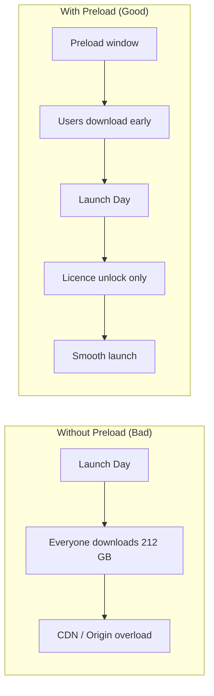

### What is in scope?

- Platform identity (PSN / Xbox account) — **not** a separate Rockstar signup for download
- Purchase & ownership via PlayStation Store / Microsoft Store entitlements
- Preload downloads + resumable progress
- Global CDN distribution
- Timed release per region
- DRM / licence so the game cannot start early
- Patches / updates
- Analytics
- Clients at launch: **PlayStation 5 and Xbox Series X|S**

### What is out of scope (for this design)?

- **PC launch / PC launcher** (GTA VI is not launching on PC initially)
- Building a custom “create account / email login” system for console download (consoles already have PSN / Xbox accounts)
- In-game multiplayer matchmaking
- Chat / social features inside the game
- Payment gateway internals (PlayStation Store / Microsoft Store handle checkout)
- Building the game engine itself

---

## 1.1 Functional Requirements

**Functional = what the system must do** (features).

| ID | Requirement | Beginner explanation |
|----|-------------|----------------------|
| FR1 | Platform identity & auth | User is already on **PSN** or **Xbox**. We verify their platform token — we do **not** ask them to register a new email/password just to download GTA VI |
| FR2 | Game discovery | Browse / search catalogue metadata on the console store / Rockstar presence |
| FR3 | Purchase & ownership | Buy via PlayStation Store / Microsoft Store; we trust/sync that entitlement |
| FR4 | Preload download | Download full game before release |
| FR5 | Block early play | Even if files are on disk, game won't launch early |
| FR6 | Regional release times | US, EU, JP can unlock at different local times |
| FR7 | Resumable downloads | If Wi-Fi drops at 150/212 GB, resume from 150 |
| FR8 | Progress tracking | Show % downloaded |
| FR9 | Patches / updates | Ship small deltas, not full 212 GB again |
| FR10 | Analytics | Track downloads, failures, launch attempts |
| FR11 | Console clients | PS5 and Xbox clients talk to the same backend ideas |

---

## 1.2 Non-Functional Requirements

**Non-functional = how well the system must do it** (quality attributes).

| ID | Requirement | Target / meaning |
|----|-------------|------------------|
| NFR1 | Scalability | Support **10M** owners; surge beyond that |
| NFR2 | Availability | **99.99%** for critical distribution / licence paths |
| NFR3 | Performance | Global fast downloads via edge CDN |
| NFR4 | Security | No unpaid access, no tampering, no early play |
| NFR5 | Reliability | Resume downloads; survive partial failures |
| NFR6 | Fault tolerance | No single point of failure |
| NFR7 | Consistency | Entitlements & release policy must be correct |
| NFR8 | Cost | Prefer CDN + preload over overbuilding origin |

### Consistency note (important)

Different data needs different consistency:

| Data | Consistency choice | Why |
|------|--------------------|-----|
| Purchase / entitlement | Strong | Wrong ownership = lost money / piracy |
| Release “can play?” flag | Strong + signed | Early unlock is a business disaster |
| Download progress | Eventual is fine | Slight delay on % is OK |
| Analytics events | Eventual | Lost/delayed metrics are not catastrophic |

---

## 1.3 Capacity Estimation

> These numbers are **engineering assumptions for learning**, not real Rockstar / Take-Two / Sony / Microsoft figures.

### Assumptions

| Metric | Value |
|--------|------:|
| Game owners | 10,000,000 |
| Package size | 212 GB (PS5 free-space guidance; Xbox may differ slightly) |
| Preload window | 5 days |
| Concurrent downloaders (peak) | 500,000 |
| Launch attempts around release | 5,000,000 |
| Availability target | 99.99% |
| Regions | Global |
| Updates | Incremental patches |

### 1) Total storage requirements

**Game binary storage (origin):**

- One master package ≈ **212 GB**
- Keep multiple versions + patches (say 3 full-ish generations + deltas) ≈ **~1–2 TB** logical content
- With replication across regions / providers (e.g. 3–6 copies) ≈ **~6–12 TB** durable object storage

**User metadata storage (not the game files):**

| Data | Rough size | Notes |
|------|------------|-------|
| Users | 10M × ~1 KB | ~10 GB |
| Entitlements | 10M × ~0.5 KB | ~5 GB |
| Download progress | 10M × ~1 KB | ~10 GB |
| Analytics (hot window) | tens of TB possible | keep aggregated + sampled |

**Beginner takeaway:** The expensive part is **bandwidth**, not storing one 212 GB file. Metadata DBs are tiny compared to CDN egress.

### 2) Total download bandwidth

If every owner downloads the full game once:

```text
10,000,000 × 212 GB = 2,120,000,000 GB
                     = 2,120 PB
                     ≈ 2.12 EB of egress
```

With preload, this traffic is **spread over 5 days**, not 1 hour.

### 3) Average and peak requests per second

**Download chunk requests (during preload):**

Assume each concurrent user pulls chunks continuously.

```text
Peak concurrent downloaders = 500,000
Assume average chunk size     = 4 MB
Assume effective chunk rate   ≈ 1 chunk / 2 seconds per user
                                (depends on user bandwidth)

Peak chunk RPS ≈ 500,000 / 2 = 250,000 RPS  (to CDN edges, not origin)
```

Most of this hits **CDN edge caches**, not your origin.

**API / control-plane RPS (auth, entitlement, progress):**

```text
Progress heartbeats: 500,000 users × 1 request / 30s ≈ 16,700 RPS
Auth / entitlement at launch: see below
```

### 4) Expected CDN bandwidth consumption

```text
Peak concurrent = 500,000 users
Assume average download speed per user = 50 Mbps (optimistic home broadband blend)

Peak CDN throughput ≈ 500,000 × 50 Mbps
                     = 25,000,000 Mbps
                     = 25 Tbps
```

Reality: not everyone gets 50 Mbps, and not all 500k peak at the exact same second — but this shows why you need a **global multi-CDN**, not a few servers in one datacenter.

**5-day average egress:**

```text
2.12 EB over 5 days
≈ 2.12e9 GB / (5 × 86400 s)
≈ ~4,900 GB/s average
≈ ~39 Tbps average  (order-of-magnitude; real traffic is bursty)
```

### 5) Launch-time authentication / licence load

Assume **5 million** launch attempts concentrated in a short window.

**Worst case — everyone in 1 minute:**

```text
5,000,000 / 60 ≈ 83,000 RPS licence checks
```

**More realistic — spread over 15 minutes:**

```text
5,000,000 / (15 × 60) ≈ 5,500 RPS
```

Design for **tens of thousands RPS** with caching, queues, and graceful degradation — not a single licence DB.

### 6) Infrastructure capacity (summary)

| Layer | What you need |
|-------|----------------|
| CDN | Multi-provider, multi-region, 10s of Tbps class capacity |
| Origin object store | Replicated object storage + origin shield |
| API / microservices | Horizontally scaled pods behind gateway |
| Entitlement DB | Strongly consistent primary + replicas |
| Cache | Redis / Memcached for sessions, release flags, hot entitlements |
| Queue / stream | Kafka (or similar) for analytics + async jobs |
| Licence service | Stateless + cache + signed tokens; failover mode |

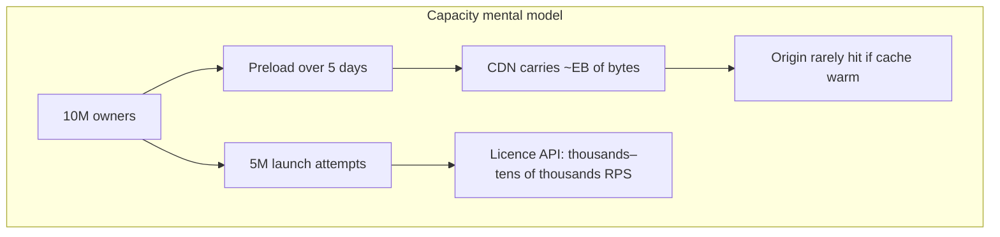

---

# Step 2 — Design (Basic → HLD → LLD)

## 2.1 Basic Design (Start Simple)

Imagine you are a beginner. First draw the **smallest system that works**:

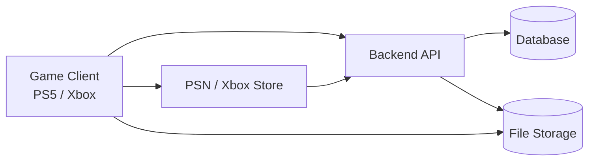

### What this naive design does

1. Console proves identity with PSN / Xbox account
2. User buys GTA VI on PlayStation Store / Microsoft Store → entitlement says “owns game”
3. Client downloads file from storage
4. At launch time, API says “yes, you can play”

### Why this fails at global scale

| Problem | Why naive design breaks |
|---------|-------------------------|
| One storage region | Users far away get slow downloads |
| Full file download | Lost connection = restart 212 GB |
| Launch spike | One API + DB melts at 80k RPS |
| Early play | Client clock change can bypass “time check” |
| Cost | Origin bandwidth is extremely expensive |
| Single region outage | Whole world goes down |

So we **extend** the design.

---

## 2.2 High-Level Design (HLD)

### Guiding ideas

1. **Separate control plane from data plane**
   - Control plane: platform auth, entitlement sync, release policy, progress metadata
   - Data plane: big file bytes via CDN
2. **Preload moves bytes early; launch only checks permission**
3. **Never trust the client clock** for release time
4. **Chunk + manifest + checksum** for resume and integrity
5. **Signed short-lived download URLs + signed licences**

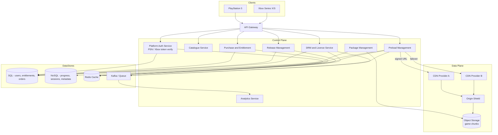

### Component responsibilities (beginner map)

| Component | Job in one sentence |
|-----------|---------------------|
| **API Gateway** | Single front door: auth, rate limits, routing |
| **Platform Auth** | Verify PSN / Xbox tokens; map to internal player id (no custom registration for download) |
| **Catalogue** | Game title, versions, regions, store page data |
| **Purchase & Entitlement** | “Did this user pay / own this game?” |
| **Package Management** | Upload, chunk, encrypt/sign, publish manifests |
| **CDN** | Serve chunks from nearby edge locations |
| **Preload Management** | Who can download, signed URLs, resume, progress |
| **Release Management** | Official unlock times per region + emergency delay |
| **DRM & Licence** | Issues play permission; blocks early launch |
| **Analytics** | Downloads, failures, launches, health |

---

## 2.3 Core Workflows

### A) Preload workflow

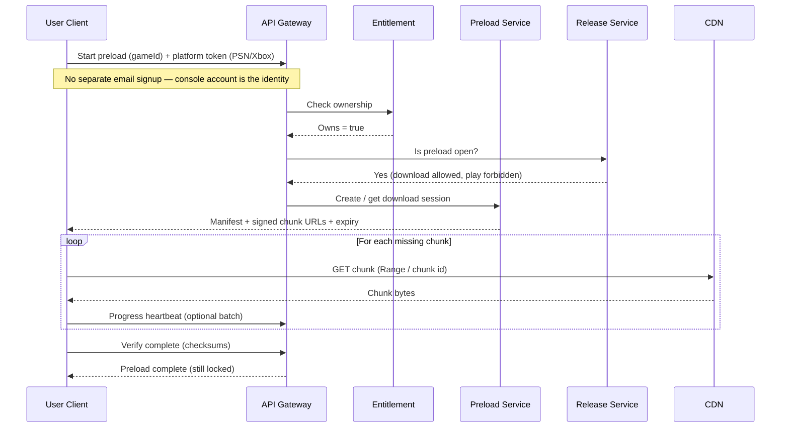

**Key beginner points:**

- Owning the game ≠ allowed to play
- Preload can be open while play is locked
- Client downloads from **CDN**, not from preload service
- Progress is metadata; bytes are CDN

### B) Game release & activation workflow

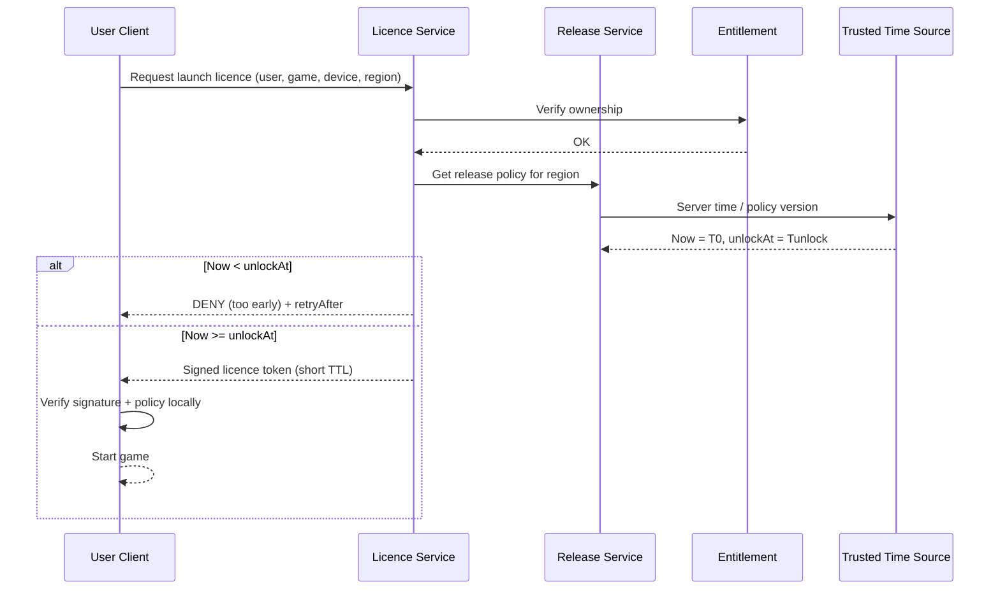

**Anti-clock-tamper idea:**

- Client clock is **untrusted**
- Unlock decision uses **server time** (and signed policy)
- Licence token is **short-lived** and **signed** with server keys
- Console secure boot / platform DRM reinforces this (hardware-backed where possible)

### C) Patch during / after preload

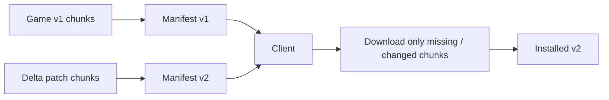

Users do **not** re-download all 212 GB. They download changed chunks only (binary diff / content-addressed chunks).

---

## 2.4 Low-Level Design (LLD)

### 2.4.1 Data models (simplified)

#### Players (SQL) — linked to console identity

| Column | Type | Notes |
|--------|------|-------|
| player_id | UUID PK | Internal id |
| platform | enum | `psn` or `xbox` |
| platform_user_id | string | PSN account id / Xbox XUID |
| region | string | store / home region |
| created_at | timestamp | First seen when they buy/preload |
| unique(platform, platform_user_id) | | |

> **Beginner note:** On console, “registration” already happened when the user created their **PlayStation Network** or **Xbox** account. Our system mostly **verifies** that identity and stores a mapping row.

#### Games / Catalogue (SQL)

| Column | Type | Notes |
|--------|------|-------|
| game_id | UUID PK | |
| title | string | |
| publisher | string | |
| platforms | json/array | PS5, Xbox |
| current_manifest_id | UUID | points to active package |

#### Entitlements (SQL) — strong consistency

| Column | Type | Notes |
|--------|------|-------|
| entitlement_id | UUID PK | |
| user_id | UUID | indexed |
| game_id | UUID | indexed |
| status | enum | active, revoked, refunded |
| purchased_at | timestamp | |
| unique(user_id, game_id) | | one ownership row |

#### Release Policies (SQL + cached)

| Column | Type | Notes |
|--------|------|-------|
| policy_id | UUID PK | |
| game_id | UUID | |
| region_code | string | e.g. US, EU, JP, GLOBAL |
| preload_opens_at | timestamptz | UTC |
| unlock_at | timestamptz | UTC |
| status | enum | scheduled, live, postponed |
| policy_version | int | bump on emergency change |

> Store times in **UTC**. Convert to local only for UI display.

#### Package Manifest (metadata DB / object index)

| Column | Type | Notes |
|--------|------|-------|
| manifest_id | UUID | |
| game_id | UUID | |
| version | string | 1.0.0 |
| chunk_list | json / separate table | chunk_id, size, hash, CDN path |
| encryption_scheme | string | |
| signature | string | publisher signature |

#### Download Sessions / Progress (NoSQL)

| Field | Type | Notes |
|-------|------|-------|
| session_id | string | |
| user_id | string | |
| game_id | string | |
| manifest_id | string | |
| completed_chunks | set / bitmap | enables resume |
| bytes_downloaded | number | |
| status | string | active, complete, failed |
| updated_at | timestamp | |

**Why NoSQL for progress?** High write rate, flexible, eventual consistency is OK.

### 2.4.2 Chunking & integrity

```text
212 GB package
÷ 4 MB chunks
≈ 54,000 chunks
```

Each chunk has:

- `chunk_id` (content hash or stable id)
- `sha256`
- CDN path
- optional encryption wrapping

Client resume algorithm:

1. Load local incomplete state
2. Diff local chunks vs manifest
3. Request only missing chunk IDs
4. Verify hash per chunk
5. Mark complete in progress store

### 2.4.3 API endpoints (representative)

**Platform Auth**

- `POST /v1/auth/platform/session` — exchange PSN / Xbox token for a short-lived backend session
- `POST /v1/auth/logout`
- `POST /v1/auth/refresh`

> No `register` / email-password `login` APIs for console download.

**Catalogue**

- `GET /v1/games`
- `GET /v1/games/{gameId}`
- `GET /v1/games/{gameId}/release-policy?region=`

**Purchase / Entitlement**

- `POST /v1/orders` (create purchase)
- `GET /v1/entitlements/me`
- `GET /v1/entitlements/me/{gameId}`

**Preload**

- `POST /v1/preload/{gameId}/sessions`
- `GET /v1/preload/sessions/{sessionId}`
- `POST /v1/preload/sessions/{sessionId}/progress`
- `POST /v1/preload/sessions/{sessionId}/complete`

**Licence / Launch**

- `POST /v1/licence/{gameId}/issue`
- `POST /v1/licence/validate` (optional online re-check)

**Admin / Studio**

- `POST /v1/admin/packages` (upload manifest)
- `POST /v1/admin/releases` (set / postpone unlock)

### 2.4.4 CDN & caching strategy

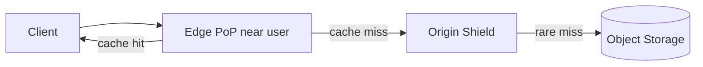

| Technique | Purpose |
|-----------|---------|
| Edge caching | Most chunk GETs never hit origin |
| Origin shield | Protects origin from thundering herd |
| Multi-CDN | Failover if one provider has regional outage |
| Signed URLs | Time-limited access; reduce hotlinking |
| Cache keys by chunk hash | Immutable chunks = long TTL |
| Manifest short TTL / versioned URL | Safe updates without stale wrong files |

**Cache invalidation:** Prefer **versioned immutable chunk names** over “delete everything”. New patch = new chunk hashes + new manifest.

### 2.4.5 Security & DRM architecture

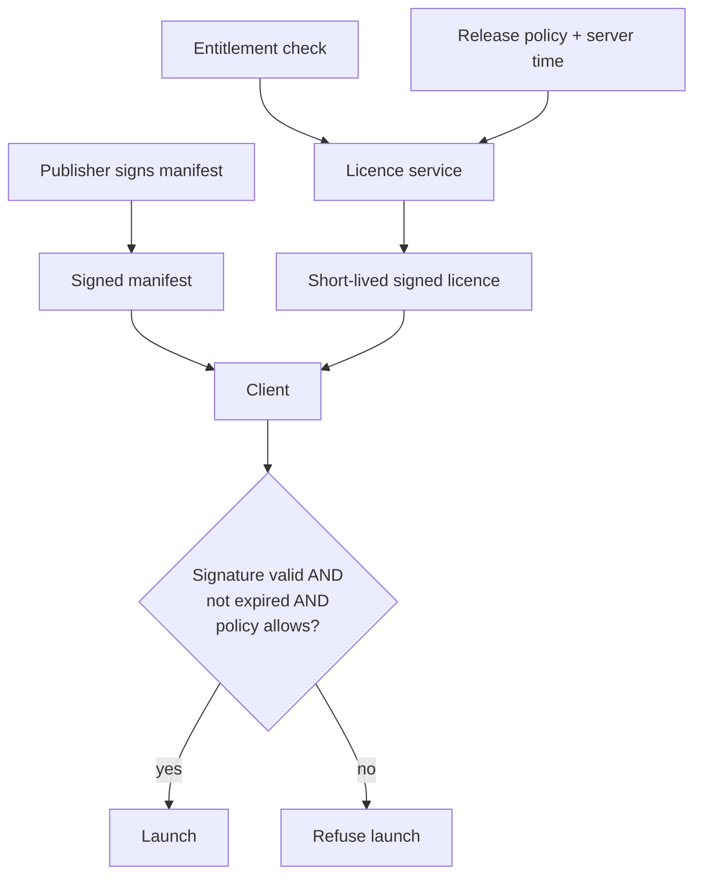

Layers of protection:

1. **Entitlement** — must own the game
2. **Release policy** — server-controlled unlock time
3. **Signed licence token** — short TTL, binds user/device/game/policy version
4. **Package encryption / platform DRM** — encrypted content; keys only with valid licence
5. **Platform trust** — PS5 / Xbox secure environments make clock and binary tampering much harder than on open platforms

**Clock manipulation defense:** Changing console clock does not mint a valid server-signed licence.

### 2.4.6 Scaling & load balancing

| Layer | Strategy |
|-------|----------|
| Gateway | Horizontal replicas + rate limits per user/IP |
| Stateless services | Autoscale on CPU / RPS |
| Entitlement reads | Cache hot keys in Redis; SQL read replicas |
| Licence at launch | Aggressive caching of release policy; signed tokens reduce repeat DB hits |
| Downloads | CDN absorbs byte load |
| Progress writes | Batch / debounce client heartbeats; write to NoSQL |
| Spikes | Queue non-critical work; shed load with Retry-After |

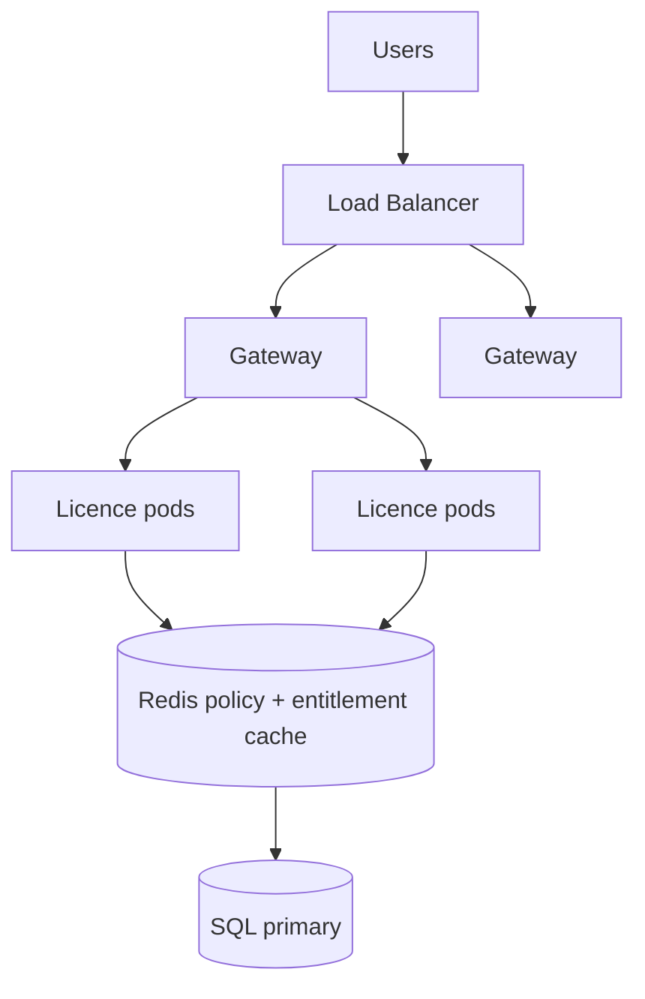

---

## 2.5 Technology Selection

| Area | Suggested choice | Why | Alternatives |
|------|------------------|-----|--------------|
| Object storage | S3 / GCS / Azure Blob | Durable, cheap bulk storage, integrates with CDN | MinIO (self-host), multi-cloud replication |
| CDN | CloudFront / Fastly / Akamai + secondary CDN | Global PoPs, huge egress capacity | Single CDN (simpler, weaker failover) |
| API gateway | Kong / AWS API GW / Envoy Gateway | Auth, rate limit, routing | Nginx only (less features) |
| Backend services | Go / Java / Node in containers | Stateless horizontal scale | Monolith first (OK early, harder at spike) |
| Relational DB | PostgreSQL | Strong consistency for users/orders/entitlements | MySQL, CockroachDB (global SQL) |
| NoSQL | DynamoDB / Cassandra / MongoDB | Progress / high-throughput flexible docs | Redis alone (not durable enough as source of truth) |
| Cache | Redis | Sessions, release flags, hot entitlements | Memcached |
| Events | Kafka | Analytics, async pipelines, decoupling | Pulsar, SQS/SNS (simpler, less replay power) |
| Auth | Platform token validation (PSN / Xbox) + short-lived backend JWT | Matches how consoles actually work; no custom signup for download | Building our own email/password accounts (wrong for console-first) |
| DRM | Platform DRM + own licence tokens | Defense in depth | Licence-only without platform DRM (weaker) |
| Observability | OpenTelemetry + Prometheus + Grafana + logs | Metrics, traces, alerts | Vendor APM (Datadog, New Relic) |
| Orchestration | Kubernetes | Autoscale services | ECS/Cloud Run (managed simplicity) |

> **Beginner rule:** Pick boring, proven tech. The hard part is **chunking, CDN, entitlements, and launch-spike design**, not inventing a new database.

---

# Step 3 — Edge Cases, Trade-offs, Bottlenecks

## Critical scenarios (and how we handle them)

### Scenario 1: Launch-day traffic spike

**Problem:** Millions click “Play” at once.

**Handle it:**

1. Preload so bytes are already local
2. Licence service is horizontally scaled + cached
3. Release policy cached in Redis (almost never hit SQL)
4. Issue short-lived licences; clients do not re-hit every second
5. Rate limit + `Retry-After` + jittered retries
6. Queue / drop non-critical analytics first under pressure
7. Optional staggered unlock windows by region already spreads load

**Bottleneck to watch:** Licence service + entitlement cache stampede.

---

### Scenario 2: CDN failure (regional provider down)

**Problem:** Provider A fails in Europe.

**Handle it:**

1. Multi-CDN: client SDK tries provider B
2. DNS / traffic steering away from unhealthy CDN
3. Origin shield still protected
4. Pre-warm popular chunks on secondary CDN before launch

**Trade-off:** Multi-CDN adds cost and complexity; worth it for a GTA VI-scale launch.

---

### Scenario 3: Interrupted downloads (150 / 212 GB done)

**Problem:** Wi-Fi dies mid-download.

**Handle it:**

1. Content chunked with checksums
2. Client stores completed chunk bitmap locally
3. Server progress record optional backup
4. Resume = fetch missing chunks only
5. Re-verify hashes after resume

---

### Scenario 4: Premature game access (clock tampering)

**Problem:** User sets console clock to “launch day”.

**Handle it:**

1. Do not trust client clock for unlock
2. Require server-signed licence referencing unlock policy version
3. Encrypt game content; decryption needs valid licence material
4. Short token TTL forces periodic online refresh near launch
5. Platform secure time / attestation where available

---

### Scenario 5: Licence service failure at launch

**Question:** Should nobody play?

**Practical answer:** Prefer **degraded allow for already-entitled users** with safeguards — not a hard global lockout — if business accepts risk.

Possible modes:

| Mode | Behavior | Trade-off |
|------|----------|-----------|
| Fail closed | No licence service → no play | Safest vs piracy / early access; worst UX |
| Fail open for entitled + already preloaded | Temporary offline licence / cached grant | Better UX; risk if attacker predicts outage |
| Regional failover | Secondary licence cluster in another region | Best balance; more infra cost |

Recommended production stance:

- Active-active licence clusters in multiple regions
- Cached signed “release is live” policy
- Short emergency offline grace **only after official unlock**, for users with proven entitlement cache
- Still **fail closed before unlock time**

---

### Scenario 6: Release-time synchronisation across countries

**Problem:** Different local launch times.

**Handle it:**

1. Store all policy times in **UTC**
2. Map user/device to `region_code` (store region / platform store rules)
3. Licence check uses that region’s `unlock_at`
4. Admin can postpone a region without affecting others
5. Clients display local time; servers enforce UTC policy

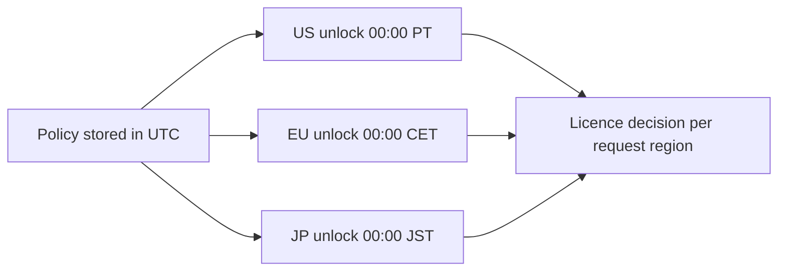

---

### Scenario 7: Critical patch during preload

**Problem:** Day-before-launch patch.

**Handle it:**

1. Publish new manifest v2 with changed chunk hashes
2. Clients reconcile: download only new/changed chunks
3. Keep v1 available until cutover
4. Optionally pause “complete” state until patch applied
5. Mark patch as required for licence issuance if critical

---

### Scenario 8: Unexpected demand (more purchases than expected)

**Problem:** 10M estimate becomes 20M.

**Handle it:**

1. Autoscale control-plane services
2. CDN bills scale with egress (pre-negotiate capacity)
3. Partition entitlement DB / use read replicas + cache
4. Backpressure on non-critical APIs
5. Preload window extension to flatten traffic
6. Capacity runbooks + synthetic load tests before launch

**Remember:** Buying more app servers does **not** fix origin bandwidth if everyone downloads at once. Preload + CDN does.

---

## 3.1 Failure Handling & Disaster Recovery

| Failure | Detection | Mitigation |
|---------|-----------|------------|
| Single service pod crash | K8s health checks | Auto restart / reschedule |
| Region outage | Multi-region health | Failover DNS / traffic manager |
| DB primary down | Replication lag / health | Automated failover to replica |
| Cache stampede | Latency spike | Hard timeouts, request coalescing, stale-while-revalidate |
| Poison bad manifest | checksum / canary | Version rollback |
| Bad release config | Admin audit + confirm | Postpone flag, previous policy version |

**RPO/RTO mindset:**

- Entitlements: low RPO (no lost purchases)
- Progress metadata: higher RPO acceptable
- Licence path: very low RTO (must recover fast at launch)

---

## 3.2 Monitoring & Observability

Track at least:

| Signal | Why |
|--------|-----|
| CDN cache hit ratio | Low hit ratio → origin melt risk |
| Origin bandwidth | Cost + capacity alarm |
| Preload success / failure rates | User experience |
| Chunk checksum failures | Corruption / tampering |
| Licence RPS / latency / error % | Launch health |
| Entitlement cache hit rate | DB protection |
| Regional unlock denials vs allows | Policy correctness |
| Queue lag for analytics | Backpressure indicator |

Alert on launch day with **burn-rate SLO** style alerts (99.99% availability target).

---

## 3.3 Cost Estimation (Rough)

Costs are dominated by **CDN egress**, not app servers.

Order-of-magnitude thinking:

```text
Egress: ~2.12 EB for full population download
Even at discounted bulk CDN rates, this is a major line item
→ Preload does not remove bytes; it moves when bytes are transferred
→ Still essential to avoid buying insane peak origin capacity
```

Cost levers:

1. Multi-year CDN commits / private interconnects
2. Compression / smaller install variants where possible
3. Deduplicated chunks across versions
4. Aggressive edge hit ratio
5. Shorter retention of unused old packages
6. Sample analytics instead of storing every event forever

---

## 3.4 Architecture Trade-offs

| Decision | Pros | Cons |
|----------|------|------|
| Preloading | Flattens launch bandwidth spike | Users need disk space early; still pay for total egress |
| Multi-CDN | Higher availability | Complexity, dual config, cost |
| Chunked immutable content | Resume + efficient patches | More moving parts than one big file |
| SQL entitlements | Correct ownership | Must protect with cache at scale |
| Short-lived licences | Limits early/offline abuse | Extra launch traffic; needs resilient licence tier |
| Fail-open after unlock | Better player UX during outages | More risk than fail-closed |
| Global single unlock time | Simpler | Worse for local marketing windows |
| Per-region unlock | Better product fit | More policy / testing complexity |

### Main bottlenecks (summary)

1. **CDN egress capacity & cache warmth**
2. **Licence / entitlement path at T0**
3. **Origin protection if cache miss storm**
4. **Progress write amplification** if heartbeats too chatty
5. **Operational mistakes** (wrong unlock time, bad manifest)

---

## Putting the 3 Steps Together

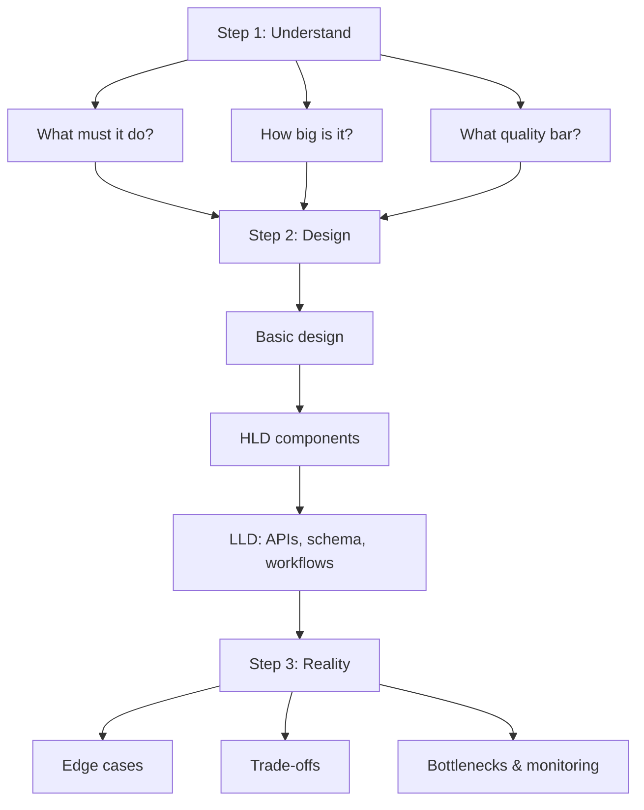

---

## Quick Recap

1. **Problem:** Ship GTA VI (~212 GB) to 10M users without launch-day meltdown; block early play.
2. **Key product idea:** Preload bytes early; unlock with server-signed licence at release.
3. **Data plane vs control plane:** CDN carries GB; APIs carry permissions.
4. **Capacity:** Total egress ~2.12 EB; launch stress is licence RPS, not only downloads.
5. **Must-haves:** Chunking, resume, multi-CDN, UTC regional policies, strong entitlements.
6. **Do not trust client clocks.**
7. **Patches = new/changed chunks**, not full re-download.
8. **More servers ≠ strategy.** Preload + CDN + caching + good failure modes are the strategy.

---

## Practice Questions

1. Why does preloading reduce launch risk but not total bytes transferred?
2. Why store release times in UTC?
3. How does chunk hashing help both resume and patching?
4. What should happen if licence service is down *before* unlock vs *after* unlock?
5. Where would you put rate limits first on launch day?
6. Why are entitlements a poor fit for pure eventual consistency?
7. Draw the sequence for a user who already preloaded and clicks Play at T0.
8. If cache hit ratio falls from 99% to 90% during preload, what breaks first?

---

## Appendix: Beginner Glossary

| Term | Meaning |
|------|---------|
| CDN | Network of edge servers that cache files close to users |
| Origin | Source of truth storage the CDN fetches from on miss |
| Preload | Download before release without enabling play |
| Entitlement | Proof the user owns the game |
| Manifest | List of chunks/files + hashes for a game version |
| DRM | Tech that restricts unauthorized use/copying |
| RPS | Requests per second |
| TTL | Time to live (how long a token/cache entry stays valid) |
| Fail closed | On error, deny the action |
| Fail open | On error, allow the action |

---

*End of case study. Use this as a template: requirements → math → simple design → extend → break it on purpose and fix it.*
