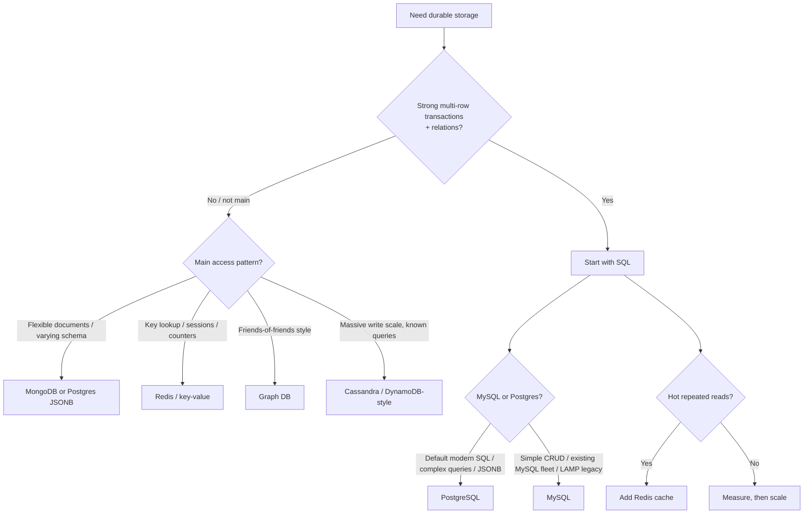
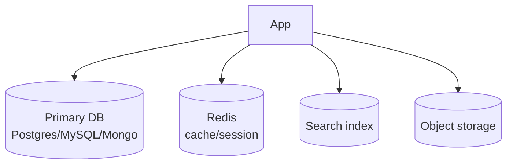
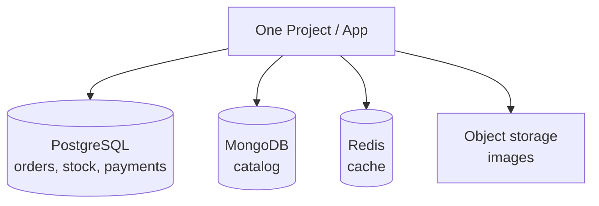
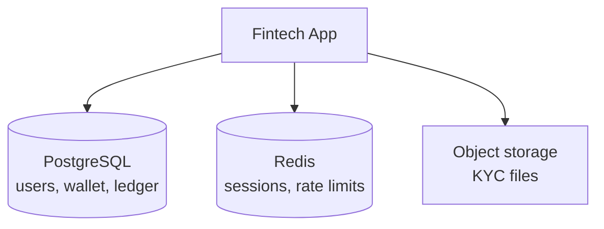
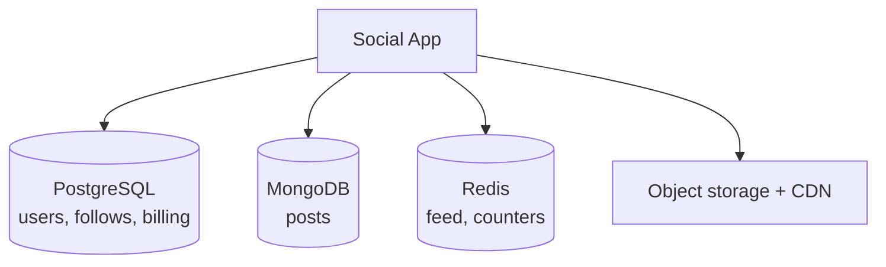
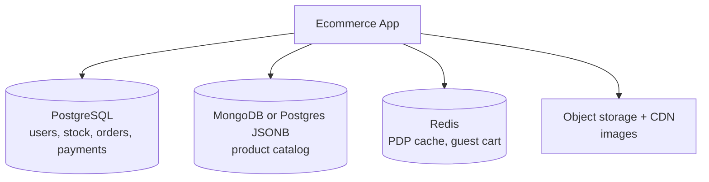

# How to Choose a Database (Interview Guide)

> **Who is this for?** Anyone preparing for system design interviews who gets asked: *"Why this database?"*
>
> **What you will learn:** A repeatable decision process, what to ask before picking, when to choose MySQL / PostgreSQL / MongoDB / Redis (and friends), multiple databases in one project, how to answer in interviews, anti-patterns, plus full examples for **Fintech**, **Social Media**, and **Ecommerce**.
>
> **Related:** [Databases (SQL vs NoSQL)](../fundamentals/03-databases-sql-vs-nosql.md) · [PostgreSQL](../technologies/02-postgresql.md) · [MongoDB](../technologies/03-mongodb.md) · [Redis](../technologies/01-redis.md) · [CAP Theorem](../fundamentals/04-cap-theorem-and-consistency.md)

---

## Table of Contents

1. [The Interview Question Behind Every DB Choice](#1-the-interview-question-behind-every-db-choice)
2. [Clarify Requirements First](#2-clarify-requirements-first)
3. [The Decision Checklist (Must See)](#3-the-decision-checklist-must-see)
4. [Decision Flow](#4-decision-flow)
5. [MySQL vs PostgreSQL vs MongoDB](#5-mysql-vs-postgresql-vs-mongodb)
6. [When to Choose What](#6-when-to-choose-what)
7. [Redis and Other Stores (Quick)](#7-redis-and-other-stores-quick)
8. [Polyglot Persistence (Can One Project Use Multiple Databases?)](#8-polyglot-persistence-can-one-project-use-multiple-databases)
9. [Interview Answer Template](#9-interview-answer-template)
10. [Example 1: Fintech](#10-example-1-fintech)
11. [Example 2: Social Media](#11-example-2-social-media)
12. [Example 3: Ecommerce](#12-example-3-ecommerce)
13. [Anti-Patterns Interviewers Catch](#13-anti-patterns-interviewers-catch)
14. [One-Page Cheat Sheet](#14-one-page-cheat-sheet)
15. [Practice Questions](#15-practice-questions)
16. [Quick Recap](#16-quick-recap)

---

## 1. The Interview Question Behind Every DB Choice

Interviewers rarely want a brand name. They want to hear:

> Can you match **data shape + access pattern + consistency needs** to a storage tool?

Bad answer:

> "I'll use MongoDB because it's scalable."

Good answer:

> "Orders and payments need multi-row transactions and relations, so PostgreSQL as source of truth. Product pages are read-heavy, so Redis cache in front. Catalog attributes vary by category, so MongoDB for product content is optional, or JSONB in Postgres if we want one primary DB."

Same interview. Very different signal.

---

## 2. Clarify Requirements First

Before naming a database, ask (or state assumptions):

| Ask | Why it matters |
|-----|----------------|
| What entities and relationships? | Joins vs documents |
| How do we mostly read/write? | By ID? range? search? analytics? |
| Strong consistency needed? | Payments vs feed likes |
| Multi-row transactions? | Money, inventory, bookings |
| Expected QPS / data size / growth? | Replica vs shard timing |
| Read:write ratio? | Cache + replicas |
| Schema stable or changing often? | SQL tables vs documents |
| Multi-region / offline? | CAP trade-offs |
| Team skill / ops maturity? | Operational cost is real |

If the interviewer gives little detail, **state assumptions out loud**, then choose.

### Real-life

Choosing a DB without access patterns is like buying a truck before knowing if you need to move furniture or deliver pizza.

---

## 3. The Decision Checklist (Must See)

Score the problem on these axes. This is what you must see every time.

### A. Data model

| Signal | Lean toward |
|--------|-------------|
| Clear tables, FKs, many relations | SQL (Postgres / MySQL) |
| Nested / varying fields per record | Document (Mongo) or Postgres JSONB |
| Simple key → value | Redis / DynamoDB-style |
| Relationship traversal is the product | Graph DB |

### B. Consistency and transactions

| Signal | Lean toward |
|--------|-------------|
| Money, inventory, seat booking | SQL + ACID |
| Likes, views, activity feeds (eventual OK) | NoSQL / async often fine |
| "Must never double-charge" | Transactional SQL |

### C. Query patterns

| Pattern | Fit |
|---------|-----|
| Get by primary key | Almost anything |
| Complex joins / reports | SQL |
| Flexible filters on nested JSON | Mongo or Postgres JSONB |
| Full-text / geo | Check DB features (Postgres, Elasticsearch, etc.) |
| Huge append-only events | Wide-column / log store |

### D. Scale and growth

| Stage | Typical move |
|-------|----------------|
| Early | One primary DB, good indexes |
| Read-heavy | Cache + read replicas |
| Write-heavy / huge | Partition / shard / specialized store |
| Unknown scale | Do not over-engineer day 1 |

### E. Ops and team

| Reality | Impact |
|---------|--------|
| Team knows MySQL well | MySQL can win even if Postgres is "cooler" |
| Need advanced SQL + extensions | Postgres |
| Managed cloud + simple key access | DynamoDB-style options |
| Every extra DB = more ops | Prefer fewer stores |

---

## 4. Decision Flow

**Beginner rule:** Default to **one SQL database**. Add others only when a clear need appears.

---

## 5. MySQL vs PostgreSQL vs MongoDB

### Side-by-side

| Dimension | MySQL | PostgreSQL | MongoDB |
|-----------|-------|------------|---------|
| Model | Relational tables | Relational + strong JSONB | Document (BSON) |
| Transactions | Yes (InnoDB) | Excellent | Multi-doc exists; relational still stronger mental model |
| Complex queries / joins | Good | Excellent | Weaker; design around documents |
| Schema | Fixed (migrations) | Fixed + flexible JSONB | Flexible by default |
| Ecosystem | Huge web/legacy footprint | Strong for apps + analytics-ish SQL | Strong for document workloads |
| Horizontal scale story | Replicas; sharding careful | Replicas; sharding careful | Built-in sharding story |
| Best "default" feel | Classic web CRUD | General-purpose SQL default | Document-first products |

### MySQL: choose when

- Simple relational CRUD is enough
- Existing company stack / hosting is MySQL-heavy
- Read replicas + mature ops already exist
- You want a battle-tested, widely hired skill set

**Interview line:** *"MySQL fits because the schema is stable, relations are simple, and the team already runs it well."*

### PostgreSQL: choose when

- You want a strong default SQL pick in interviews
- Complex queries, constraints, and reporting matter
- You may need JSON/JSONB without leaving SQL
- Extensions / richer SQL features help (geo, full-text, etc.)

**Interview line:** *"I'd default to Postgres for transactional core data: relations, constraints, and room to grow with JSONB if some fields vary."*

### MongoDB: choose when

- Documents are the natural unit (user profile, CMS page, product with varying attributes)
- Schema evolves fast and differs across records
- Most reads fetch one aggregate document (not heavy cross-entity joins)
- You accept modeling discipline still matters (not a JSON junkyard)

**Interview line:** *"Mongo fits the product catalog because attributes differ by category and we usually load one product document at a time."*

### Quick "vs" answers

| Comparison | Short take |
|------------|------------|
| MySQL vs Postgres | Both SQL. Postgres often wins for complex queries + JSONB; MySQL wins on familiarity / existing ops. |
| Postgres vs Mongo | Prefer Postgres if transactions + joins dominate. Prefer Mongo if document aggregates dominate and joins are rare. |
| Mongo vs "schema-less excuse" | Flexible is not the same as unplanned. Still design around queries. |

---

## 6. When to Choose What

### Default picks (interview-safe)

| Situation | First pick | Why |
|-----------|------------|-----|
| Users, orders, payments, roles | PostgreSQL (or MySQL) | ACID + relations |
| Payments / banking ledger | PostgreSQL / MySQL | Correctness over hype |
| Product catalog with varying attributes | Mongo **or** Postgres JSONB | Flexible fields |
| Sessions, rate limits, leaderboards | Redis | Speed, TTL, simple structures |
| Activity / click stream at huge write volume | Cassandra / DynamoDB-style | Scale + known access keys |
| Social graph queries | Graph DB (or carefully modeled SQL early) | Relationship traversal |
| Search-heavy product discovery | Search engine (+ primary DB) | Text relevance |

### Prefer SQL when

1. Relationships are central
2. Transactions matter
3. Ad-hoc / complex queries matter
4. Strong consistency is a product requirement

### Prefer Mongo when

1. One document ≈ one read unit
2. Schema varies by document type
3. Joins are rare
4. You are okay denormalizing for read speed

### Prefer Redis when

1. Data is hot and can be rebuilt or expire
2. You need very fast reads
3. Use cases: cache, session, locks, counters

**Important:** Redis is usually **not** the source of truth for business-critical durable data.

---

## 7. Redis and Other Stores (Quick)

Keep these in your interview toolkit without overusing them.

| Store type | Examples | Use when |
|------------|----------|----------|
| Cache / KV in-memory | Redis | Speed layer, TTL, ephemeral-ish data |
| Wide-column / distributed KV | Cassandra, DynamoDB | Huge scale, key-based access, eventual OK |
| Search | Elasticsearch / OpenSearch | Full-text, facets, relevance |
| Blob / object | S3 | Files, images, videos (not relational rows) |
| Graph | Neo4j | Deep relationship queries |

### Redis in one line

> Redis makes hot reads fast. It is usually **not** the main business database.

---

## 8. Polyglot Persistence (Can One Project Use Multiple Databases?)

**Yes.** One project can use multiple database types. This is normal in real systems.

It is often called **polyglot persistence**: different storage for different jobs.

| Job | Typical store |
|-----|----------------|
| Money, orders, users | PostgreSQL / MySQL |
| Flexible content (posts, catalog) | MongoDB |
| Fast cache / sessions / counters | Redis |
| Images / videos / PDFs | Object storage |

### Ecommerce in one app

- PostgreSQL → orders, stock, payments
- MongoDB → product catalog
- Redis → product page cache
- S3 → images

### Interview rules

1. Start with **one** primary DB (usually PostgreSQL).
2. Add another only when there is a clear reason (speed, flexible shape, files).
3. Do not add 5 databases on day 1 just because it sounds cool.

### Say this in the interview

> "Yes, one system can use multiple databases.  
> Each store should have one clear job.  
> I will start with PostgreSQL for core data, then add Redis or Mongo only if needed."

---

## 9. Interview Answer Template

Memorize this structure. Fill in the blanks.

1. **Restate needs:** data, reads/writes, consistency
2. **Pick primary store + why** (2 to 3 concrete reasons)
3. **Say what you rejected + why**
4. **Add supporting stores if needed** (cache, search, blobs)
5. **Scale path:** indexes → replicas/cache → partition/shard

### Fill-in script

> "For [core entities], access is mostly [pattern], and we need [consistency level].  
> I'd choose **[DB]** because [reason 1], [reason 2].  
> I'd avoid **[other DB]** because [trade-off].  
> For [hot reads / search / files], I'd add **[supporting tech]**.  
> If we grow, first [optimize/index/cache], then [replicas], and only later [shard/specialized store]."

### 30-second example

> "Checkout needs ACID updates to orders, inventory, and payments: PostgreSQL as source of truth.  
> Product detail pages are read-heavy: Redis cache with DB fallback.  
> I wouldn't put payments in Mongo; flexible schema doesn't help ledger correctness.  
> Scale path: indexes + replicas + cache before sharding."

---

## 10. Example 1: Fintech

### System

Wallet / payments app:

- users + KYC
- wallet balance
- send / receive money
- transaction history

### What matters most

**Correctness.**  
₹500 leaving A must reach B. Balance must be exact.

### What to choose

| Data | DB | Why |
|------|----|-----|
| Users, KYC status | PostgreSQL | Stable fields + constraints |
| Wallet balance | PostgreSQL | Must be exact |
| Transfer + ledger | PostgreSQL | Debit and credit in one transaction |
| OTP / rate limits | Redis | Fast and temporary |
| KYC PDFs / photos | Object storage | Files |

### Say this in the interview

> "For fintech, source of truth is PostgreSQL because transfers need ACID transactions and an auditable ledger.  
> Redis only for sessions and rate limits.  
> I would not keep balances in Mongo or Redis."

### Why not MongoDB as the main store?

Mongo is flexible, but fintech main flow is balance update + ledger insert + related account rows. That is a **transaction + relations** problem. SQL is the natural fit.

### MySQL or PostgreSQL here?

Both can work. For fintech interviews, **PostgreSQL** is usually the cleanest default.

---

## 11. Example 2: Social Media

### System

Simple Instagram / Twitter style app:

- users
- follow graph
- posts
- home feed
- likes / comments

### What matters most

- flexible post content
- fast feed reads
- likes can be a bit delayed (eventual consistency is often OK)

### What to choose

| Data | DB | Why |
|------|----|-----|
| Users, login, settings | PostgreSQL / MySQL | Stable relational data |
| Follows (early stage) | PostgreSQL / MySQL | Simple relations |
| Creator payouts / ads billing | PostgreSQL | Money needs SQL |
| Posts (text / image / poll / video blocks) | MongoDB | Shape changes by post type |
| Feed cache + like counters | Redis | Must feel fast |
| Photos / videos | Object storage + CDN | Media files |

### Say this in the interview

> "Users and follows in PostgreSQL.  
> Posts in MongoDB because one post can be text, carousel, poll, or video.  
> Feed and counters in Redis for speed.  
> Media in object storage."

### Can we do only PostgreSQL?

Yes for early stage: users/follows/likes in tables, post extras in JSONB. Add Mongo later only if document modeling becomes painful.

---

## 12. Example 3: Ecommerce

### System

Shop like Flipkart / Amazon lite:

- products
- cart
- checkout
- payments
- inventory

### What matters most

Ecommerce has two worlds:

1. **Catalog world:** product info, filters, flexible attributes
2. **Order world:** stock, payment, order status (must be correct)

### What to choose

| Data | DB | Why |
|------|----|-----|
| Users, addresses | PostgreSQL / MySQL | Relational, stable |
| Inventory stock count | PostgreSQL / MySQL | Cannot oversell easily |
| Orders + payments | PostgreSQL / MySQL | Transactions |
| Cart (logged-in durable) | PostgreSQL / MySQL | Should not vanish randomly |
| Cart (guest / short-lived) | Redis optional | Fast temporary |
| Product catalog with varying attributes | MongoDB **or** Postgres JSONB | Attributes differ by category |
| Product detail page cache | Redis | Read-heavy |
| Product images | Object storage + CDN | Files |
| Search / filters at scale | Search engine later | Text and facets |

### Why catalog is different

| Product | Attributes |
|---------|------------|
| Phone | RAM, storage, camera MP |
| Sofa | fabric, dimensions, seating |
| Book | author, ISBN, pages |

### Say this in the interview

> "Orders, inventory, and payments in PostgreSQL for transactions.  
> Product catalog in MongoDB or Postgres JSONB because attributes vary.  
> Redis for product page cache.  
> Images in object storage."

### Why not Mongo for orders?

Checkout updates stock, order, and payment together. That is a transaction problem, so SQL is safer.

---

## 13. Anti-Patterns Interviewers Catch

| Trap | Why it fails | Better |
|------|--------------|--------|
| "Mongo because NoSQL scales" | Vague, often wrong for the workload | Tie choice to access + consistency |
| "SQL cannot scale" | Outdated extreme | Replicas, cache, then careful shard |
| Redis as source of truth for money | Volatility / rebuild risk | SQL primary, Redis as accelerator |
| Mongo for wallet ledger only | Weak fit for multi-row money correctness | PostgreSQL / MySQL |
| 5 databases on day one | Ops + consistency complexity | One primary + justify extras |
| Schema-less = no design | Messy documents, slow queries | Model for query patterns |
| Sharding first | Early complexity | Indexes, query fix, cache, replicas first |
| Putting images inside DB rows by default | Heavy DB, hard to scale | Object storage + CDN |
| Search engine as order database | Wrong tool for transactions | Search for search; SQL for orders |
| Ignoring team/ops | Unmaintainable choice | Prefer known stack when close enough |

---

## 14. One-Page Cheat Sheet

### Ask first

Data shape → queries → consistency → scale → team/ops

### Defaults

| Need | Pick |
|------|------|
| General transactional app | **PostgreSQL** |
| Simple SQL + MySQL ecosystem | **MySQL** |
| Document aggregates / varying schema | **MongoDB** |
| Speed layer | **Redis** |
| Files | **Object storage** |
| Search UX | **Search engine** |

### Domain shortcuts

| Domain | Main answer |
|--------|-------------|
| **Fintech** | PostgreSQL for wallet/ledger; Redis for sessions/limits |
| **Social media** | PostgreSQL for users/follows; Mongo for posts; Redis for feed |
| **Ecommerce** | PostgreSQL for orders/stock/payments; Mongo/JSONB for catalog; Redis for cache |
| **Multiple DBs** | Yes, allowed. One job per store. Start simple. |

### Say this in interviews

> Pick for **access patterns and correctness**, not fashion. Start simple. Add stores when a clear job appears.

---

## 15. Practice Questions

Answer out loud with the template from section 9.

1. Why PostgreSQL for a payments service instead of MongoDB?
2. When would you pick MySQL over PostgreSQL?
3. Product attributes differ by category. Mongo or Postgres JSONB: how do you decide?
4. Design DB choices for a UPI-style wallet.
5. Design DB choices for Instagram-like posts and feed.
6. Design DB choices for Flipkart-like checkout + catalog.
7. Your Postgres is fine on writes but product pages are slow. What do you add first?
8. Interviewer says "Just use Cassandra." What clarifying questions do you ask?
9. Give one case where Redis is perfect, and one where it is dangerous as primary storage.
10. Can one project use PostgreSQL + MongoDB + Redis together? When is that a good idea?
11. Explain polyglot persistence with an ecommerce example in 4 sentences.
12. Name 3 anti-patterns interviewers catch.

---

## 16. Quick Recap

| Idea | Remember |
|------|----------|
| Interview goal | Show decision process, not brand loyalty |
| First step | Clarify data, queries, consistency, scale |
| Must-see axes | Model, transactions, queries, scale, ops |
| SQL default | Postgres (or MySQL if stack fits) |
| Documents | Mongo when aggregates + flexible shape win |
| Redis | Cache/session/speed; rarely source of truth |
| Multiple DBs | OK when each has one clear job |
| Growth path | Index → cache/replicas → partition/shard |
| Fintech | Correctness first → PostgreSQL |
| Social | Flexible posts + fast feed → Mongo + Redis + SQL |
| Ecommerce | SQL for checkout; Mongo/JSONB for catalog |

### One sentence to remember

> **Choose the database for how you query and how correct the data must be, then explain the trade-offs and the scale path.**
