# Scalability & Load Balancing

> **Who is this for?** Absolute beginners who want to understand system design without heavy jargon.
>
> **What you will learn:** Why systems slow down as users grow, how we fix that, and how load balancers share traffic — explained with real-life examples and diagrams.

---

## Table of Contents

1. [The Big Picture](#1-the-big-picture)
2. [What is Scalability?](#2-what-is-scalability)
3. [Vertical Scaling (Scale Up)](#3-vertical-scaling-scale-up)
4. [Horizontal Scaling (Scale Out)](#4-horizontal-scaling-scale-out)
5. [Vertical vs Horizontal — When to Use What](#5-vertical-vs-horizontal--when-to-use-what)
6. [What is Load Balancing?](#6-what-is-load-balancing)
7. [How a Load Balancer Works](#7-how-a-load-balancer-works)
8. [Load Balancing Algorithms](#8-load-balancing-algorithms)
9. [Health Checks](#9-health-checks)
10. [Sticky Sessions](#10-sticky-sessions)
11. [Layer 4 vs Layer 7 Load Balancing](#11-layer-4-vs-layer-7-load-balancing)
12. [Putting It All Together](#12-putting-it-all-together)
13. [Common Mistakes Beginners Make](#13-common-mistakes-beginners-make)
14. [Quick Recap](#14-quick-recap)

---

## 1. The Big Picture

Imagine you open a small tea stall.

- Day 1: 10 customers. You make tea alone. Everything is fine.
- Day 30: 200 customers. The queue is long. People leave.
- Day 100: 2,000 customers. One person + one stove cannot handle it.

**Software systems face the same problem.**

When Instagram or a food delivery app gets more users, one server is not enough. The system must **grow** without breaking. That growth ability is called **scalability**. And when you have many servers, someone must decide **which server handles which request**. That someone is a **load balancer**.

```text
More users  →  More traffic  →  Need more capacity  →  Scale
Many servers → Need a traffic manager → Load Balancer
```

---

## 2. What is Scalability?

**Scalability** means: *your system can handle more load by adding resources, without a full redesign.*

### Real-life example: A library

| Situation | What happens |
|-----------|--------------|
| 50 visitors/day | One librarian, one shelf — fine |
| 5,000 visitors/day | Need more librarians + more shelves |
| 50,000 visitors/day | Need multiple floors, many staff, a queue system |

A **scalable library** can grow from 50 to 50,000 visitors by adding people and space — not by inventing a brand new library every time.

### In software terms

| Load increases… | System should… |
|-----------------|----------------|
| More users open the app | Still respond quickly |
| More photos uploaded | Still store them reliably |
| Big sale day (like Diwali / Black Friday) | Not crash |

### Two ways to scale

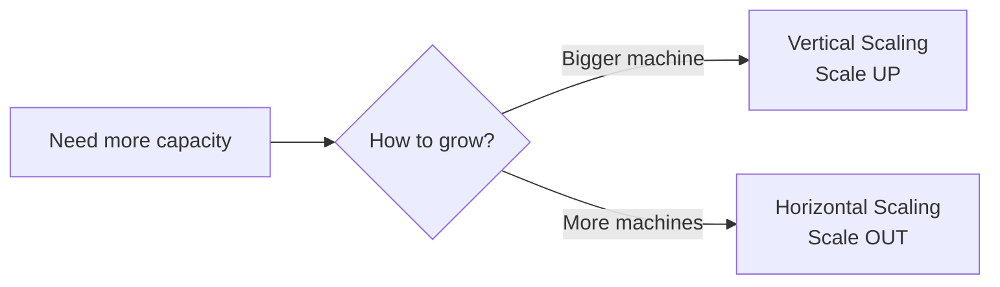

We will cover both next.

---

## 3. Vertical Scaling (Scale Up)

**Vertical scaling** = make the **same machine stronger**.

Buy a bigger computer: more CPU, more RAM, faster disk.

### Real-life example: One chef's kitchen

You have **one kitchen** and **one chef**.

Traffic grows, so you:

- Give the chef a bigger stove
- Add more utensils
- Give them a faster mixer

Still **one chef**, just a **stronger setup**.

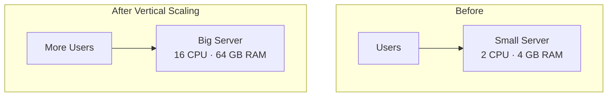

### Pros

- Simple — no major code changes
- Easy to manage — still one machine
- Good for databases that are hard to split

### Cons

- There is a **limit** — you cannot buy an infinitely powerful machine
- **Single point of failure** — if that one machine dies, the whole app is down
- Bigger machines get **expensive very fast**

### When beginners see this

Your first NestJS / Node / Django app on a single VPS is vertical scaling when you upgrade from 1 GB RAM → 8 GB RAM.

---

## 4. Horizontal Scaling (Scale Out)

**Horizontal scaling** = add **more machines**, not a bigger one.

Instead of one super-chef, hire **many chefs** in many kitchens.

### Real-life example: Multiple tea stalls

Your tea stall is overcrowded. Instead of one giant stove:

- Open stall #2, #3, #4 on the same street
- Customers go to whichever stall is free

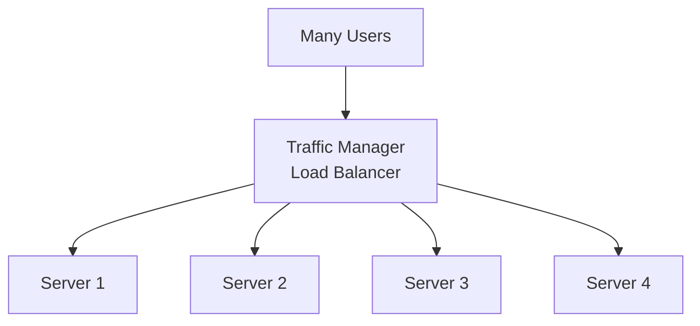

### Pros

- Almost **unlimited growth** — keep adding servers
- Better **reliability** — if one server dies, others still work
- Often **cheaper** at large scale than one giant machine

### Cons

- More complex — you need a load balancer
- App must be designed for multiple servers (shared sessions, shared DB carefully)
- More moving parts to monitor

### Simple rule of thumb

| Approach | Think of it as |
|----------|----------------|
| Vertical | One strong person doing all the work |
| Horizontal | A team sharing the work |

Modern internet apps (WhatsApp, Netflix, Swiggy) mostly use **horizontal scaling**.

---

## 5. Vertical vs Horizontal — When to Use What

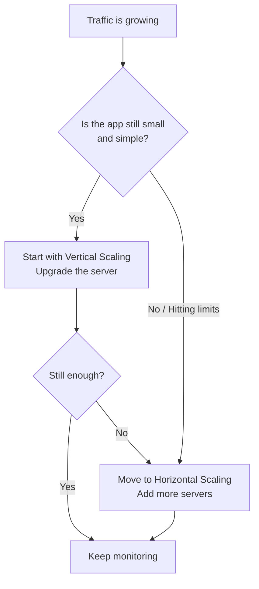

### Quick comparison

| | Vertical (Scale Up) | Horizontal (Scale Out) |
|--|---------------------|------------------------|
| What you do | Bigger machine | More machines |
| Complexity | Low | Higher |
| Max limit | Hardware ceiling | Very high |
| Failure impact | Whole system down | Partial — others survive |
| Best for | Early stage, simple apps | Growing / large apps |

**Beginner tip:** Start vertical when learning. Move horizontal when one machine is not enough — and that is when load balancing becomes essential.

---

## 6. What is Load Balancing?

A **load balancer** is a traffic manager that sits in front of your servers and **spreads requests** so no single server is overloaded.

### Real-life example: Airport check-in

Without a manager:

- Everyone runs to Counter 1
- Counter 1 is jammed
- Counters 2, 3, 4 are empty

With a queue manager (load balancer):

- People are sent to the **next free counter**
- All counters share the work
- Lines move faster

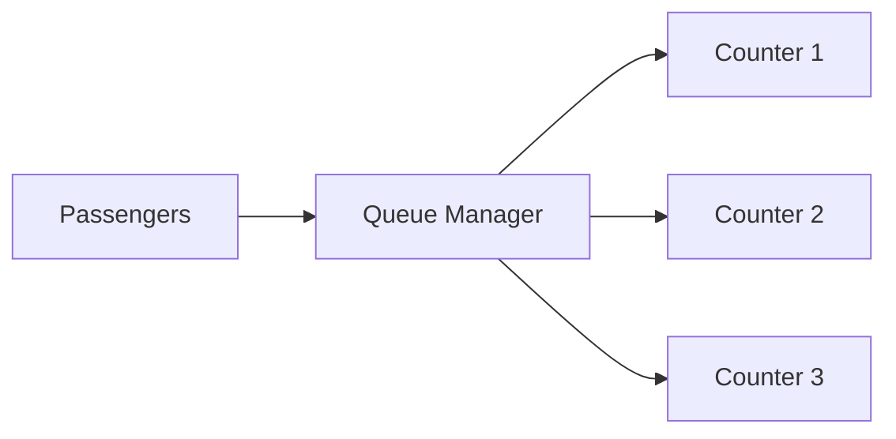

### In software

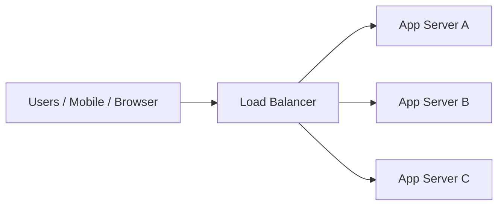

Users never talk to servers directly. They talk to the **load balancer**, and the load balancer picks a healthy server.

---

## 7. How a Load Balancer Works

Step by step:

1. User opens `www.myapp.com`
2. Request hits the **load balancer** first
3. Load balancer chooses a server using a **rule** (algorithm)
4. That server processes the request
5. Response goes back through the load balancer to the user

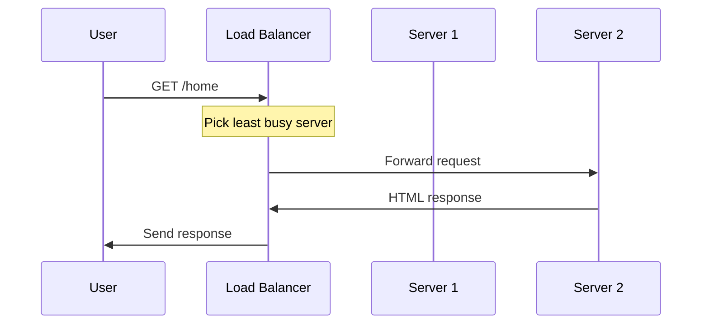

### Why this matters

- Servers can be added or removed without users noticing
- If Server 1 crashes, traffic goes to Server 2 and 3
- You can upgrade servers one by one (rolling updates)

---

## 8. Load Balancing Algorithms

An **algorithm** is simply the rule for "who gets the next request?"

### 8.1 Round Robin — "Take turns"

Requests go in a circle: Server 1 → Server 2 → Server 3 → Server 1 → …

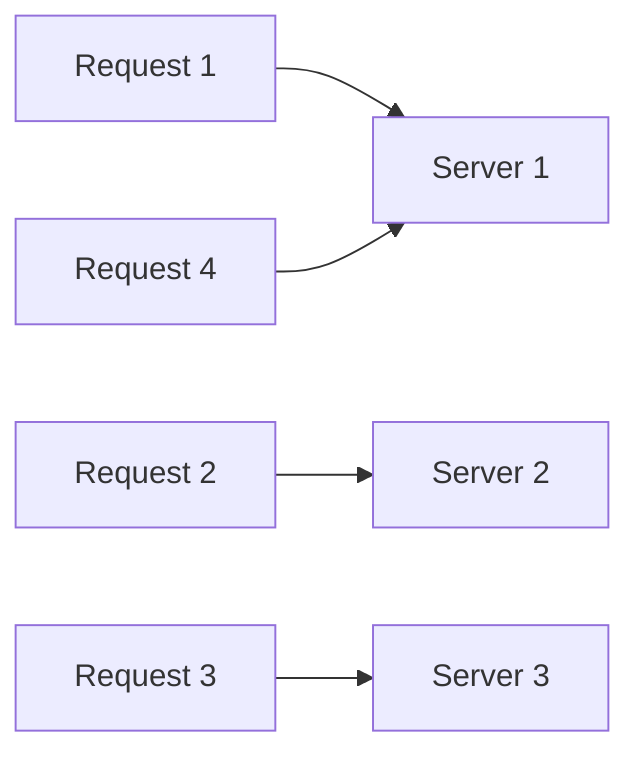

**Real life:** Dealing cards one by one to each player.

**Best when:** All servers are roughly equal in power.

---

### 8.2 Weighted Round Robin — "Stronger servers get more"

If Server A is twice as powerful as Server B, give A more requests.

```text
Server A (weight 2) → gets 2 requests
Server B (weight 1) → gets 1 request
Pattern: A, A, B, A, A, B, ...
```

**Real life:** A fast cashier gets more customers than a trainee.

---

### 8.3 Least Connections — "Help the freest person"

Send the next request to the server with the **fewest active connections**.

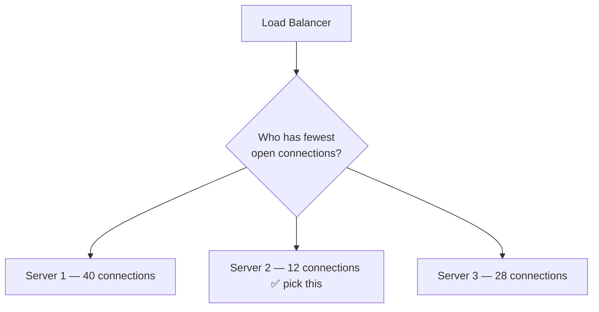

**Real life:** At a bank, a floor manager sends you to the teller with the shortest line.

**Best when:** Some requests take much longer than others (uploads, reports).

---

### 8.4 IP Hash — "Same user → same server"

Hash the user's IP address and always map them to the same server.

```text
hash(user_ip) % number_of_servers → chosen server
```

**Real life:** Your regular grocery store always sends you to the same billing counter so your membership points stay easy to track.

**Best when:** You need the same user to hit the same server (see Sticky Sessions below).

---

### Algorithm cheat sheet

| Algorithm | Idea | Good for |
|-----------|------|----------|
| Round Robin | Equal turns | Similar servers, similar requests |
| Weighted Round Robin | Stronger gets more | Mixed server sizes |
| Least Connections | Freest server first | Uneven request duration |
| IP Hash | Same user → same server | Session affinity |

---

## 9. Health Checks

A load balancer should **not** send traffic to a dead server.

So it regularly asks each server: *"Are you okay?"*

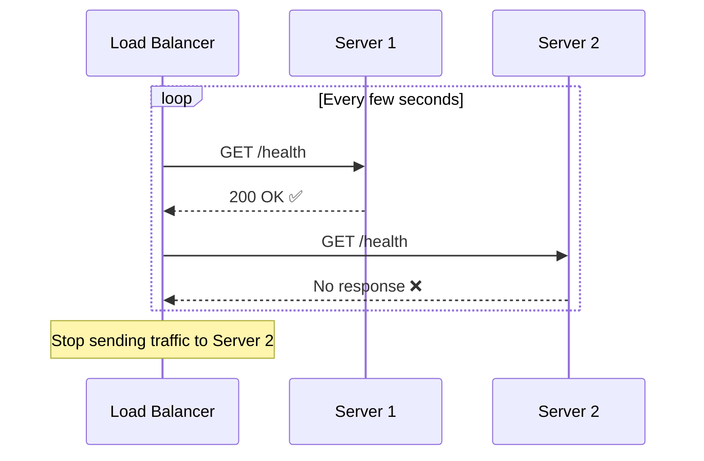

### Real-life example

A restaurant host notices Table 5's waiter is sick and stops seating new guests at that waiter's tables.

### Typical health check

- Endpoint: `/health` or `/ping`
- Expected: HTTP `200 OK`
- If fails N times → mark server **unhealthy** → remove from rotation
- When it recovers → add it back

---

## 10. Sticky Sessions

Sometimes a user's data (like a shopping cart in memory) lives on **one specific server**.

If Request 1 goes to Server A, and Request 2 goes to Server B, the cart may look empty.

**Sticky session** (session affinity) means: *keep this user on the same server*.

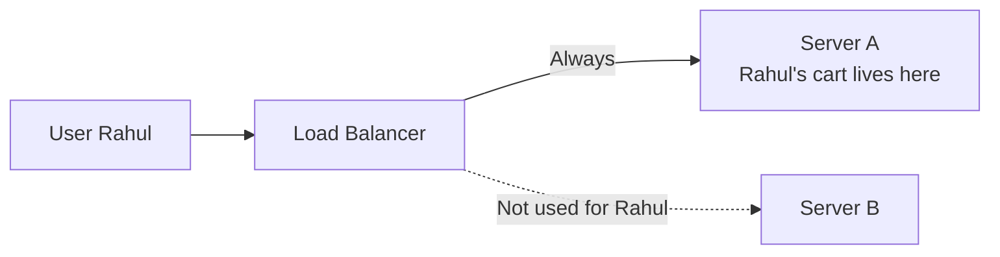

### Real-life example

You start a conversation with Customer Care Agent Priya. Sticky session = all your follow-up calls go back to Priya, not a random new agent who has no context.

### Better long-term approach

Instead of sticky sessions, store session data in a **shared place** (Redis / database). Then any server can serve any user.

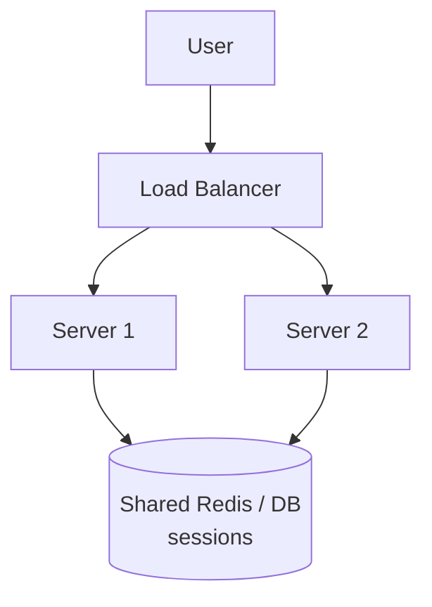

**Beginner takeaway:** Sticky sessions are a quick fix. Shared session storage is the cleaner design.

---

## 11. Layer 4 vs Layer 7 Load Balancing

You will hear "L4" and "L7" in interviews. Keep it simple:

| Type | Looks at | Analogy |
|------|----------|---------|
| **Layer 4 (Transport)** | IP + Port | A security guard who only checks "which building & door" |
| **Layer 7 (Application)** | Full request (URL, headers, cookies) | A receptionist who reads *why* you came and routes you |

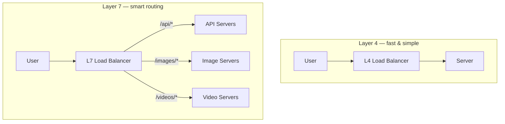

### Real-life example

- **L4:** "Send all guests entering Gate B to Building 2" — no questions asked.
- **L7:** "If you need billing, go to Floor 3. If you need returns, go to Floor 1."

L7 is smarter (can route by URL/path) but slightly heavier. L4 is faster and simpler.

---

## 12. Putting It All Together

Here is a beginner-friendly picture of a scalable web app:

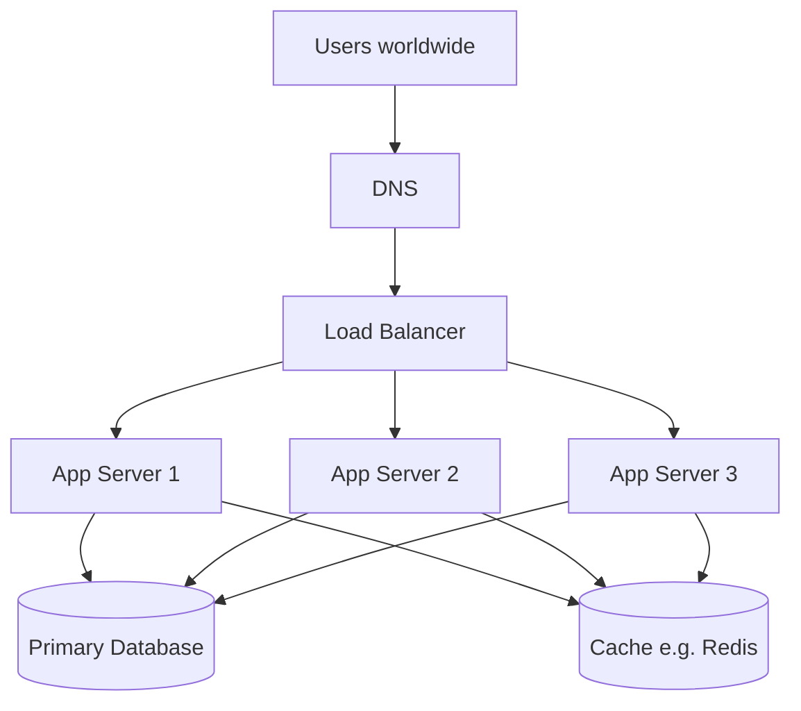

### Story version

1. Users arrive (like customers entering a mall).
2. DNS finds the mall address.
3. Load balancer is the **main entrance guide**.
4. App servers are the **shops** that do the work.
5. Database is the **warehouse**.
6. Cache is the **front counter** with popular items ready.

As traffic grows:

- Add more app servers (horizontal scale)
- Upgrade DB carefully (often vertical first, then replicas / sharding later)

---

## 13. Common Mistakes Beginners Make

| Mistake | Why it hurts | Better thinking |
|---------|--------------|-----------------|
| Only scaling the app, ignoring DB | DB becomes the bottleneck | Scale and design each layer |
| No health checks | Dead servers still get traffic | Always health-check |
| Sticky sessions forever | Harder to scale / recover | Prefer shared session store |
| One giant server forever | Hits a hard ceiling + risky | Plan horizontal growth early |
| Assuming equal servers | Uneven load | Use weights or least-connections |

---

## 14. Quick Recap

| Concept | One-line meaning | Real-life analogy |
|---------|------------------|-------------------|
| Scalability | Grow without redesigning everything | Expanding a tea stall as customers grow |
| Vertical scaling | Bigger machine | Stronger single chef |
| Horizontal scaling | More machines | More chefs / more stalls |
| Load balancer | Spreads traffic | Airport queue manager |
| Round robin | Take turns | Dealing cards |
| Least connections | Pick freest server | Shortest bank queue |
| Health check | Skip dead servers | Don't seat guests with a sick waiter |
| Sticky session | Same user → same server | Same support agent |

### Remember this sentence

> **Scale out with many servers, and use a load balancer so traffic is shared fairly and unhealthy servers are avoided.**

---

Master this chapter first. Almost every system design problem starts with:

> "How will this handle millions of users?" → Scalability + Load Balancing

---

### Practice questions (think, don't memorize)

1. Your app has 1 server and 10,000 users. Traffic will 10x next month. What do you do first, and why?
2. One of 5 servers is twice as powerful. Which algorithm helps most?
3. Why can sticky sessions become a problem during scaling?
4. What should a load balancer do when `/health` fails 3 times?

Write your answers in notes,  teaching yourself is the best way to learn system design.
