# Caching

> **Who is this for?** Beginners learning system design.
>
> **What you will learn:** What caching is, how it works, when you need it, types of caches, and why Redis is so popular, with real-life examples and diagrams.

---

## Table of Contents

1. [The Big Picture](#1-the-big-picture)
2. [What is Caching?](#2-what-is-caching)
3. [How Caching Works](#3-how-caching-works)
4. [When Do You Need Caching?](#4-when-do-you-need-caching)
5. [Benefits of Caching](#5-benefits-of-caching)
6. [Cache Hit vs Cache Miss](#6-cache-hit-vs-cache-miss)
7. [Types of Caching](#7-types-of-caching)
8. [Caching Strategies (How Data is Written)](#8-caching-strategies-how-data-is-written)
9. [Eviction Policies (What Gets Removed)](#9-eviction-policies-what-gets-removed)
10. [TTL: Time To Live](#10-ttl--time-to-live)
11. [Redis: Why and When to Use](#11-redis--why-and-when-to-use)
12. [Redis Pros & Cons](#12-redis-pros--cons)
13. [Putting It All Together](#13-putting-it-all-together)
14. [Common Mistakes Beginners Make](#14-common-mistakes-beginners-make)
15. [Quick Recap](#15-quick-recap)

---

## 1. The Big Picture

Imagine you cook every day.

Without a fridge:

- Every meal → go to the market → buy vegetables → cook
- Slow, expensive, tiring

With a fridge:

- Keep frequently used items ready (milk, veggies, leftovers)
- Grab them quickly when needed
- Go to the market only when something is missing

**A cache is the fridge of your system.**

Your database is the market (far, slower, but has everything).  
Your cache is the fridge (near, fast, keeps popular items).

```text
Slow path:  User → App → Database → App → User
Fast path:  User → App → Cache  → App → User   ✅
```

---

## 2. What is Caching?

**Caching** means storing a copy of frequently used data in a **fast place**, so you don't fetch it from the slow place every time.

### Real-life examples

| Real life | In software |
|-----------|-------------|
| Fridge near the kitchen | Cache near the app |
| Browser remembering a website logo | Browser cache |
| Keeping your bus pass in your pocket (not locker) | In-memory cache |
| Hot snacks at the counter (not warehouse) | CDN / edge cache |

### Simple definition

> Cache = temporary, fast storage for data you expect to need again soon.

---

## 3. How Caching Works

### Step-by-step (read path)

1. User asks for data (example: profile of user `42`)
2. App checks the **cache** first
3. If found → return it (**cache hit**). Fast ⚡
4. If not found → go to **database** (**cache miss**)
5. Save a copy in cache for next time
6. Return data to user

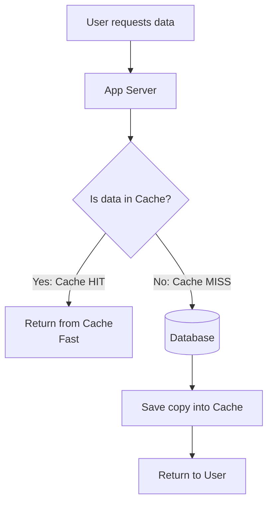

### Sequence view

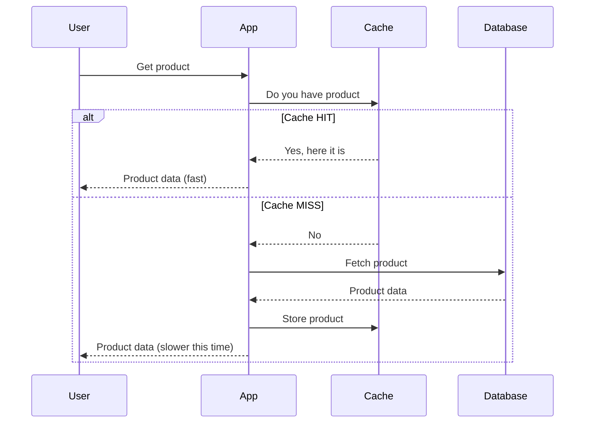

### Tiny code-style mental model

```text
function getUser(id):
  cached = cache.get("user:" + id)
  if cached exists:
      return cached          # HIT

  user = database.getUser(id) # MISS
  cache.set("user:" + id, user, ttl=60 seconds)
  return user
```

You don't need to memorize code. Just remember: **check cache → miss → DB → store in cache**.

---

## 4. When Do You Need Caching?

Not every app needs a cache on day 1. Add caching when you feel these pains:

### Signs you need caching

| Symptom | Why cache helps |
|---------|-----------------|
| Same data is read again and again | Stop hitting DB repeatedly |
| Pages feel slow under load | Cache returns in microseconds/milliseconds |
| Database CPU / connections are high | Fewer DB queries |
| Homepage / product list rarely changes | Perfect cache candidates |
| Expensive calculations (leaderboard, recommendations) | Cache the result |

### Real-life: Food delivery app

- Restaurant menu changes a few times a day
- Thousands of users open the same menu
- Without cache → DB queried thousands of times
- With cache → serve menu from Redis for minutes/hours

### When you may NOT need caching yet

- Very small traffic
- Data changes every second and must always be exact (and you haven't designed invalidation)
- Early prototype: optimize after measuring

**Beginner tip:** Measure first. Cache what is **read often** and **changes rarely**.

---

## 5. Benefits of Caching

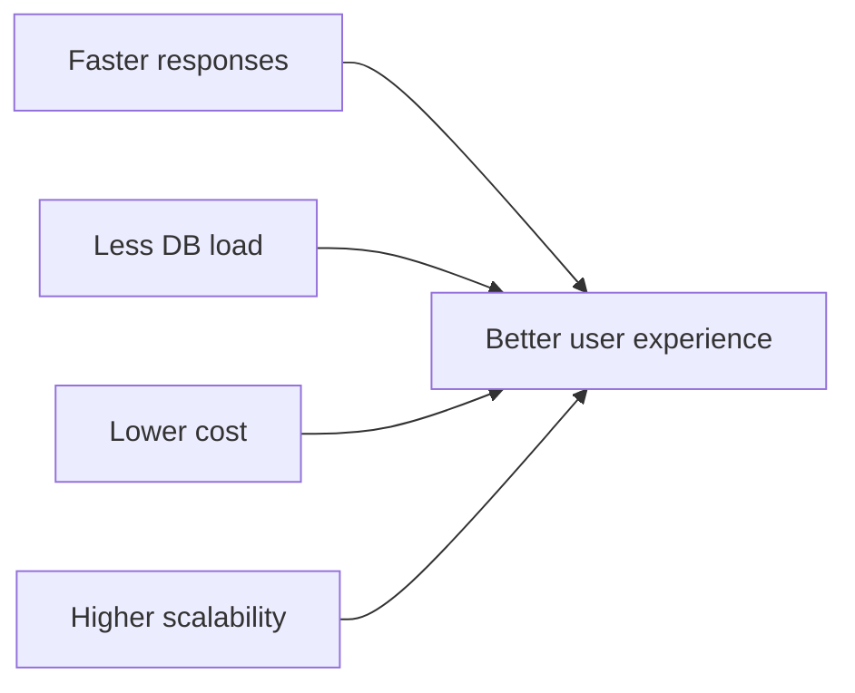

| Benefit | Easy explanation |
|---------|------------------|
| **Speed** | Memory is much faster than disk/DB |
| **Less database load** | DB can breathe; fewer queries |
| **Cheaper at scale** | Serving from cache costs less than always querying DB |
| **Better under spikes** | Sale day / viral post: cache absorbs repeated reads |
| **Smoother UX** | Feeds, profiles, menus feel instant |

### Number intuition (approximate)

| Source | Typical speed |
|--------|---------------|
| In-memory cache (Redis) | ~1 ms or less |
| Database query | ~10-100+ ms (can be more) |

Even a small saving per request becomes huge at 10,000 requests/second.

---

## 6. Cache Hit vs Cache Miss

| Term | Meaning | Feeling |
|------|---------|---------|
| **Cache Hit** | Data found in cache | Instant win |
| **Cache Miss** | Data not in cache → go to DB | Slower path |

### Hit ratio

```text
Hit Ratio = Hits / (Hits + Misses)
```

Example:

- 900 hits, 100 misses → **90% hit ratio** → excellent for many apps

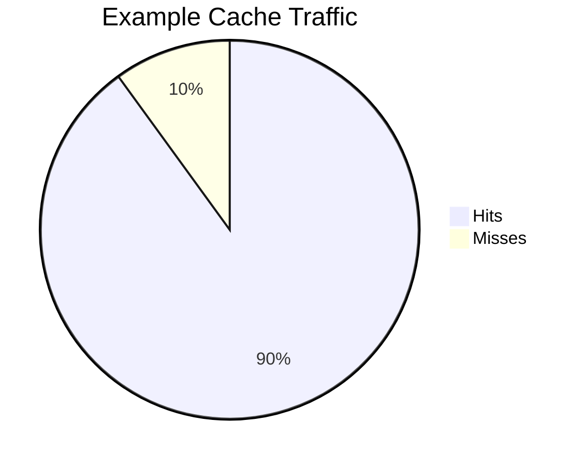

**Goal:** Keep hit ratio high for hot data, without serving stale data forever.

---

## 7. Types of Caching

Caching can exist at many layers. Think of a city with storage at home, shop, and warehouse.

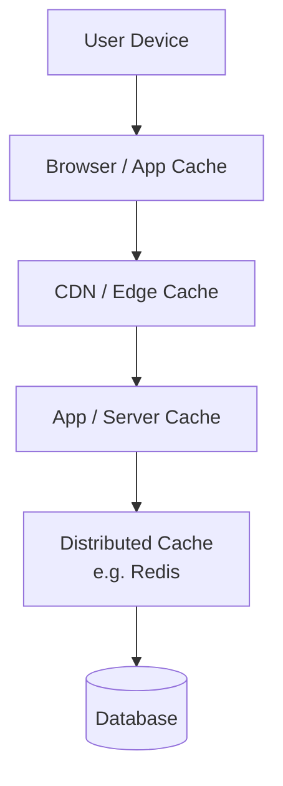

### 7.1 Client-side / Browser Cache

Stores static files on the user's device: images, CSS, JS.

**Real life:** Your phone keeps WhatsApp profile photos so it doesn't download them every open.

**Good for:** Logos, fonts, scripts, images.

---

### 7.2 CDN Cache (Edge Cache)

CDN keeps copies of content close to users worldwide (Mumbai, London, NYC…).

**Real life:** Instead of one warehouse in Delhi for all India, keep popular items in local city stores.

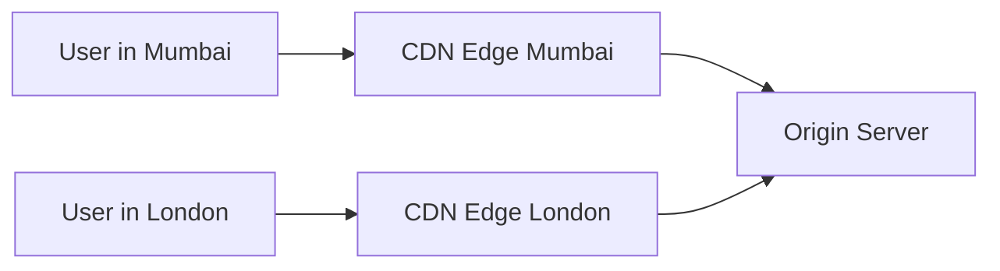

**Good for:** Images, videos, static pages, downloadable files.

---

### 7.3 Application / In-memory Cache (same server)

App keeps data in its own RAM (like a local Map / object store).

**Real life:** Notes on your desk. Fastest, but only you can see them.

**Pros:** Extremely fast  
**Cons:** Lost if server restarts; not shared across multiple servers

---

### 7.4 Distributed Cache (Redis / Memcached)

A separate fast cache service shared by all app servers.

**Real life:** A shared office fridge. Every teammate can use it.

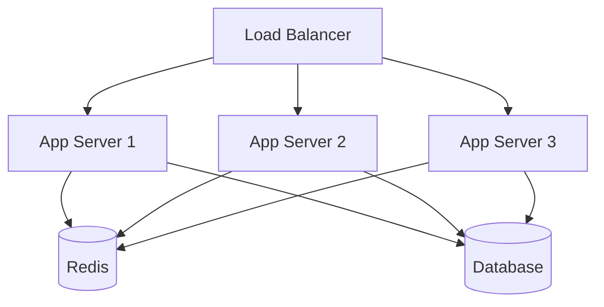

**Good for:** Sessions, profiles, product details, rate limits, leaderboards.

---

### 7.5 Database Cache

Databases themselves cache query results / pages in memory (buffer pool).

**Real life:** Librarian keeps popular books on a nearby cart.

Useful, but usually **not enough alone** under heavy repeated reads. That's why apps add Redis.

---

### Types cheat sheet

| Type | Where | Shared across servers? | Best for |
|------|-------|------------------------|----------|
| Browser cache | User device | No | Static assets |
| CDN | Edge locations | Yes (globally) | Media / static content |
| In-memory (local) | App process RAM | No | Tiny ultra-hot data |
| Distributed (Redis) | Separate service | Yes | Most backend caching |
| DB internal cache | Database RAM | N/A | Query pages / buffers |

---

## 8. Caching Strategies (How Data is Written)

These patterns answer: *When do we read/write cache vs database?*

### 8.1 Cache-Aside (Lazy Loading): most common

App is in control:

1. Read cache
2. On miss → read DB
3. Put into cache

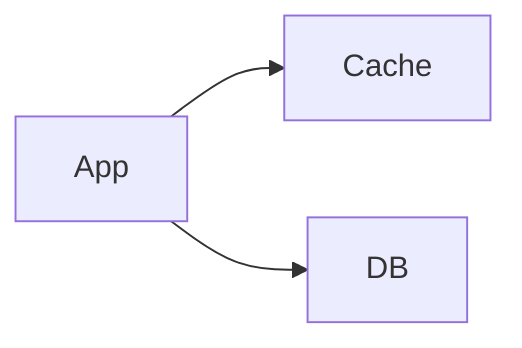

**Pros:** Simple, only caches what is actually requested  
**Cons:** First request is always a miss (cold start)

**Real life:** You put leftovers in the fridge only after cooking and eating once.

---

### 8.2 Write-Through

Every write goes to **cache and database together**.

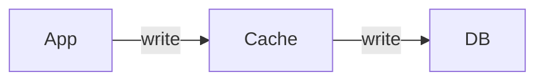

**Pros:** Cache stays fresh on writes  
**Cons:** Writes are slower; may cache data that is never read

**Real life:** Every time you buy groceries, you put a copy in fridge AND update home inventory list immediately.

---

### 8.3 Write-Behind (Write-Back)

Write to cache first; database is updated a bit later (async).

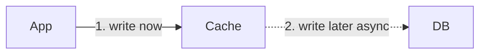

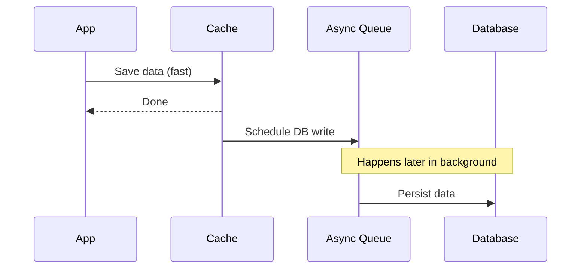

**Pros:** Very fast writes  
**Cons:** Risk of data loss if cache dies before DB write

**Real life:** Waiter notes orders on paper first, enters billing system later. Faster service, but risky if paper is lost.

---

### 8.4 Read-Through

App always talks to cache; cache itself fetches from DB on miss.

Similar to cache-aside, but the **cache library/service** handles loading.

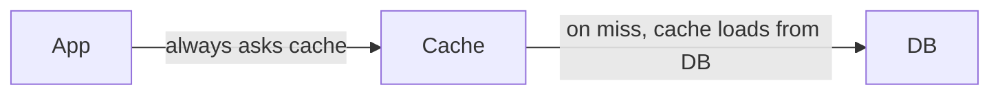

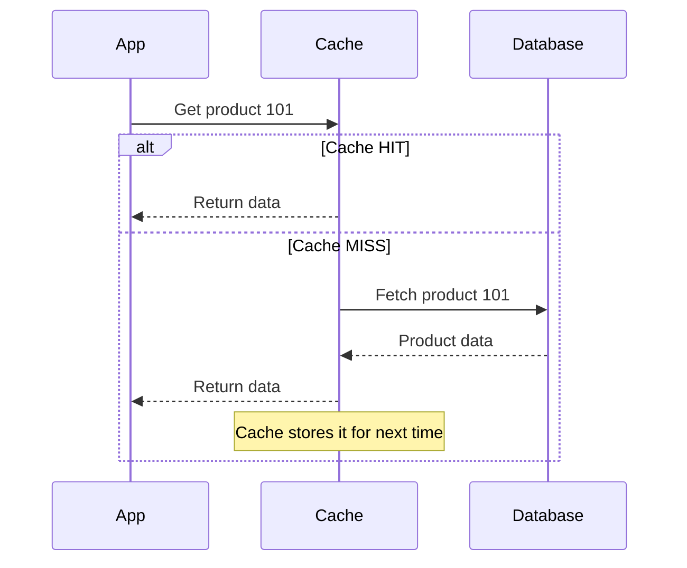

**Key difference from Cache-Aside:**  
In Cache-Aside, the **app** fetches from DB on miss.  
In Read-Through, the **cache** fetches from DB on miss. App only talks to cache.

---

### Strategy cheat sheet

| Strategy | Best when | Risk |
|----------|-----------|------|
| Cache-Aside | Most apps / general reads | Stale if you forget to invalidate |
| Write-Through | Need fresher cache on writes | Slower writes |
| Write-Behind | Very high write speed needed | Possible data loss |
| Read-Through | Want cache layer to manage loads | Less app control |

**Beginner default:** Start with **Cache-Aside + TTL**.

---

## 9. Eviction Policies (What Gets Removed)

Cache memory is limited. When full, something must leave.

| Policy | Meaning | Real-life analogy |
|--------|---------|-------------------|
| **LRU** (Least Recently Used) | Remove what wasn't used recently | Throw oldest untouched leftovers |
| **LFU** (Least Frequently Used) | Remove least used overall | Remove the snack nobody eats |
| **FIFO** | Remove oldest inserted | First packed lunch leaves first |
| **TTL expiry** | Remove after time ends | Milk expires after 2 days |
| **Random** | Remove randomly | Quick & simple, rarely ideal |

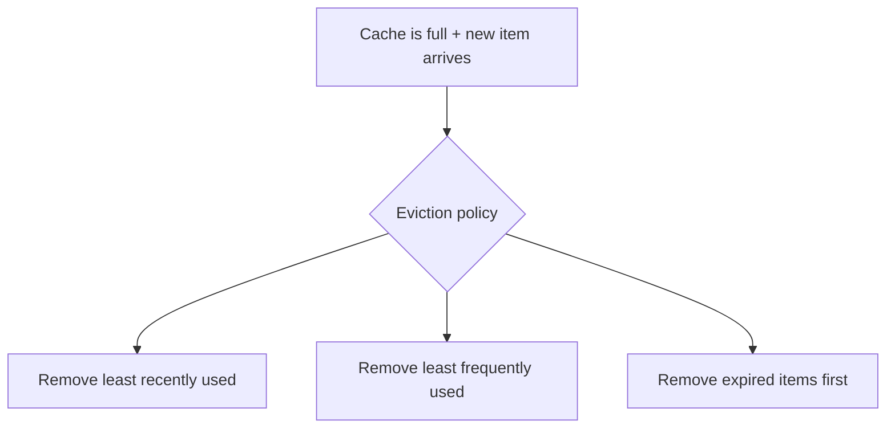

**Most common in interviews & practice:** **LRU + TTL**.

---

## 10. TTL: Time To Live

**TTL** = how long data stays in cache before it expires automatically.

```text
cache.set("menu:rest_19", menuData, ttl = 10 minutes)
```

After 10 minutes → entry disappears → next request refetches from DB.

### Why TTL matters

Without TTL, you may serve **old data forever** (stale cache).

### Choosing TTL (intuition)

| Data | Example TTL idea |
|------|------------------|
| OTP / short tokens | seconds-minutes |
| Product price during sale | seconds-few minutes |
| Restaurant menu | minutes-hours |
| Rarely changing config | hours-days |
| User session | matches session lifetime |

**Trade-off:**

- Short TTL → fresher data, more DB load
- Long TTL → faster/cheaper, more staleness risk

---

## 11. Redis: Why and When to Use

### What is Redis?

**Redis** = *Remote Dictionary Server*

It is an **in-memory data store** used mostly as:

- Cache
- Session store
- Rate limiter helper
- Leaderboards / counters
- Pub/Sub messaging (advanced)

Because data lives in **RAM**, Redis is extremely fast.

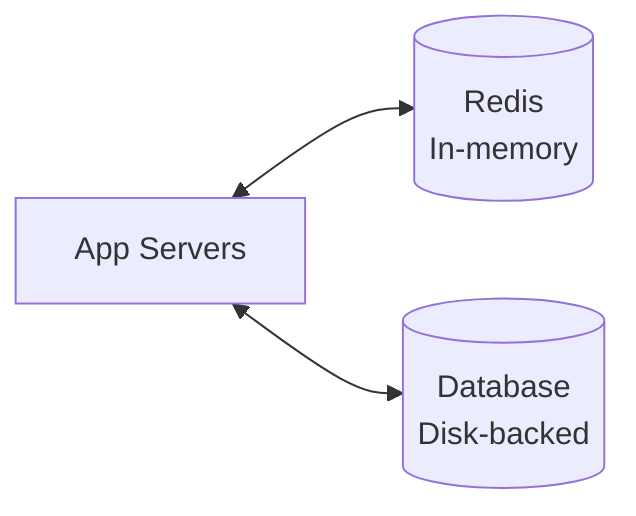

### Real-life analogy

| Store | Role |
|-------|------|
| Redis | Counter / fridge: instant access |
| Database | Warehouse: complete and durable |

---

### Why people use Redis

1. **Speed**: RAM is fast
2. **Shared by many servers**: perfect with horizontal scaling
3. **Rich data types**: strings, lists, sets, hashes, sorted sets
4. **TTL built-in**: expire keys easily
5. **Simple mental model**: `GET` / `SET` key-value
6. **Battle-tested**: used by countless production systems

---

### When to use Redis

| Use case | Example | Why Redis |
|----------|---------|-----------|
| Cache hot reads | Product details, profiles | Fast repeated reads |
| Sessions | Login session for web app | Shared across app servers |
| Rate limiting | Max 100 API calls / minute | Fast counters + expiry |
| Leaderboards | Top players by score | Sorted sets |
| Temporary data | OTP, password reset tokens | TTL naturally fits |
| Distributed locks (careful design) | One job runs at a time | Fast coordination |

### When NOT to use Redis as your main DB

- You need complex relational queries / joins as source of truth
- Data must never be lost and you haven't configured durability carefully
- Dataset is huge and mostly cold (RAM is expensive for everything)

**Rule:** Redis is amazing as a **speed layer**, not always as the **only source of truth**.

---

### Redis with multiple app servers (important)

From the previous chapter: horizontal scaling + sticky sessions is messy.

Better pattern:

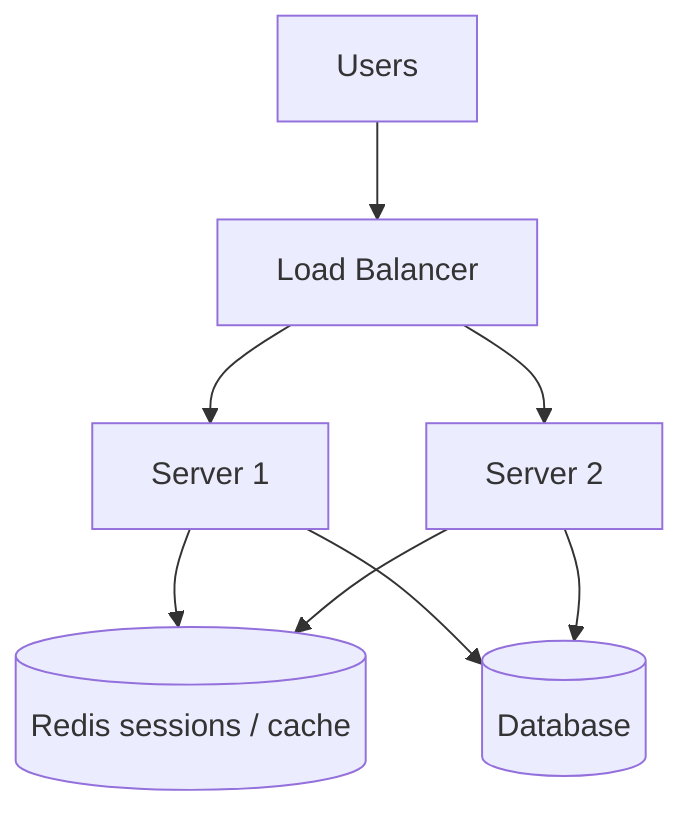

Any server can serve any user because session/cache lives in Redis.

---

## 12. Redis Pros & Cons

### Pros

| Pro | Meaning for beginners |
|-----|------------------------|
| Very fast | Great user experience under load |
| Easy to start | Key-value feels simple |
| TTL support | Auto-cleanup of temporary data |
| Many data structures | More than plain string cache |
| Helps scaling | Shared cache for many servers |
| Ecosystem | Libraries for Node, Python, Java, Go, etc. |

### Cons

| Con | Meaning for beginners |
|-----|------------------------|
| Memory cost | RAM is costlier than disk |
| Data can be lost | If used only in-memory without persistence / replicas |
| Cache stampede risk | Many requests miss at once and hit DB together |
| Operational complexity | Monitoring, eviction, clustering, failover |
| Stale data risk | Must invalidate or use TTL wisely |
| Not ideal for huge cold datasets | Don't dump entire DB into Redis blindly |

### Persistence note (simple)

Redis can optionally save to disk (RDB / AOF), but think of Redis primarily as:

> **Fast layer**. Still keep important permanent data in your main database.

---

## 13. Putting It All Together

A practical beginner architecture:

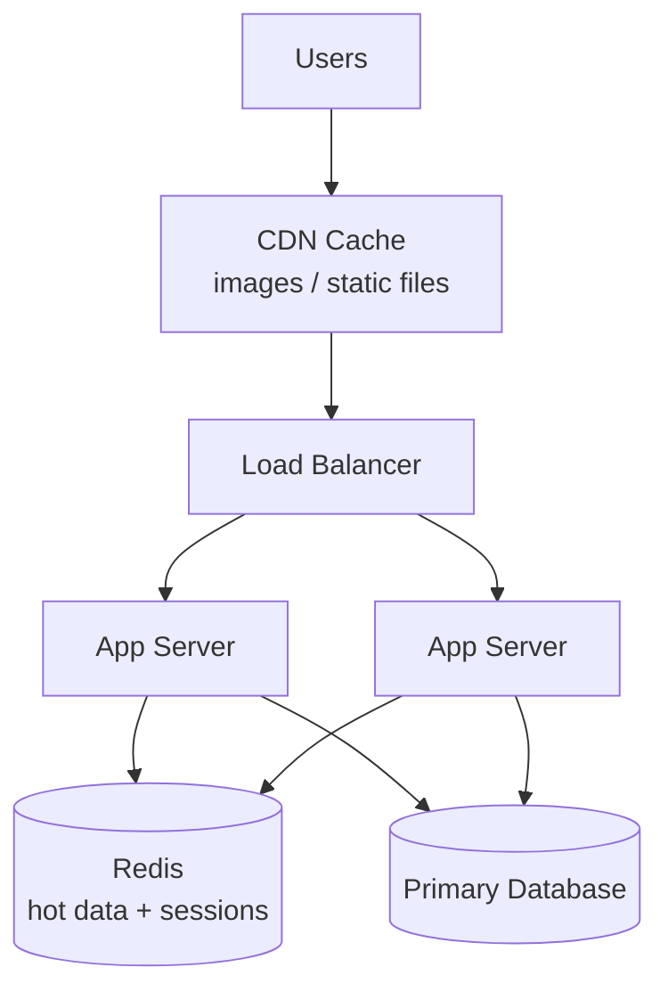

### Story: Opening Instagram-like profile page

1. Profile photo may come from **CDN**
2. App checks **Redis** for profile JSON
3. If miss → load from **DB**, store in Redis with TTL
4. Next 1,000 viewers of same profile get Redis speed

### What to cache first (practical order)

1. Rarely changing + highly read data (configs, menus)
2. Expensive-to-compute results
3. Sessions / auth-related temporary data
4. Then optimize more with metrics

---

## 14. Common Mistakes Beginners Make

| Mistake | Problem | Better approach |
|---------|---------|-----------------|
| Cache everything | Wastes RAM, more bugs | Cache hot + valuable data |
| No TTL / no invalidation | Users see old prices/data | TTL + clear update rules |
| Forget cache on write | Update DB but cache still old | Invalidate or update cache key |
| Use local memory only with many servers | Each server has different data | Use Redis (shared) |
| No plan for cache miss storm | DB melts when key expires | Soft TTL / locking / staggered expiry |
| Treat Redis as only database | Durability & query limits | DB as source of truth |

### Cache invalidation (famous hard problem)

When data changes in DB, cached copy can become wrong.

Simple patterns:

1. **Expire with TTL** (easy, eventual freshness)
2. **Delete key on update** (`DEL user:42` when profile updates)
3. **Update key on write** (write-through style)

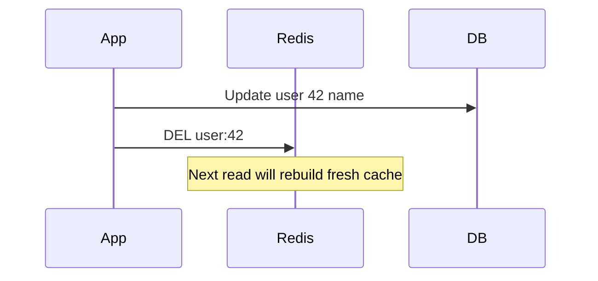

---

## 15. Quick Recap

| Concept | One-line meaning | Real-life analogy |
|---------|------------------|-------------------|
| Cache | Fast temporary copy of data | Fridge |
| Cache hit | Found in cache | Snack already in fridge |
| Cache miss | Not in cache → fetch source | Go to market |
| CDN | Cache close to users worldwide | Local city stores |
| Cache-aside | App loads DB into cache on miss | Store leftovers after cooking |
| TTL | Auto-expire time | Food expiry date |
| LRU | Remove least recently used | Throw untouched leftovers |
| Redis | Fast shared in-memory store | Shared office fridge |

### Remember this sentence

> **Caching keeps frequent data close and fast. Use it for hot reads, expire/invalidate wisely, and keep the database as the source of truth. Redis is the common shared cache when you scale out.**

---

### Practice questions (think in plain English)

1. Your product page is read 10,000 times/minute but updated 2 times/hour. Should you cache it? What TTL would you try first?
2. You have 3 app servers. Why is Redis better than storing cache only in each server's memory?
3. User updates their profile name. What should happen to `user:42` in Redis?
4. Cache expires for a celebrity profile at the same second 50,000 people open it. What can go wrong?
5. Give one case where CDN helps more than Redis, and one where Redis helps more than CDN.

Write your answers in notes. Explaining in your own words is the best way to learn.
