# Databases (SQL vs NoSQL)

> **Who is this for?** Beginners learning system design.
>
> **What you will learn:** What a database is, how SQL and NoSQL differ, types of NoSQL, when to use which, scaling ideas, and trade-offs, with easy examples and diagrams.
>
> **Related:** [Caching](./02-caching.md) · [Redis](../technologies/01-redis.md)

---

## Table of Contents

1. [The Big Picture](#1-the-big-picture)
2. [What is a Database?](#2-what-is-a-database)
3. [SQL Databases](#3-sql-databases)
4. [NoSQL Databases](#4-nosql-databases)
5. [Types of NoSQL](#5-types-of-nosql)
6. [SQL vs NoSQL (Clear Comparison)](#6-sql-vs-nosql-clear-comparison)
7. [ACID vs BASE (Simple View)](#7-acid-vs-base-simple-view)
8. [Schema: Fixed vs Flexible](#8-schema-fixed-vs-flexible)
9. [Relationships and Joins](#9-relationships-and-joins)
10. [Scaling Databases](#10-scaling-databases)
11. [When to Use SQL](#11-when-to-use-sql)
12. [When to Use NoSQL](#12-when-to-use-nosql)
13. [Polyglot Persistence (Using Both)](#13-polyglot-persistence-using-both)
14. [Popular Databases Map](#14-popular-databases-map)
15. [Putting It All Together](#15-putting-it-all-together)
16. [Common Mistakes Beginners Make](#16-common-mistakes-beginners-make)
17. [Quick Recap](#17-quick-recap)
18. [Practice Questions](#18-practice-questions)

---

## 1. The Big Picture

Every app needs a place to keep data:

- Users
- Orders
- Messages
- Products
- Payments

That permanent storage place is usually a **database**.

In system design interviews and real projects, one of the first big choices is:

> Should we use **SQL** or **NoSQL**?

There is no single winner. Both are useful. The skill is knowing **which problem fits which tool**.

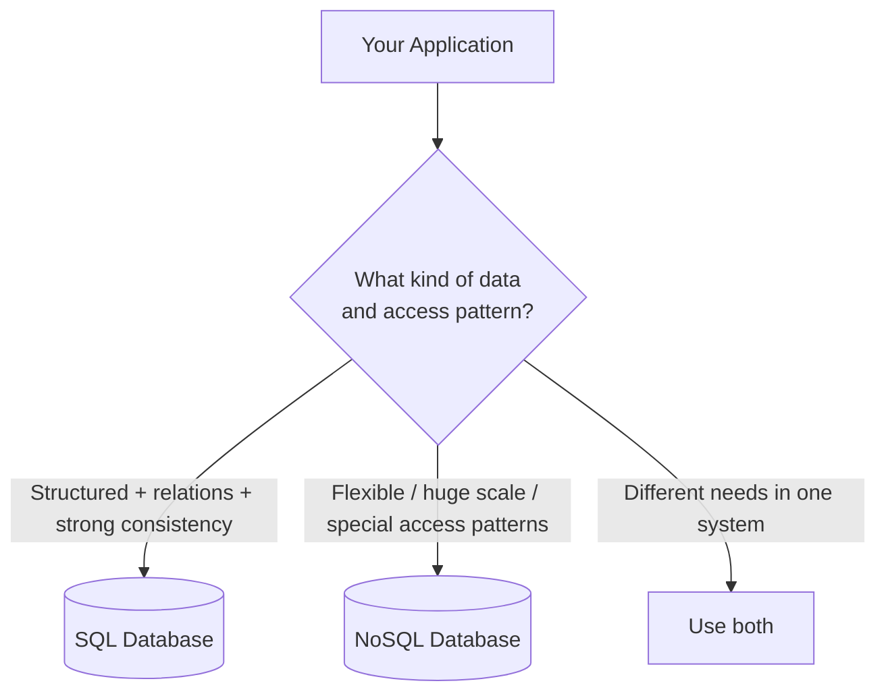

---

## 2. What is a Database?

A **database** is an organized system to store, find, update, and protect data.

### Real-life example: School office

| School office | Database world |
|---------------|----------------|
| Student register books | Tables / collections |
| Clerk searching by roll number | Query |
| Rules: roll number must be unique | Constraints / schema |
| Lock on cabinet | Access control |
| Photocopy of register in another room | Replica / backup |

### Database vs cache (quick reminder)

| | Database | Cache (example Redis) |
|--|----------|------------------------|
| Role | Source of truth | Speed layer |
| Durability | Designed to keep data | Often temporary / rebuildable |
| Speed | Slower than memory cache | Very fast |
| Question it answers | "What is the real data?" | "Can I answer faster with a copy?" |

---

## 3. SQL Databases

**SQL** = Structured Query Language.

SQL databases are also called **relational databases**.

Data is stored in **tables** (rows and columns), and tables can be linked with relationships.

### Real-life example: Excel sheets that are connected

Imagine:

- Sheet 1: Students
- Sheet 2: Courses
- Sheet 3: Enrollments (which student took which course)

That is relational thinking.

### Example tables

**users**

| id | name | email |
|----|------|-------|
| 1 | Asha | asha@mail.com |
| 2 | Ravi | ravi@mail.com |

**orders**

| id | user_id | amount | status |
|----|---------|--------|--------|
| 101 | 1 | 499 | paid |
| 102 | 1 | 150 | pending |
| 103 | 2 | 999 | paid |

`orders.user_id` points to `users.id`. That link is a **relationship**.

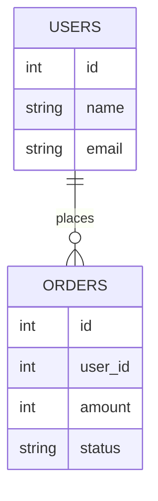

### How you ask questions (SQL)

```sql
SELECT name, email
FROM users
WHERE id = 1;

SELECT *
FROM orders
WHERE user_id = 1;
```

### Popular SQL databases

- PostgreSQL
- MySQL
- MariaDB
- Microsoft SQL Server
- Oracle
- SQLite (great for local / small apps)

### Strengths of SQL

| Strength | Easy meaning |
|----------|--------------|
| Structured schema | Columns and types are clear |
| Relationships | Users, orders, payments connect cleanly |
| Strong consistency | After a successful write, reads see correct data (in normal setups) |
| Powerful queries | Filters, joins, aggregates |
| Mature ecosystem | Tools, ORMs, backups, hiring skill pool |

### Weaknesses of SQL

| Weakness | Easy meaning |
|----------|--------------|
| Schema changes can be slower | Adding/changing columns needs planning |
| Horizontal scaling is harder | Scaling across many machines is more complex |
| Rigid for messy/varied documents | Not ideal if every record looks different |

---

## 4. NoSQL Databases

**NoSQL** roughly means "Not Only SQL".

These databases are built for different shapes of data and different scaling patterns. They often prefer **flexibility** and **horizontal scale**.

### Real-life example: Different filing styles

SQL is like a government form: every field is fixed.

NoSQL can be like:

- Sticky notes of different sizes (documents)
- Huge dictionary of keys (key-value)
- Wide spreadsheet with many optional columns (wide-column)
- A map of friendships (graph)

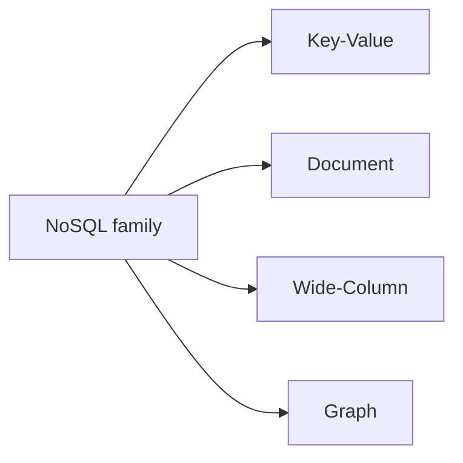

### Important truth

NoSQL is not "better than SQL".  
It is a **family of tools** for different jobs.

---

## 5. Types of NoSQL

### 5.1 Key-Value stores

Store data like a giant dictionary:

```text
key → value
```

**Examples:** Redis, DynamoDB (can be used this way), Riak

**Real life:** Locker number → bag inside

**Good for:** sessions, cache, simple lookups by ID

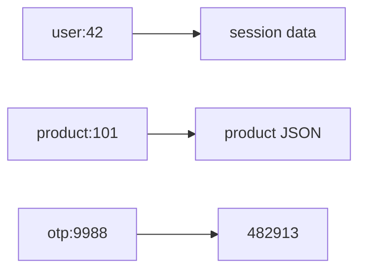

---

### 5.2 Document stores

Store JSON-like documents. Each document can have different fields.

**Examples:** MongoDB, Couchbase, Firestore

**Example document:**

```json
{
  "id": 42,
  "name": "Asha",
  "city": "Pune",
  "tags": ["premium", "seller"],
  "address": {
    "line1": "MG Road",
    "pincode": "411001"
  }
}
```

**Real life:** A student file where one student has sports certificates, another has music certificates. Folders are flexible.

**Good for:** profiles, product catalogs, content, event-style records

---

### 5.3 Wide-column stores

Data is stored in rows with flexible columns, optimized for huge scale and specific query patterns.

**Examples:** Cassandra, ScyllaDB, HBase, Bigtable

**Real life:** A giant attendance register where each student row can have many dated columns.

**Good for:** time-series style workloads, write-heavy apps, large multi-region systems (when modeled well)

> In Cassandra-style systems, you design tables around **queries you will run**, not only around entities.

---

### 5.4 Graph databases

Data is stored as **nodes** and **relationships**.

**Examples:** Neo4j, Amazon Neptune

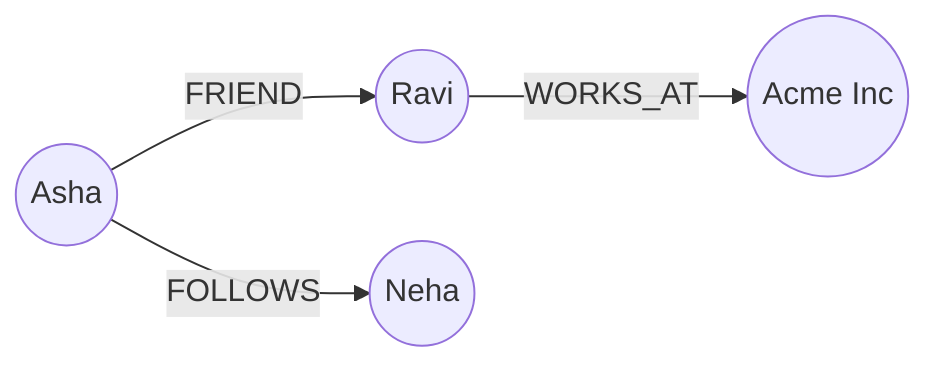

**Real life:** A friend map on a whiteboard with arrows between people.

**Good for:** social networks, recommendations, fraud rings, "friends of friends", access permissions graphs

---

### NoSQL types cheat sheet

| Type | Looks like | Best for | Example tools |
|------|------------|----------|---------------|
| Key-Value | Dictionary | Fast lookup by key | Redis, DynamoDB |
| Document | JSON files | Flexible objects | MongoDB |
| Wide-Column | Huge flexible tables | Massive scale / write heavy | Cassandra |
| Graph | Nodes + edges | Relationship-heavy queries | Neo4j |

---

## 6. SQL vs NoSQL (Clear Comparison)

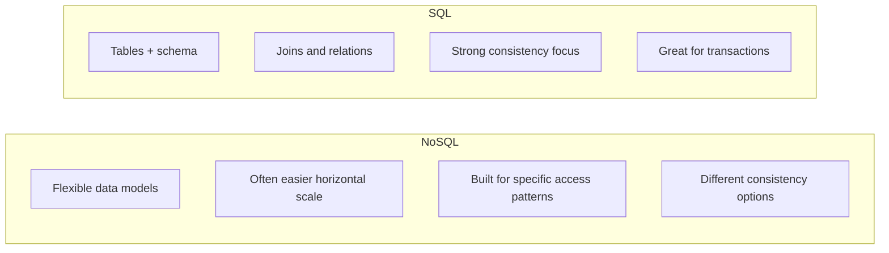

| Point | SQL | NoSQL |
|-------|-----|-------|
| Data model | Tables, rows, columns | Documents / key-value / graph / wide-column |
| Schema | Usually fixed first | Often flexible |
| Relationships | First-class (joins) | Often embedded or app-side |
| Transactions | Strong and mature | Varies by database |
| Scaling style | Vertical first, horizontal with more effort | Often designed for horizontal scale |
| Query power | Very strong general querying | Depends on type and design |
| Best mental fit | Structured business data | High scale / flexible / special patterns |

### One sentence each

- **SQL:** "My data is structured and related, and correctness matters a lot."
- **NoSQL:** "My data shape or scale needs a specialized storage model."

---

## 7. ACID vs BASE (Simple View)

You will hear these terms in interviews.

### ACID (common in SQL systems)

| Letter | Meaning | Easy example |
|--------|---------|--------------|
| **A**tomicity | All or nothing | Money leaves A only if it reaches B |
| **C**onsistency | Rules remain valid | Balance cannot go invalid mid-transfer |
| **I**solation | Concurrent transfers do not mess each other up | Two withdrawals handled safely |
| **D**urability | Once saved, it stays saved | Power cut after commit still keeps the transfer |

**Real life:** Bank transfer rules.

### BASE (often discussed with NoSQL systems)

| Idea | Meaning |
|------|---------|
| **B**asically **A**vailable | System keeps responding |
| **S**oft state | Data may change as it syncs |
| **E**ventually consistent | Copies become same after some time |

**Real life:** WhatsApp tick marks / follower counts may update a little late, but the app stays available.

> Not every NoSQL database is weakly consistent. Many offer stronger options. Learn per database.

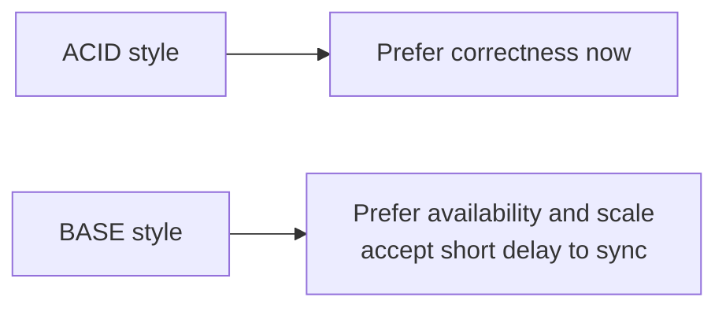

---

## 8. Schema: Fixed vs Flexible

### Fixed schema (SQL)

You define columns first:

```text
users(id, name, email, created_at)
```

Every row follows this shape.

**Pros:** clean, predictable, safer constraints  
**Cons:** changing shape needs migrations

### Flexible schema (Document NoSQL)

One user document can have extra fields another user does not have.

**Pros:** fast iteration, evolving product fields  
**Cons:** messy data if team has no discipline

### Real-life

| Fixed schema | Flexible schema |
|--------------|-----------------|
| Passport form | Personal notebook |

---

## 9. Relationships and Joins

### In SQL

Relationships are natural.

```sql
SELECT users.name, orders.amount
FROM users
JOIN orders ON users.id = orders.user_id
WHERE users.id = 1;
```

Database joins tables for you.

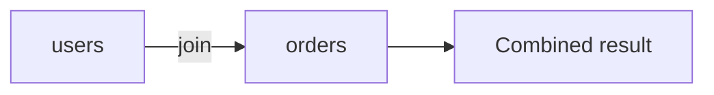

### In NoSQL (document example)

Common options:

1. **Embed** related data inside one document  
2. **Reference** IDs and fetch in application code  
3. Use a database feature if available

**Embed example (good when data is read together):**

```json
{
  "orderId": 101,
  "amount": 499,
  "user": {
    "id": 1,
    "name": "Asha"
  }
}
```

**Reference example:**

```json
{
  "orderId": 101,
  "userId": 1
}
```

### Rule of thumb

- Data always read together and not huge → embedding can be fine
- Data reused in many places and updated often → references / relational model may be better

---

## 10. Scaling Databases

### Vertical scaling

Give the database server more CPU, RAM, disk.

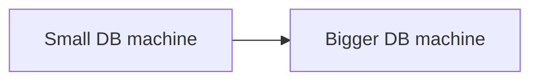

Simple at first. Hits a limit later.

### Read replicas (common for SQL and many systems)

One primary handles writes. Replicas serve reads.

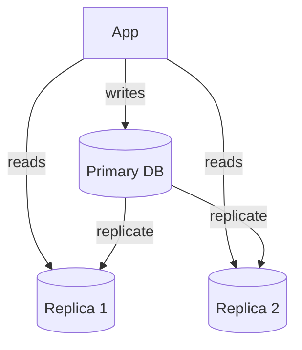

**Real life:** One master register for updates, photocopies for people who only need to read.

### Sharding (horizontal split)

Split data across multiple databases by a key (example: `user_id`).

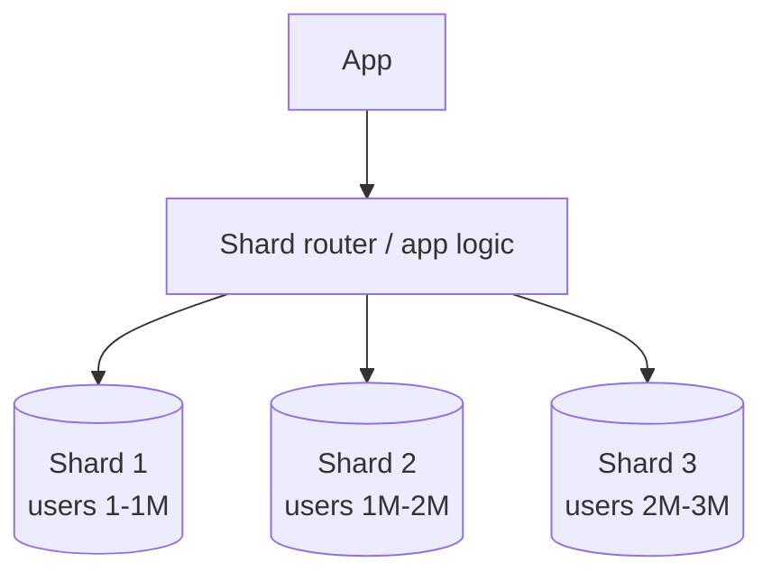

**Real life:** Instead of one giant notebook for all India customers, keep separate notebooks by state.

### SQL vs NoSQL scaling intuition

| | SQL | NoSQL |
|--|-----|-------|
| Start | Vertical + replicas | Often designed with distribution in mind |
| Sharding | Possible, more operationally careful | Common in many NoSQL systems |
| Complexity | Joins across shards are hard | Cross-partition queries can also be hard |

**Beginner tip:** First optimize queries + indexes + caching. Shard only when needed.

---

## 11. When to Use SQL

Choose SQL when:

1. Data is structured and relational  
2. You need strong transactions (payments, inventory deduction, booking seats)  
3. You need complex queries/reporting  
4. Consistency matters more than flexible documents  
5. Team already knows relational modeling well  

### Good SQL examples

| System part | Why SQL fits |
|-------------|--------------|
| Banking ledger | Transactions + correctness |
| E-commerce orders + payments | Relations + ACID style needs |
| HR / inventory systems | Structured records |
| Most SaaS business apps | Users, plans, invoices, roles |

### Real-life

Airline seat booking: two people must not get the same last seat. SQL-style transactional guarantees are very useful here.

---

## 12. When to Use NoSQL

Choose NoSQL when:

1. Data shape changes often or varies by record  
2. You need very high scale across many machines  
3. Access pattern is simple and known (example: get by key)  
4. You store large volumes of event/click/log-like data  
5. Relationship traversal is the main problem (graph)  

### Good NoSQL examples

| Need | Possible NoSQL fit |
|------|--------------------|
| User session / cache style data | Key-value (Redis) |
| Product catalog with varying attributes | Document (MongoDB) |
| Social graph "friends of friends" | Graph (Neo4j) |
| Massive write-heavy activity events | Wide-column (Cassandra) |
| Global app with huge key lookups | DynamoDB-style systems |

### Real-life

A content app where each post has different metadata (poll, video, article, carousel). Document DB can feel natural.

---

## 13. Polyglot Persistence (Using Both)

Modern systems often use **more than one database**.

This is called **polyglot persistence**: different storage for different jobs.

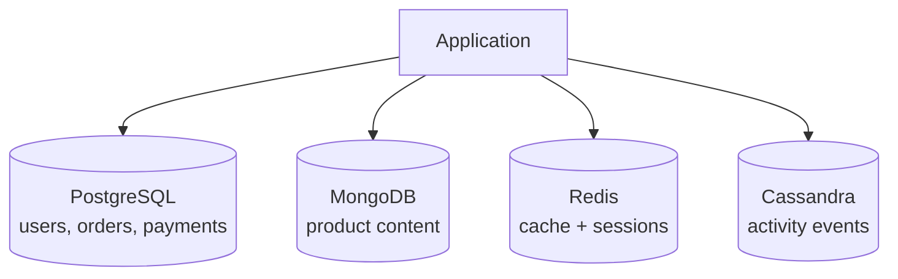

### Example: Food delivery app

| Data | Store |
|------|-------|
| Restaurant contracts, billing | SQL |
| Flexible restaurant menu items | Document DB |
| Active order tracking hot data | Redis |
| Years of GPS/driver pings | Wide-column / time-series style store |

**Do not overdo this.** Every extra database adds operations cost. Start simple. Split when a clear need appears.

---

## 14. Popular Databases Map

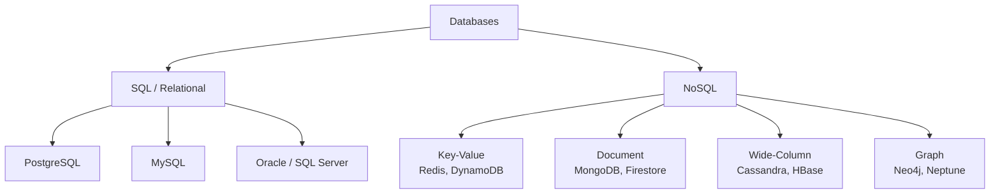

### Beginner learning order (practical)

1. One SQL DB well (PostgreSQL or MySQL)
2. Redis (speed layer)
3. One document DB (MongoDB)
4. Later: Cassandra / DynamoDB / Neo4j as needed

---

## 15. Putting It All Together

### Decision flow (beginner friendly)

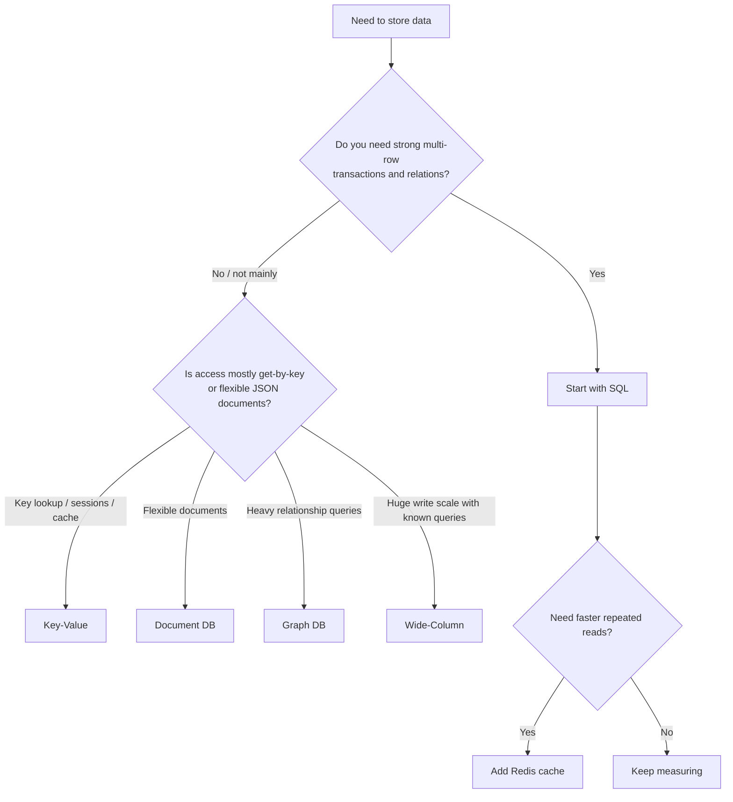

### Example system design sentence

> "We will store orders and payments in PostgreSQL for transactional safety, cache hot product pages in Redis, and store variable product content in MongoDB."

That one sentence already sounds like real system design thinking.

---

## 16. Common Mistakes Beginners Make

| Mistake | Why it hurts | Better thinking |
|---------|--------------|-----------------|
| "NoSQL is always more scalable, so always use it" | Wrong tool for transactional data | Choose by access pattern + consistency needs |
| "SQL cannot scale" | Outdated extreme view | SQL scales far with indexes, replicas, caching, careful sharding |
| Using MongoDB like random JSON dump | Data becomes messy | Still design models carefully |
| Joining everything in app with no plan | Slow and complex | Model data around queries |
| Ignoring indexes | Both SQL and NoSQL get slow | Index for real query paths |
| Choosing 5 databases on day 1 | Ops nightmare | Start with 1 primary DB + cache if needed |

---

## 17. Quick Recap

| Concept | One-line meaning |
|---------|------------------|
| Database | Organized durable data storage |
| SQL | Relational tables + powerful queries + strong transactions |
| NoSQL | Family of non-relational stores for different patterns |
| Document DB | JSON-like flexible records |
| Key-Value | Fast dictionary lookups |
| Wide-column | Massive scale, query-focused tables |
| Graph | Best for relationship-heavy data |
| ACID | Strong transactional guarantees |
| BASE | Availability first, eventual sync |
| Polyglot | Use different DBs for different jobs |

### Remember this sentence

> **Use SQL when relationships and correctness are central. Use NoSQL when data shape, scale, or access patterns need a specialized model. Many real systems use both.**

---

## 18. Practice Questions

1. You are building a payments service. SQL or NoSQL as source of truth? Why?
2. You need "friends of friends" suggestions for a social app. Which database type fits best?
3. Product attributes differ a lot by category (phone vs sofa vs book). Which store is attractive, and why?
4. Your SQL DB is healthy on writes but slow on repeated product reads. What do you add first?
5. What is one reason sharding is hard?
6. Give one example where embedding documents is good, and one where referencing IDs is better.
7. Explain ACID Atomicity with a UPI / bank transfer example in plain words.

Write answers in your own notes.