# CAP Theorem & Consistency

> **Who is this for?** Beginners learning system design.
>
> **What you will learn:** What CAP means, why distributed systems cannot have everything at once, what consistency really means, and how to choose trade-offs, with easy examples and diagrams.
>
> **Related:** [Databases (SQL vs NoSQL)](./03-databases-sql-vs-nosql.md) · [Caching](./02-caching.md)

---

## Table of Contents

1. [The Big Picture](#1-the-big-picture)
2. [Why This Topic Matters](#2-why-this-topic-matters)
3. [What is a Distributed System?](#3-what-is-a-distributed-system)
4. [C, A, and P Explained](#4-c-a-and-p-explained)
5. [The CAP Theorem (Simple Rule)](#5-the-cap-theorem-simple-rule)
6. [What is a Network Partition?](#6-what-is-a-network-partition)
7. [CP Systems](#7-cp-systems)
8. [AP Systems](#8-ap-systems)
9. [Why "CA" is Misleading](#9-why-ca-is-misleading)
10. [Consistency Models (Beyond CAP)](#10-consistency-models-beyond-cap)
11. [Strong Consistency](#11-strong-consistency)
12. [Eventual Consistency](#12-eventual-consistency)
13. [Other Useful Consistency Ideas](#13-other-useful-consistency-ideas)
14. [Consistency vs Availability (Real Choices)](#14-consistency-vs-availability-real-choices)
15. [Case Study: Instagram and Social Media](#15-case-study-instagram-and-social-media)
16. [PACELC (Quick Extra)](#16-pacelc-quick-extra)
17. [Putting It All Together](#17-putting-it-all-together)
18. [Common Mistakes Beginners Make](#18-common-mistakes-beginners-make)
19. [Quick Recap](#19-quick-recap)
20. [Practice Questions](#20-practice-questions)
---

## 1. The Big Picture

When your app runs on **one machine**, life is simple.

When your app runs on **many machines** (almost every large system), new problems appear:

- Machines can fail
- Network cables / Wi-Fi / links can break
- Copies of data can temporarily disagree

**CAP Theorem** helps you understand the hard choice systems face during network trouble:

> In a distributed system, when the network splits, you cannot fully have both perfect Consistency and perfect Availability at the same time.

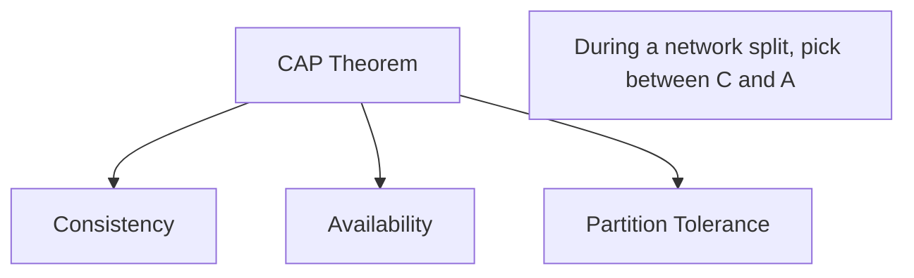

---

## 2. Why This Topic Matters

In system design interviews and real architecture, people ask:

- Can users always write/read even if some servers cannot talk?
- Can two users see different data for a short time?
- Is that acceptable for payments? For likes? For comments?

Your answer depends on the product.

| Feature | Usually prefer |
|---------|----------------|
| Bank balance / payments | Consistency |
| Instagram likes / views | Availability (small delay is okay) |
| Instagram login / password change | Stronger consistency |
| Shopping cart stock during huge sale | Depends on business rules |
| Messaging "sent" status | Often availability + eventual sync |

---

## 3. What is a Distributed System?

A **distributed system** is multiple computers working together as one system.

### Real-life example: Bank with many branches

- Branch in Pune
- Branch in Mumbai
- Branch in Delhi

All should show correct account data. But sometimes phone lines between branches fail.

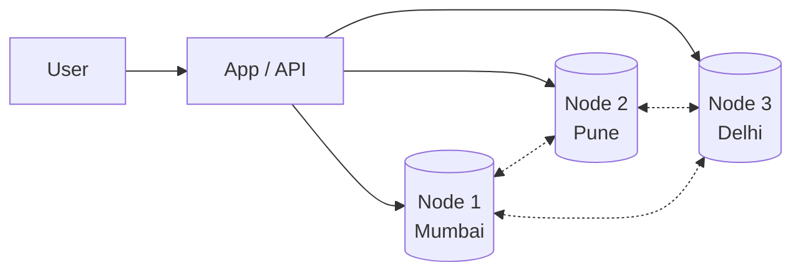

### Modern example: Instagram

Instagram is not one computer in one city. It is many services and data centers worldwide:

- Feed servers
- Media/CDN servers for photos and Reels
- Like / comment services
- Notification services
- Databases and caches in multiple regions

A user in India and a user in the USA may hit different nearby servers. Those servers must sync. That is a distributed system.

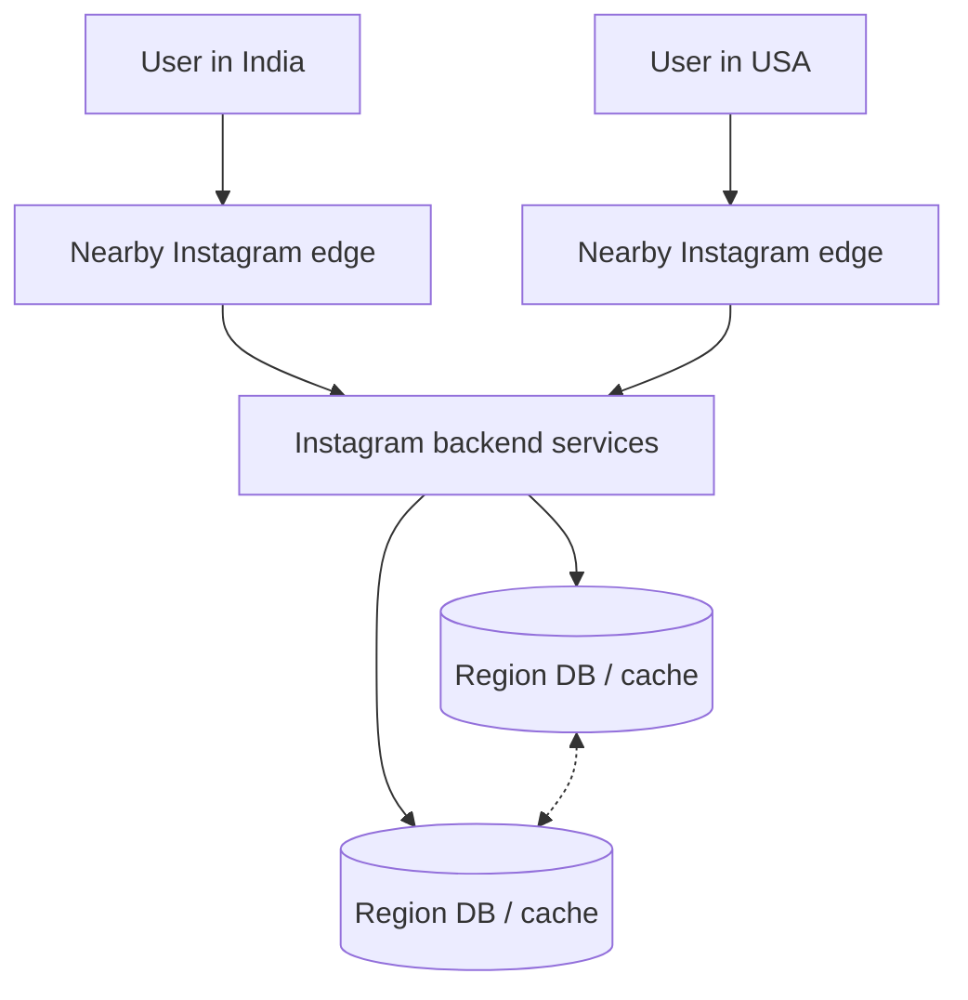

Once you have multiple nodes storing or serving data, CAP thinking becomes useful.
---

## 4. C, A, and P Explained

### C = Consistency

Every read gets the **latest successful write** (all nodes agree on the same up-to-date value from the client's point of view).

**Real life:**  
You update your address at one bank branch. At any other branch, staff should see the new address immediately (or the system should refuse to show stale data).

### A = Availability

Every request gets a **non-error response**, even if some nodes are down or disconnected.

**Real life:**  
Even if Mumbai branch cannot call Delhi, customers in Mumbai can still deposit/withdraw using local systems.

### P = Partition Tolerance

The system continues to work even when **network messages between nodes are lost or delayed** (network split).

**Real life:**  
The road between two cities is blocked. Each city office still exists, but they cannot sync for a while.

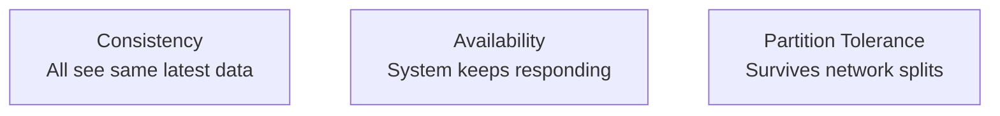

---

## 5. The CAP Theorem (Simple Rule)

**CAP Theorem says:**

In a distributed data system, you can aim for all three ideas, but **when a network partition happens**, you must choose:

- protect **Consistency** (CP), or
- protect **Availability** (AP)

You cannot fully keep both C and A during a partition.

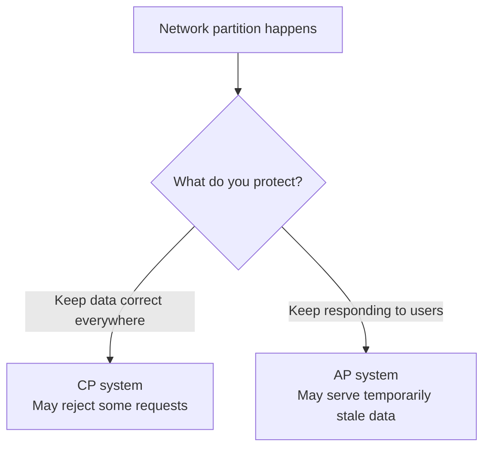

### Super short memory trick

| Letters | Meaning in failure |
|---------|--------------------|
| **CP** | "Correct data, even if some requests fail" |
| **AP** | "Keep serving, even if data may be briefly old" |
| **P** | Always assumed in real distributed networks |

---

## 6. What is a Network Partition?

A **partition** means nodes cannot reliably talk to each other.

Examples:

- Cable cut between data centers
- Switch failure
- Cloud region network issue
- Severe packet loss / timeout

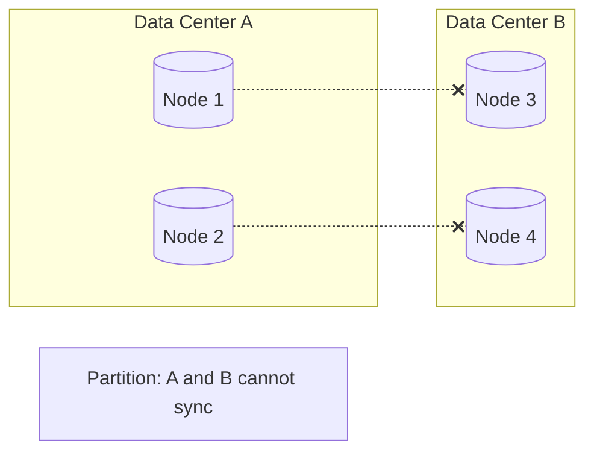

### Real-life example: Two WhatsApp groups with no internet

Class Group A and Class Group B lose connection.

- People in A keep chatting locally
- People in B keep chatting locally
- When internet returns, messages sync

During the split, both sides were "available", but not fully consistent with each other.

---

## 7. CP Systems

**CP** = Consistency + Partition Tolerance

During a partition, the system may **refuse requests** rather than risk wrong data.

### Real-life example: Locker with dual keys

A bank locker needs approval from two officers in two rooms. If the phone between rooms is dead, they **do not open the locker**. Safer, but service pauses.

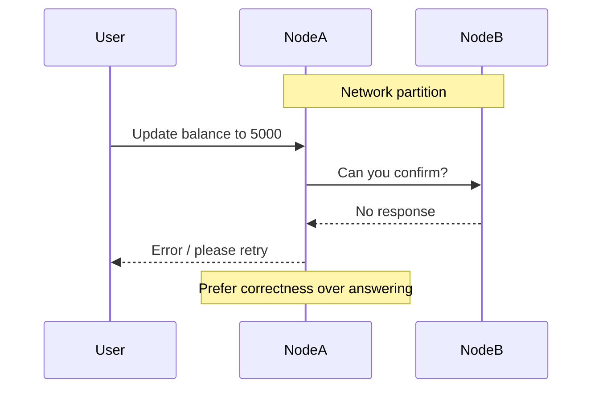

### Where CP style is useful

- Bank transfers
- Inventory reservation for limited stock
- Seat booking (one seat, many buyers)
- Leader election / config systems (example style: ZooKeeper/etcd discussions in interviews)

### Trade-off

Users may see errors or waits during network trouble. But data stays safer from conflicting writes.

---

## 8. AP Systems

**AP** = Availability + Partition Tolerance

During a partition, the system **keeps responding**. Different nodes may temporarily have different values, then sync later.

### Real-life example: Notebook copies in two shops

Two shop counters keep local sales notebooks. If the phone line dies, both still sell. Later they merge records. For a while, totals may disagree.

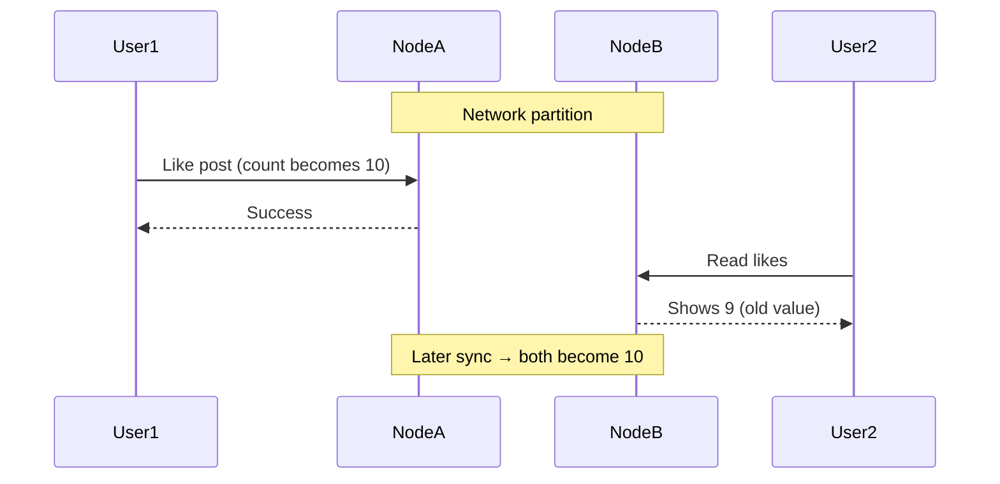

### Instagram-style example

You like a Reel. Your app shows liked instantly. A friend refreshing from another country may still see the old like count for a short time. Instagram stays usable worldwide. Counts catch up later.

### Where AP style is useful

- Instagram / social likes, views, share counts
- Home feed ranking freshness
- Product recommendations
- Activity feeds and stories views
- DNS-like systems (classic AP example in CAP talks)
- Many large-scale eventually consistent stores
### Trade-off

App stays up. But users may briefly see stale or conflicting data until sync finishes.
---

## 9. Why "CA" is Misleading

People draw CAP as a triangle and say systems pick CA, CP, or AP.

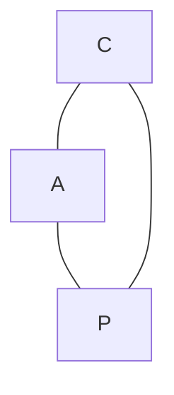

But in real distributed systems, **partitions can happen**. So assuming "CA forever" ignores reality.

Practical view used by engineers:

> When there is no partition, you can enjoy consistency and availability.  
> When partition happens, you are forced into CP or AP behavior.

So beginners should focus on **CP vs AP under failure**, not memorize a fake "CA database" label.

---

## 10. Consistency Models (Beyond CAP)

CAP "Consistency" is a specific distributed-systems meaning (linearizability-style idea in the original theorem discussion).

In practice, engineers also talk about **consistency models**: how fresh and ordered data looks to clients.

Think of consistency as a spectrum:

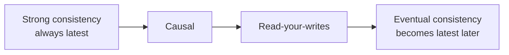

You choose based on product needs and cost.

---

## 11. Strong Consistency

After a write succeeds, **any next read** (from any client talking to the system correctly) sees that write.

### Real-life

You change your phone number in the official school portal. Any teacher opening your profile next should see the new number immediately.

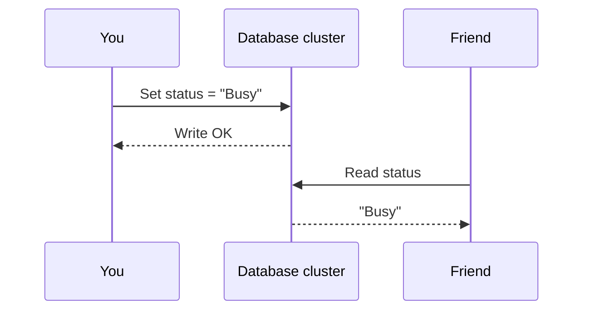

### Pros

- Easier to reason about
- Great for money, booking, critical inventory

### Cons

- Can be slower
- May reduce availability during failures
- Harder/more expensive at global scale

---

## 12. Eventual Consistency

If no new updates happen, **all replicas eventually agree** on the same value.

For some time, different reads can return old values.

### Real-life: Instagram bio / caption

You update your Instagram bio. Your phone shows the new bio instantly. A friend in another country may see the old bio for a few seconds, then it catches up.

Same idea for:

- like counts
- view counts on Reels
- follower counts (can lag a little)
- "people who liked this" lists during huge spikes

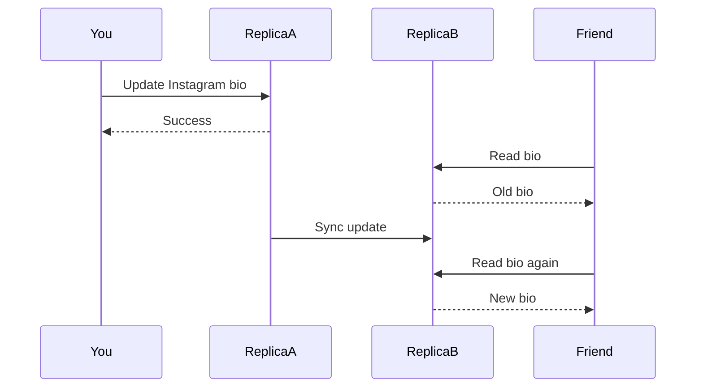

### Pros

- High availability
- Better for global low-latency reads/writes

### Cons

- App must handle stale reads
- Conflict resolution may be needed ("last write wins", merges, etc.)
---

## 13. Other Useful Consistency Ideas

These appear often in interviews. Keep them simple.

### Read-your-writes

You always see your own latest update, even if others might still see old data for a bit.

**Example:** After you change password, your next login flow sees the new state.

### Causal consistency

If action B happened because of action A, everyone sees A before B.

**Example:** You see a comment reply only after you can see the original comment.

### Session consistency

Within one login/session, behavior stays consistent for that user.

### Tunable consistency

Some databases (classic example: Cassandra-style discussions) let you choose consistency per operation:

- quick and loose for some reads
- stricter for important reads/writes

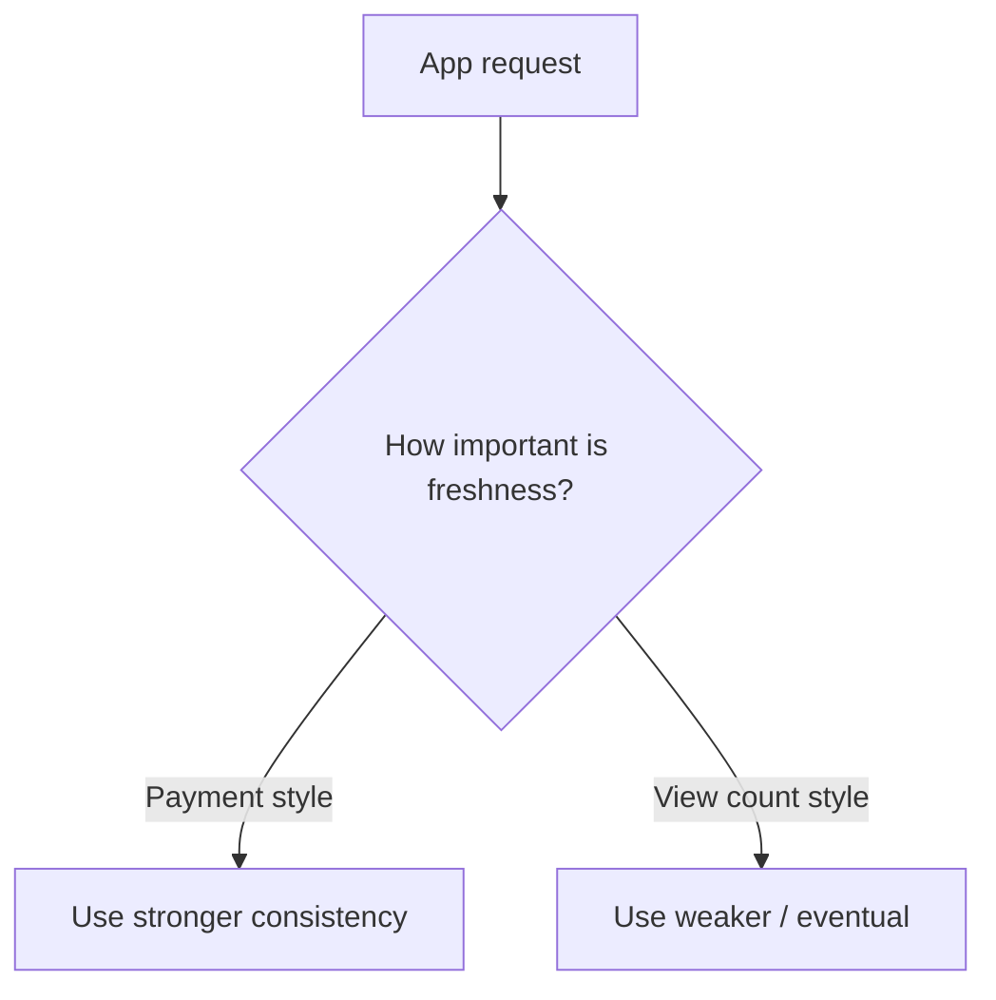

---

## 14. Consistency vs Availability (Real Choices)

Use business impact, not buzzwords.

| Scenario | Better default leaning | Why |
|----------|------------------------|-----|
| UPI / card debit | Consistency | Wrong balance is dangerous |
| Book last concert seat | Consistency | Double booking is bad |
| Instagram like / Reel view count | Availability / eventual | Being off briefly is okay |
| Instagram home feed | Availability / eventual | Fresh enough is fine |
| Instagram password / login session | Stronger consistency | Security cannot be fuzzy |
| Profile edit then refresh | Read-your-writes | User expects to see own change |
| Global product catalog read | Often eventual + cache | Speed and scale matter |

### Decision question checklist

1. What happens if user sees old data for 5 seconds?
2. What happens if system returns error for 5 seconds?
3. Can two writes conflict? How do we resolve?
4. Is this money, identity, inventory, or just engagement metrics?

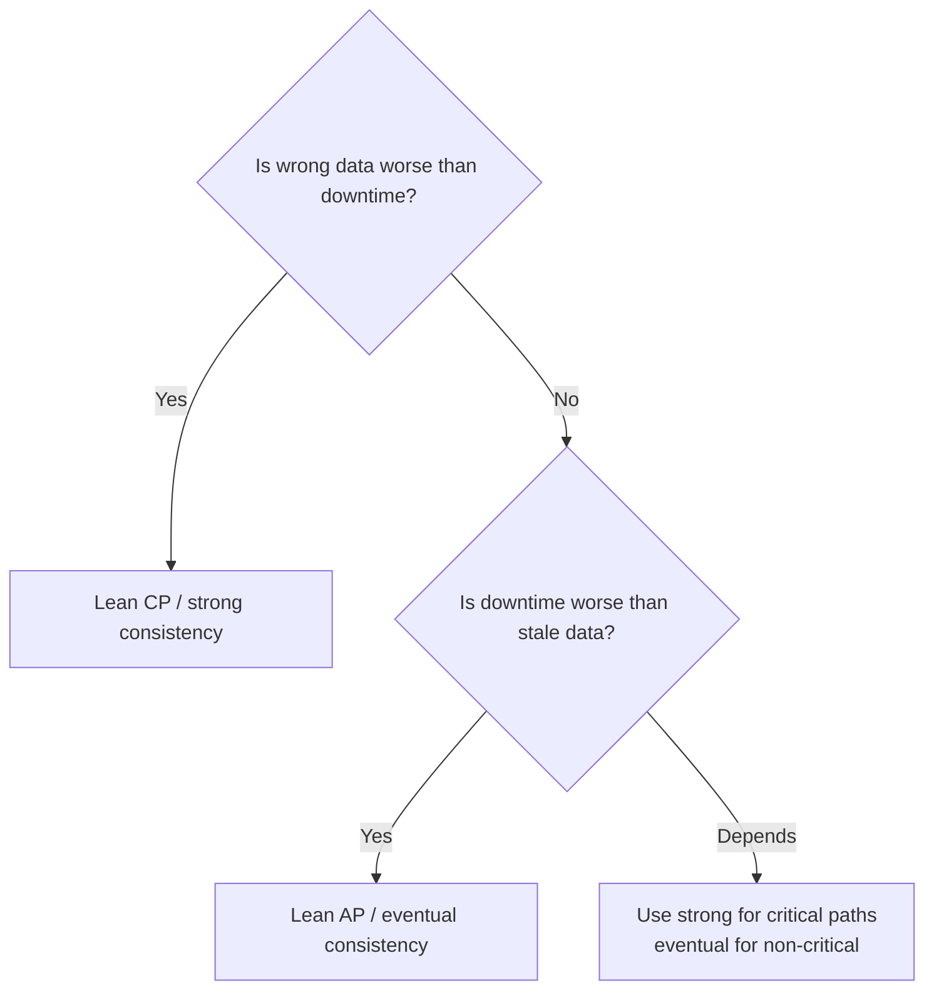

---

## 15. Case Study: Instagram and Social Media

Instagram, TikTok, X, YouTube Shorts all run as global distributed systems. They do **not** use one consistency mode for everything.

### What usually leans AP / eventual

| Feature | Why eventual is okay |
|---------|----------------------|
| Like count | Off by a few for a short time is fine |
| Reel / post views | Huge write volume; freshness can lag |
| Home feed order | "Good enough recent posts" beats perfect global lock |
| Follower count | Can update a bit late |
| Explore / recommendations | Optimized for speed and relevance |

### What usually needs stronger guarantees

| Feature | Why stronger matters |
|---------|----------------------|
| Login / logout / password reset | Security |
| Account ban / private account rules | Privacy and trust |
| Direct message send receipt inside your session | User expects their own action to stick |
| Payments / ads billing (business side) | Money |

### Instagram story in one diagram

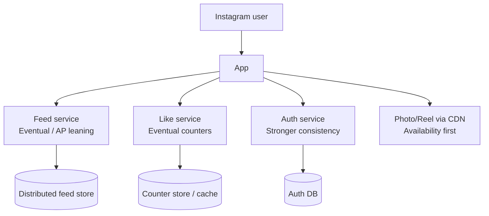

### Social media CAP lesson

> Social apps often choose **availability and low latency** for engagement features, and **stronger consistency** for identity, privacy, and money.

If likes were strongly consistent across every data center on every tap, the app would feel slower and fail more during network issues. Users would hate that more than a count being briefly wrong.

---

## 16. PACELC (Quick Extra)

CAP talks about behavior during Partition.

**PACELC** adds: even when the system is normal (no partition), there is still a trade-off between **Latency** and **Consistency**.

```text
If Partition → choose A or C
Else → choose Latency or Consistency
```

### Easy meaning

To make data strongly consistent across far-away regions, requests may get slower.  
To make responses very fast globally, you may allow temporary inconsistency.

**Real life:**  
Calling every relative before answering a question gives a more correct family answer, but you respond slowly.

**Instagram example:**  
Making every Reel view count strongly consistent worldwide would add latency. Social apps usually accept slightly delayed counts for speed.

---

## 17. Putting It All Together

### A practical architecture sentence

> "Payments and login are strongly consistent. Feeds, likes, and view counters are eventually consistent for availability and speed."
That is real system design maturity.

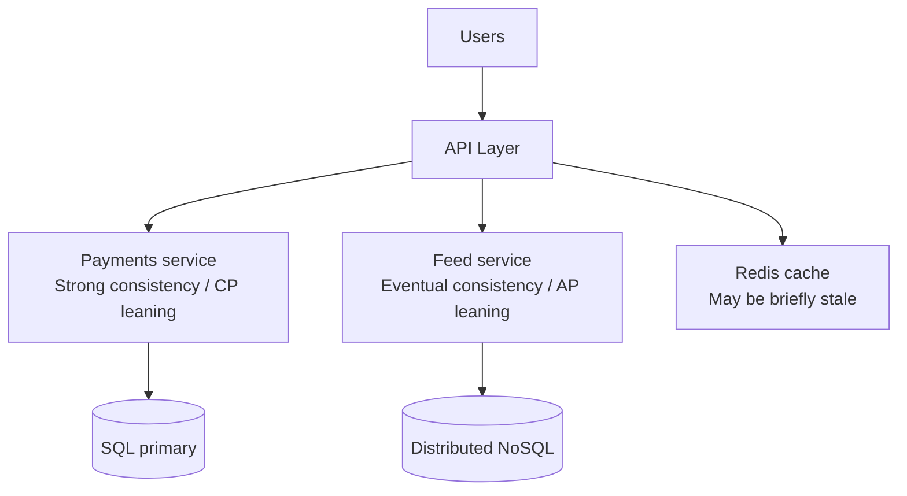

### How this connects to previous chapters

| Topic | Connection |
|-------|------------|
| SQL vs NoSQL | Many SQL setups lean stronger consistency; many distributed NoSQL setups offer eventual/tunable modes |
| Caching | Cache can return stale data by design |
| Redis replicas | Reading from replica can be slightly behind primary |
| Load balancing across regions | Cross-region sync delay affects freshness |
| CDN | Keeps media available near users |

---

## 18. Common Mistakes Beginners Make

| Mistake | Better understanding |
|---------|----------------------|
| "NoSQL means no consistency" | False. Consistency depends on database + settings + design |
| "CAP means pick only 2 forever" | Focus on trade-off during partitions |
| Calling every system CA/CP/AP as a permanent tattoo | Real systems are nuanced |
| Using eventual consistency for money movement | Dangerous without strong controls |
| Forcing strong consistency for every Instagram like/view | Unnecessary cost and fragility |
| Ignoring conflict handling | In AP systems, plan merges / last-write-wins / versioning |

---

## 19. Quick Recap

| Term | One-line meaning |
|------|------------------|
| Distributed system | Multiple machines working together |
| Consistency (C) | Clients see correct latest data |
| Availability (A) | System keeps responding |
| Partition tolerance (P) | Survives network splits |
| CAP | During partition, choose C or A |
| CP | Prefer correctness, may error |
| AP | Prefer uptime, may be briefly stale |
| Strong consistency | Reads see latest write |
| Eventual consistency | Replicas converge later |
| PACELC | Even without partition: latency vs consistency |

### Remember this sentence

> **When networks break, distributed systems must choose between staying fully correct and staying fully responsive. Pick that trade-off based on user harm, not hype.**

### Remember with modern examples

> **Instagram likes can be late. Instagram login should not be wrong.**
---

## 20. Practice Questions

1. Explain CAP using a two-branch shop notebook example.
2. For a wallet app balance, would you lean CP or AP? Why?
3. For an Instagram Reel view counter, what consistency is usually enough?
4. Why might Instagram use stronger consistency for password reset than for follower count?
5. What is a network partition in plain words?
6. Why is "CA system" a confusing label for beginners?
7. Give one read-your-writes example from Instagram (example: edit profile then refresh).
8. How can Redis caching cause temporary inconsistency even if DB is strongly consistent?
9. Using PACELC, why can forcing strong consistency for every social counter make the app feel slow worldwide?

Write answers in your own words.
