# Message Queues

> **Who is this for?** Beginners learning system design.
>
> **What you will learn:** What a message queue is, why systems need it, how producers/consumers work, delivery ideas, common patterns, and when to use queues, with easy examples and diagrams.
>
> **Related:** [Scalability & Load Balancing](./01-scalability-and-load-balancing.md) · [Caching](./02-caching.md) · [CAP Theorem & Consistency](./04-cap-theorem-and-consistency.md)

---

## Table of Contents

- [Message Queues](#message-queues)
  - [Table of Contents](#table-of-contents)
  - [1. The Big Picture](#1-the-big-picture)
  - [2. What is a Message Queue?](#2-what-is-a-message-queue)
    - [Simple definition](#simple-definition)
    - [Real-life analogies](#real-life-analogies)
  - [3. Why Do We Need Message Queues?](#3-why-do-we-need-message-queues)
    - [Main benefits](#main-benefits)
  - [4. Core Parts: Producer, Queue, Consumer](#4-core-parts-producer-queue-consumer)
    - [Message](#message)
  - [5. Sync vs Async (Very Important)](#5-sync-vs-async-very-important)
    - [Synchronous (direct call)](#synchronous-direct-call)
    - [Asynchronous (with queue)](#asynchronous-with-queue)
  - [6. How a Queue Works Step by Step](#6-how-a-queue-works-step-by-step)
  - [7. Real-life Examples](#7-real-life-examples)
    - [Example 1: Signup flow](#example-1-signup-flow)
    - [Example 2: Food delivery app](#example-2-food-delivery-app)
    - [Example 3: Instagram-style uploads](#example-3-instagram-style-uploads)
    - [Example 4: E-commerce checkout](#example-4-e-commerce-checkout)
  - [8. Common Queue Patterns](#8-common-queue-patterns)
    - [8.1 Competing consumers (work queue)](#81-competing-consumers-work-queue)
    - [8.2 Pub/Sub (fanout)](#82-pubsub-fanout)
    - [8.3 Delayed / scheduled messages](#83-delayed--scheduled-messages)
    - [8.4 Priority queue](#84-priority-queue)
  - [9. Delivery Guarantees](#9-delivery-guarantees)
    - [Beginner truth](#beginner-truth)
  - [10. Idempotency (Handle Duplicates Safely)](#10-idempotency-handle-duplicates-safely)
    - [Bad example](#bad-example)
    - [Better example](#better-example)
  - [11. Retry, Dead Letter Queue, and Backoff](#11-retry-dead-letter-queue-and-backoff)
    - [Retry](#retry)
    - [Backoff](#backoff)
    - [Dead Letter Queue (DLQ)](#dead-letter-queue-dlq)
  - [12. Ordering and Partitioning](#12-ordering-and-partitioning)
    - [Do you need order?](#do-you-need-order)
    - [Simple idea](#simple-idea)
  - [13. Push vs Pull Consumers](#13-push-vs-pull-consumers)
  - [14. Message Queues vs Pub/Sub vs Event Streaming](#14-message-queues-vs-pubsub-vs-event-streaming)
  - [15. Popular Tools (Quick Map)](#15-popular-tools-quick-map)
  - [16. When to Use a Message Queue](#16-when-to-use-a-message-queue)
    - [Good fits](#good-fits)
  - [17. When Not to Use a Message Queue](#17-when-not-to-use-a-message-queue)
    - [Bad fit example](#bad-fit-example)
  - [18. Putting It All Together](#18-putting-it-all-together)
    - [Example story: Place Order](#example-story-place-order)
    - [System design sentence you can use](#system-design-sentence-you-can-use)
  - [19. Common Mistakes Beginners Make](#19-common-mistakes-beginners-make)
  - [20. Quick Recap](#20-quick-recap)
    - [Remember this sentence](#remember-this-sentence)
  - [21. Practice Questions](#21-practice-questions)

---

## 1. The Big Picture

Imagine a busy restaurant.

- Waiter takes orders very fast
- Kitchen cooks at its own speed
- If waiters shout every order directly into the kitchen with no system, chaos starts

A better system:

1. Waiter writes order ticket
2. Ticket goes on a rail / queue
3. Chefs pick next ticket when free

That ticket rail is like a **message queue**.

In software:

- One service can accept work quickly
- Another service processes work later, at its own pace
- They do not need to be free at the exact same second

```text
User action → API accepts request → Queue stores job → Workers process job
```

---

## 2. What is a Message Queue?

A **message queue** is a buffer that stores messages (jobs/events) so one part of the system can send work, and another part can process it later.

### Simple definition

> Queue = temporary holding line for work between services.

### Real-life analogies

| Real life | Software |
|-----------|----------|
| Restaurant order tickets | Jobs in a queue |
| Post office parcel sorting belt | Messages moving to workers |
| WhatsApp "sending" then delivered later | Async delivery |
| Printer spooler | Print jobs waiting |

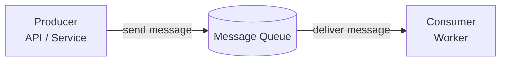

---

## 3. Why Do We Need Message Queues?

Without a queue, services often call each other directly:

```text
API → Email service → SMS service → Image service → Database
```

If any one is slow or down, the user waits or the whole request fails.

With a queue:

```text
API → Queue → (email worker, sms worker, image worker)
```

### Main benefits

| Benefit | Easy meaning |
|---------|--------------|
| Decoupling | Services do not depend on each other being online at the same moment |
| Smooth traffic spikes | Queue absorbs sudden load |
| Better user response time | API can reply fast after accepting work |
| Retries | Failed jobs can be tried again |
| Scale workers independently | Add more consumers when backlog grows |

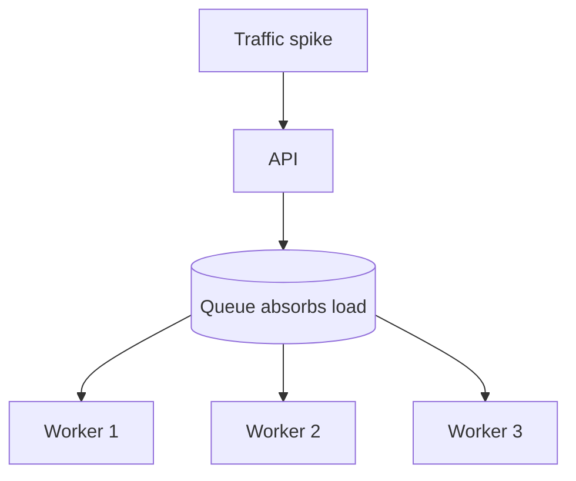

---

## 4. Core Parts: Producer, Queue, Consumer

| Part | Role | Real-life |
|------|------|-----------|
| **Producer** | Creates and sends messages | Waiter writing tickets |
| **Queue** | Stores messages temporarily | Ticket rail |
| **Consumer / Worker** | Reads and processes messages | Chef cooking orders |

### Message

A message is usually a small package of data, for example:

```json
{
  "type": "SEND_WELCOME_EMAIL",
  "userId": 42,
  "email": "asha@mail.com"
}
```

Keep messages small and clear. Large files usually go to object storage; queue gets a pointer/URL.

---

## 5. Sync vs Async (Very Important)

### Synchronous (direct call)

User waits until everything finishes.

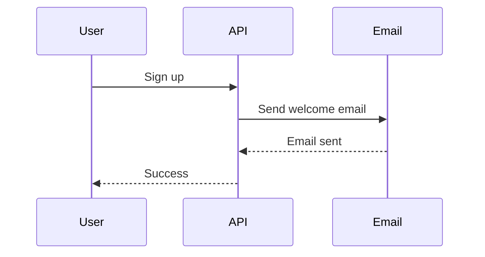

If email is slow, user waits.

### Asynchronous (with queue)

API accepts work, responds fast, email happens later.

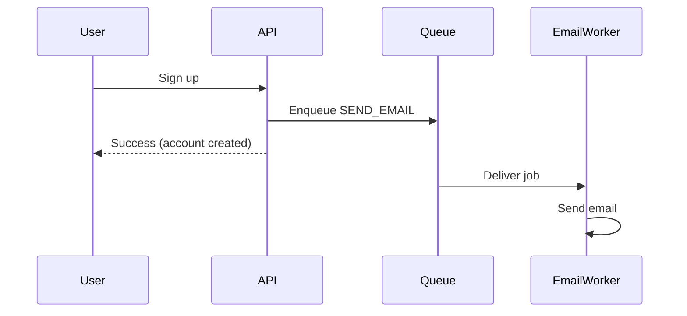

**System design rule:**  
If the user does not need the result immediately, prefer async + queue.

---

## 6. How a Queue Works Step by Step

1. Producer sends a message to the queue
2. Queue stores it safely (in memory/disk depending on tool)
3. Consumer takes the next message
4. Consumer processes it
5. Consumer acknowledges success (ACK)
6. Queue removes/marks message as done
7. If processing fails, message can be retried

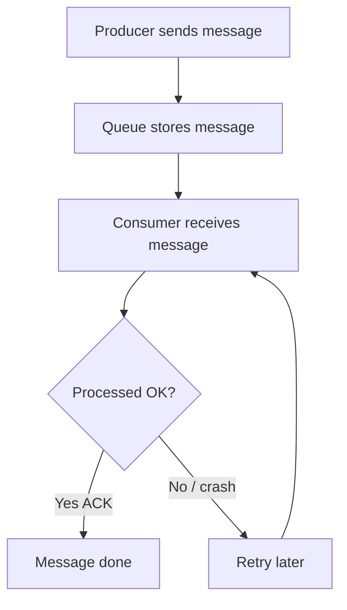

---

## 7. Real-life Examples

### Example 1: Signup flow

After signup you may need:

- save user in DB (must happen now)
- send welcome email (can happen soon)
- generate profile thumbnail (can happen later)
- notify analytics (can happen later)

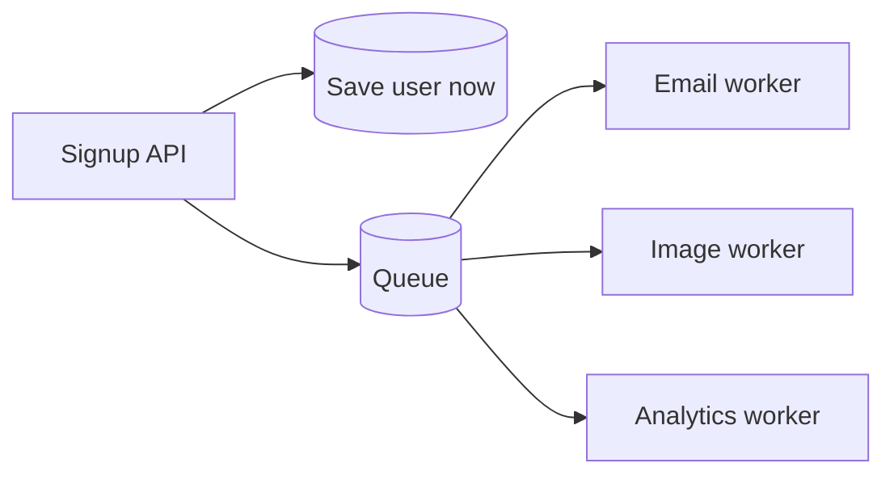

### Example 2: Food delivery app

- Place order → must be saved quickly
- Notify restaurant
- Assign delivery partner
- Send SMS updates

Order creation stays fast. Side tasks go through queues.

### Example 3: Instagram-style uploads

- User uploads photo
- API stores original file
- Queue jobs: resize, thumbnail, virus scan, feed fanout

User sees "upload accepted" quickly. Heavy processing continues in background.

### Example 4: E-commerce checkout

- Payment success recorded
- Queue: inventory update, invoice PDF, email receipt, loyalty points

---

## 8. Common Queue Patterns

### 8.1 Competing consumers (work queue)

Many workers share one queue. Each message is processed by **one** worker.

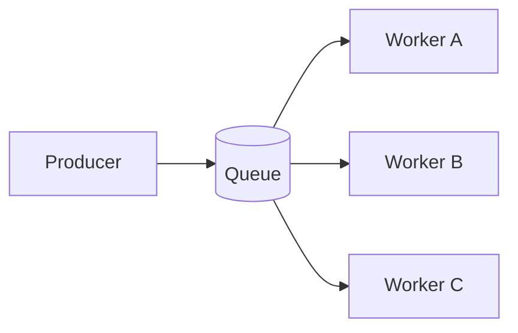

**Best for:** background jobs (emails, image resize, webhooks)

### 8.2 Pub/Sub (fanout)

One message is delivered to **many** subscribers.

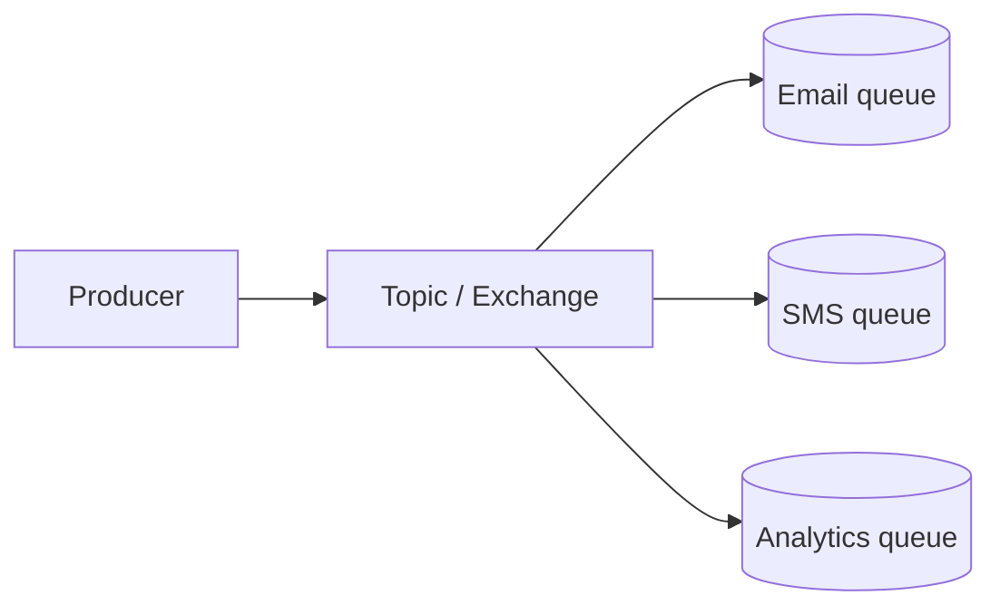

**Best for:** "order placed" event that many services need to know

### 8.3 Delayed / scheduled messages

Process message after some time.

**Examples:**

- reminder after 30 minutes
- retry payment callback later
- delete unpaid cart overnight

### 8.4 Priority queue

VIP / urgent messages jump ahead.

**Example:** password reset email before newsletter email.

---

## 9. Delivery Guarantees

Queues talk about how surely a message is delivered.

| Guarantee | Meaning | Easy view |
|-----------|---------|-----------|
| At-most-once | May lose message, no duplicates | Fast but risky |
| At-least-once | Message may come more than once, but not lost easily | Most common |
| Exactly-once | Processed once end-to-end | Hardest / expensive |

### Beginner truth

Most real systems aim for **at-least-once** and make consumers **idempotent** (safe if message repeats).

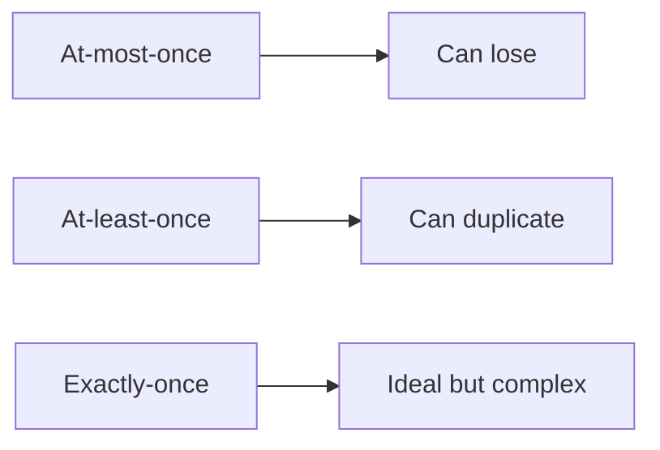

---

## 10. Idempotency (Handle Duplicates Safely)

**Idempotent consumer** = processing the same message 2 times does not break data.

### Bad example

```text
Message: add 100 loyalty points
Processed twice → user gets 200 points by mistake
```

### Better example

```text
Message id: evt_9981
Check: if evt_9981 already processed → skip
Else: add points and mark evt_9981 done
```

**Real life:**  
If a waiter accidentally hands the same order ticket twice, kitchen should notice ticket number already cooked.

---

## 11. Retry, Dead Letter Queue, and Backoff

### Retry

If worker fails (email API down), message can return to queue and try again.

### Backoff

Do not retry instantly in a tight loop.

```text
Retry 1 after 10s
Retry 2 after 30s
Retry 3 after 2 min
```

### Dead Letter Queue (DLQ)

After many failures, move message to a special "failed jobs" queue for inspection.

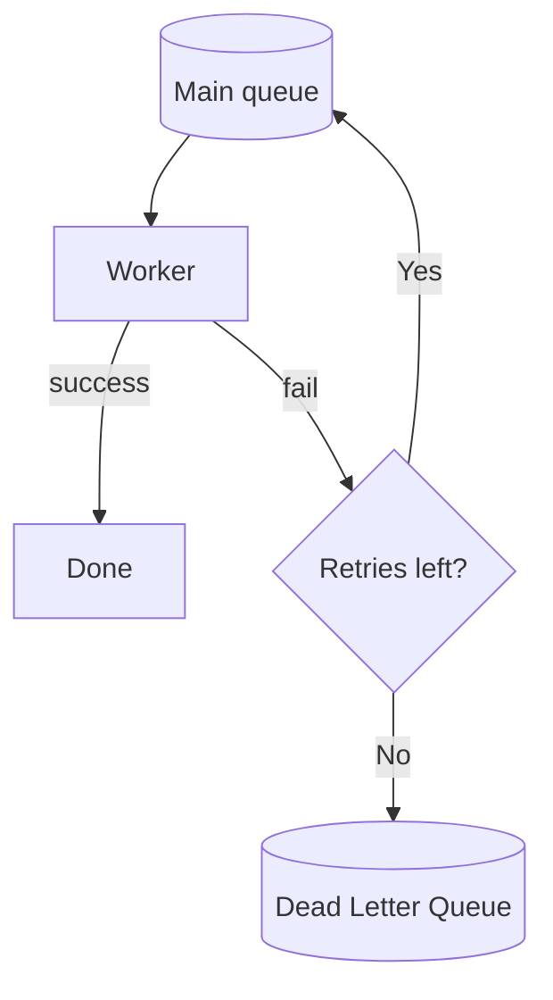

**Real life:** Damaged parcels go to a special desk, not endlessly around the conveyor.

---

## 12. Ordering and Partitioning

### Do you need order?

Sometimes yes:

- update profile then delete profile should stay in order for same user

Sometimes no:

- sending independent emails can be any order

### Simple idea

- Global strict order for all messages = hard and slow
- Order **per key** (example: per `userId` / `orderId`) is the usual practical target

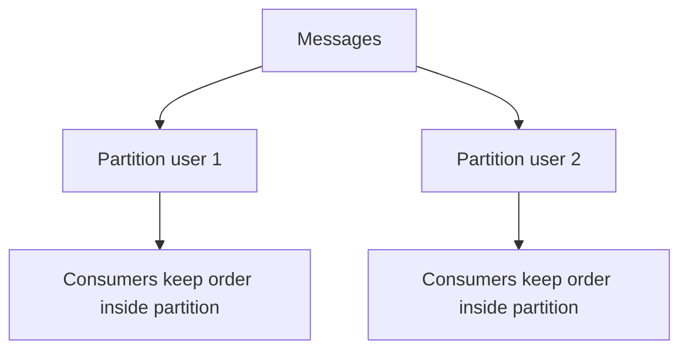

---

## 13. Push vs Pull Consumers

| Style | Meaning | Example feeling |
|-------|---------|-----------------|
| Pull | Worker asks queue for next message | Chef picks next ticket |
| Push | Queue/system pushes message to worker | Manager hands ticket to chef |

Both exist depending on tool. For learning, remember:

> Consumers process messages from a queue somehow; scale by adding more consumers when backlog grows.

---

## 14. Message Queues vs Pub/Sub vs Event Streaming

These terms overlap in conversation, so keep them practical.

| Idea | Focus | Typical use |
|------|-------|-------------|
| Message queue / work queue | Each job done by one worker | Emails, thumbnails, webhooks |
| Pub/Sub | One event, many subscribers | OrderPlaced notifies many services |
| Event streaming (Kafka-style) | Durable log of events, replay possible | Event history, stream processing |

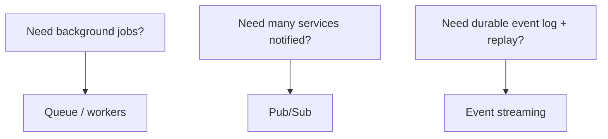

You will learn Kafka deeply later in Technologies. Here, understand the concept first.

---

## 15. Popular Tools (Quick Map)

| Tool | Beginner view |
|------|----------------|
| RabbitMQ | Classic message broker, queues + routing |
| Amazon SQS | Managed queue service |
| Redis Lists / Streams | Lightweight queue-like patterns |
| Apache Kafka | Event streaming platform (log-based) |
| Google Pub/Sub | Managed pub/sub |
| Bull / BullMQ (app-level) | Job queues often used with Redis in Node apps |

Pick based on need:

- simple jobs → queue tools
- massive event log / replay → Kafka-style systems

---

## 16. When to Use a Message Queue

Use a queue when:

1. Work can finish after the API response
2. Traffic spikes would overload a downstream service
3. You need retries for flaky external APIs
4. Multiple independent side effects follow one action
5. You want to scale producers and consumers separately

### Good fits

- emails / SMS / push notifications
- image/video processing
- invoice generation
- webhook delivery
- search index updates
- fanout of domain events

---

## 17. When Not to Use a Message Queue

Avoid queues when:

1. User needs the exact result immediately in the same request
2. Flow is still tiny and direct call is clear enough
3. You do not yet have monitoring/retry discipline (queues add complexity)
4. You only need a cache (that is Redis cache, not a queue)

### Bad fit example

User asks "what is my current wallet balance?"  
That should be a direct read, not a queue round trip.

---

## 18. Putting It All Together

A practical beginner architecture:

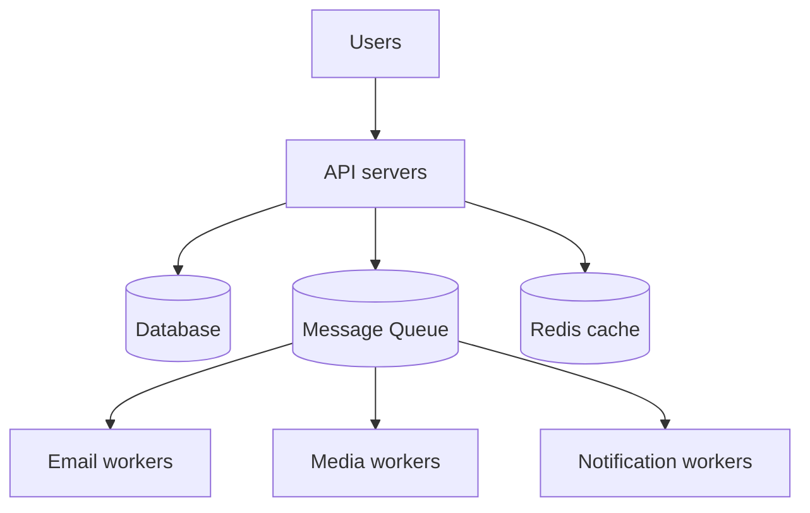

### Example story: Place Order

1. API validates cart and creates order in DB
2. API enqueues `ORDER_PLACED`
3. API returns success to user quickly
4. Workers:
   - email receipt
   - notify restaurant
   - update analytics
5. Failures retry; poison messages go to DLQ

### System design sentence you can use

> "We keep the request path thin: write critical state to the database, push side effects to a queue, and scale workers independently with retries and dead-letter handling."

---

## 19. Common Mistakes Beginners Make

| Mistake | Why it hurts | Better thinking |
|---------|--------------|-----------------|
| Putting huge files inside messages | Queue bloat / slow | Store file in object storage, send URL |
| No idempotency | Duplicate side effects | Use message IDs / processed flags |
| Infinite instant retries | Melts downstream APIs | Backoff + DLQ |
| Assuming exact once always | False safety | Design for at-least-once |
| Using queue for strongly immediate reads | Extra delay/complexity | Direct query |
| No monitoring of lag | Backlog silently grows | Watch queue depth / age |
| One giant consumer forever | Cannot scale | Competing consumers |

---

## 20. Quick Recap

| Term | One-line meaning |
|------|------------------|
| Message queue | Buffer for async work between services |
| Producer | Sends messages |
| Consumer | Processes messages |
| Async | Do work later, respond now |
| At-least-once | May retry/duplicate, rarely lose |
| Idempotency | Safe if message is processed twice |
| DLQ | Quarantine for repeatedly failed messages |
| Competing consumers | Many workers share jobs |
| Pub/Sub | One event to many subscribers |

### Remember this sentence

> **Message queues let one part of the system accept work quickly while other parts process it safely later, with retries and independent scaling.**

---

## 21. Practice Questions

1. Explain a message queue using a restaurant ticket rail.
2. Why can signup email be async, but saving the user usually not?
3. What is the difference between competing consumers and pub/sub?
4. What does at-least-once delivery mean for an email worker?
5. How does idempotency protect loyalty points from double credit?
6. What is a Dead Letter Queue for?
7. Give one case where a queue is a bad idea.
8. Why should large videos not be placed directly inside queue messages?

Write answers in your own words.
