# CDN & Content Delivery

> **Who is this for?** Beginners learning system design.
>
> **What you will learn:** What a CDN is, why websites use it, how edge caching works, cache hit/miss, static vs dynamic content, invalidation, and when CDN helps, with easy examples and diagrams.
>
> **Related:** [Caching](./02-caching.md) · [Scalability & Load Balancing](./01-scalability-and-load-balancing.md)

---

## Table of Contents

- [CDN \& Content Delivery](#cdn--content-delivery)
  - [Table of Contents](#table-of-contents)
  - [1. The Big Picture](#1-the-big-picture)
  - [2. What is a CDN?](#2-what-is-a-cdn)
    - [Real-life analogy](#real-life-analogy)
  - [3. Why Do We Need a CDN?](#3-why-do-we-need-a-cdn)
    - [Biggest beginner benefit](#biggest-beginner-benefit)
  - [4. Origin vs Edge](#4-origin-vs-edge)
    - [Important](#important)
  - [5. How a CDN Works Step by Step](#5-how-a-cdn-works-step-by-step)
  - [6. Cache Hit vs Cache Miss (CDN view)](#6-cache-hit-vs-cache-miss-cdn-view)
  - [7. What Content Should Go on a CDN?](#7-what-content-should-go-on-a-cdn)
    - [Great CDN candidates](#great-cdn-candidates)
    - [Be careful caching](#be-careful-caching)
  - [8. Static vs Dynamic Content](#8-static-vs-dynamic-content)
    - [Static content](#static-content)
    - [Dynamic content](#dynamic-content)
    - [Beginner rule](#beginner-rule)
  - [9. POP / Edge Locations](#9-pop--edge-locations)
    - [Real-life](#real-life)
  - [10. TTL and Cache Headers](#10-ttl-and-cache-headers)
    - [TTL](#ttl)
    - [Common headers (beginner view)](#common-headers-beginner-view)
    - [Versioned files trick](#versioned-files-trick)
  - [11. Cache Invalidation / Purging](#11-cache-invalidation--purging)
    - [Real-life](#real-life-1)
    - [Practical tip](#practical-tip)
  - [12. CDN + DNS (Simple View)](#12-cdn--dns-simple-view)
  - [13. Push CDN vs Pull CDN](#13-push-cdn-vs-pull-cdn)
    - [Pull CDN (most common)](#pull-cdn-most-common)
    - [Push CDN](#push-cdn)
  - [14. HTTPS, Security, and Extra CDN Benefits](#14-https-security-and-extra-cdn-benefits)
  - [15. CDN vs Redis Cache](#15-cdn-vs-redis-cache)
  - [16. Real-life Examples](#16-real-life-examples)
    - [Example 1: Instagram / social images](#example-1-instagram--social-images)
    - [Example 2: Ecommerce product pages](#example-2-ecommerce-product-pages)
    - [Example 3: Course platform](#example-3-course-platform)
    - [Example 4: Software / game downloads](#example-4-software--game-downloads)
  - [17. Putting It All Together](#17-putting-it-all-together)
    - [Request split](#request-split)
    - [System design sentence](#system-design-sentence)
  - [18. Common Mistakes Beginners Make](#18-common-mistakes-beginners-make)
  - [19. Quick Recap](#19-quick-recap)
    - [Remember this sentence](#remember-this-sentence)
  - [20. Practice Questions](#20-practice-questions)

---

## 1. The Big Picture

Imagine your app servers are in **Mumbai**, but users open your site from:

- Delhi
- Dubai
- London
- New York

If every image, JS file, and video comes all the way from Mumbai every time:

- pages feel slow
- your origin server gets overloaded
- international users suffer most

A **CDN** keeps copies of popular files closer to users around the world.

```text
Without CDN:  User (London) -----------------> Origin (Mumbai)
With CDN:     User (London) --> Nearby Edge --> (only if needed) Origin
```

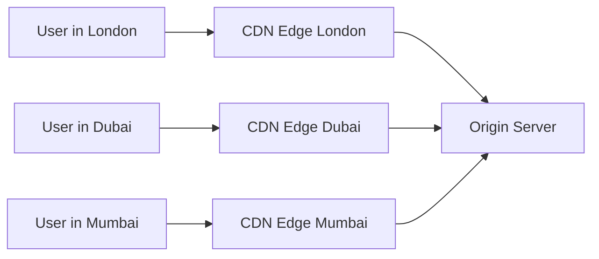

---

## 2. What is a CDN?

**CDN** means **Content Delivery Network**.

In simple words:

> A CDN is a network of servers around the world that cache and deliver your content from a location near the user.

### Real-life analogy

Think of a CDN like **local city stores** for a national brand:

- Main warehouse = Origin
- City stores = Edge servers
- Popular products are stocked locally
- Rare items may still come from the warehouse

Customers get products faster because they do not always wait for warehouse shipping.

---

## 3. Why Do We Need a CDN?

| Problem without CDN | How CDN helps |
|---------------------|---------------|
| High latency for far users | Serve from nearby edge |
| Origin overloaded by repeated file downloads | Edges absorb traffic |
| Slow images/videos | Cached closer to users |
| Traffic spikes on launch day | Global distribution of load |
| Poor mobile experience on slow networks | Smaller distance + caching helps |

### Biggest beginner benefit

CDN makes websites feel faster globally and protects your main servers from repetitive static traffic.

---

## 4. Origin vs Edge

| Term | Meaning | Analogy |
|------|---------|---------|
| **Origin** | Your source server / storage (where original content lives) | Main warehouse |
| **Edge / POP** | CDN server near users | Local city store |

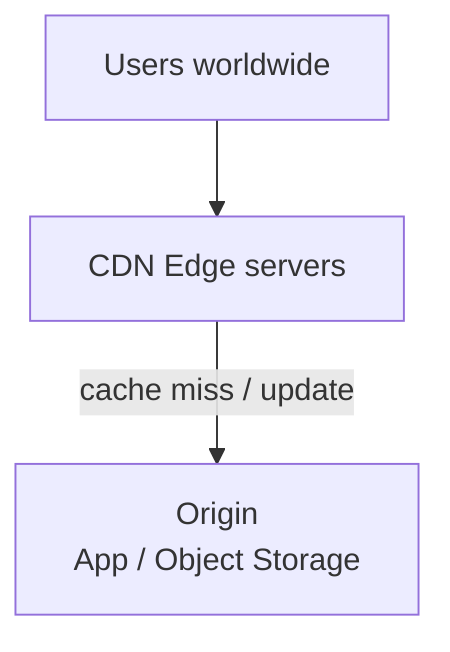

### Important

CDN does not replace your whole backend.  
It usually accelerates delivery of files and sometimes cached pages, while your APIs/databases still handle dynamic business logic.

---

## 5. How a CDN Works Step by Step

1. User asks for a file (example: `hero.jpg`)
2. DNS/CDN routing sends user to a nearby edge
3. Edge checks: "Do I already have this file cached?"
4. If yes → return it immediately (**HIT**)
5. If no → fetch from origin, store at edge, then return (**MISS**)
6. Next nearby users can get it faster

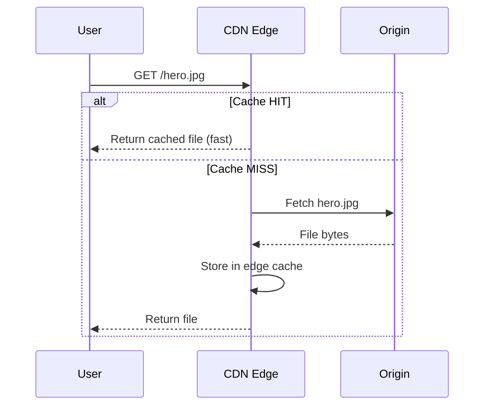

---

## 6. Cache Hit vs Cache Miss (CDN view)

| Term | Meaning | User feeling |
|------|---------|--------------|
| **Cache Hit** | Edge already has content | Fast |
| **Cache Miss** | Edge must fetch from origin | Slower first time |
| **Hit Ratio** | Hits / total requests | Higher is usually better for static content |

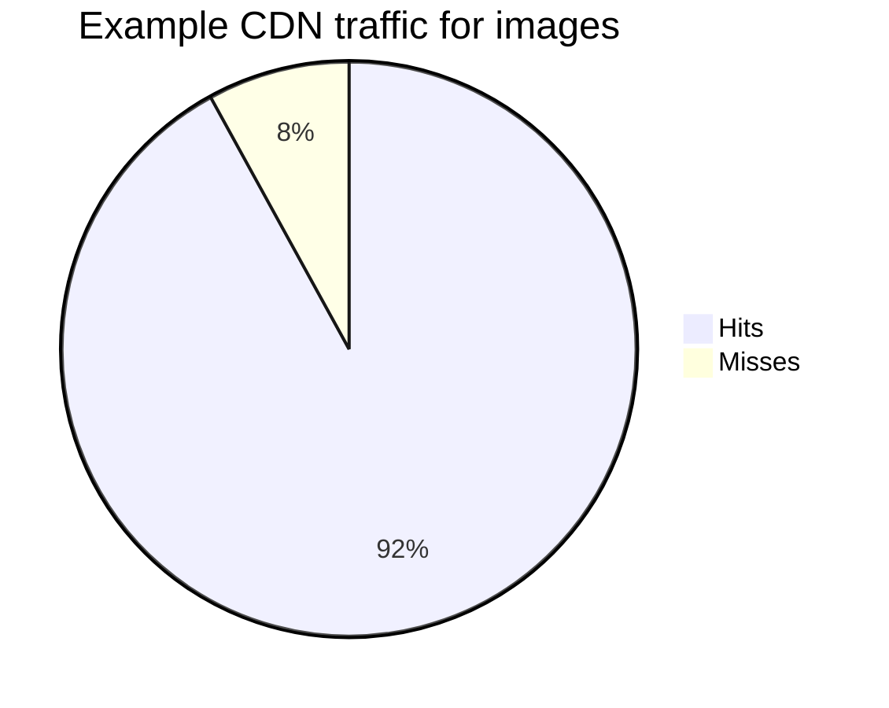

First user in a region may pay the miss cost. Later users benefit.

---

## 7. What Content Should Go on a CDN?

### Great CDN candidates

| Content | Why |
|---------|-----|
| Images | Requested often, change less |
| Videos / streaming segments | Large and bandwidth heavy |
| JS / CSS | Needed for every page load |
| Fonts | Repeated static downloads |
| Downloadable files | Installers, PDFs, game packs |
| Static HTML/landing pages | Can be cached if not personalized |

### Be careful caching

| Content | Why careful |
|---------|-------------|
| Personalized homepage HTML | Different for each user |
| Private documents | Access control risk |
| Highly dynamic API responses | Can serve stale/wrong data |
| Payment responses | Must stay fresh and correct |

---

## 8. Static vs Dynamic Content

### Static content

Same file for many users for some time.

Examples: logo.png, `app.js`, product image

CDN loves static content.

### Dynamic content

Changes per user/request/time.

Examples: cart JSON, bank balance API, personalized feed

Usually served by app servers. Sometimes small parts can be cached carefully.

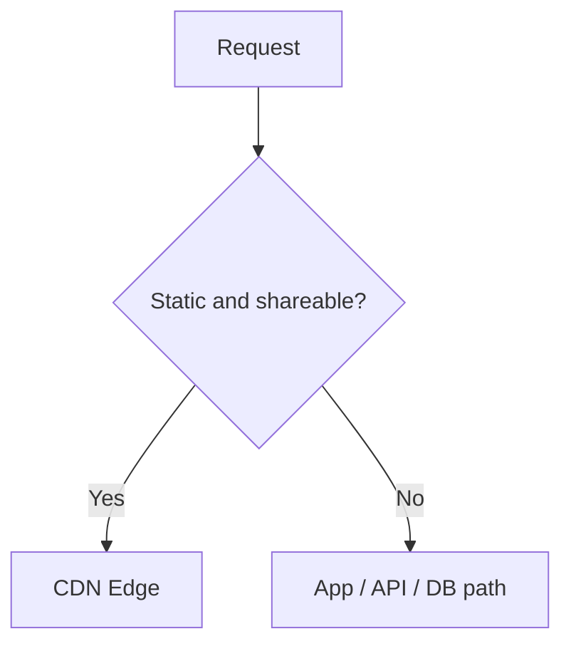

### Beginner rule

> Put shareable static assets on CDN. Keep private/dynamic logic on origin.

---

## 9. POP / Edge Locations

**POP** = Point of Presence (CDN location/data center near users)

A global CDN has many POPs. Users are routed to a nearby one.

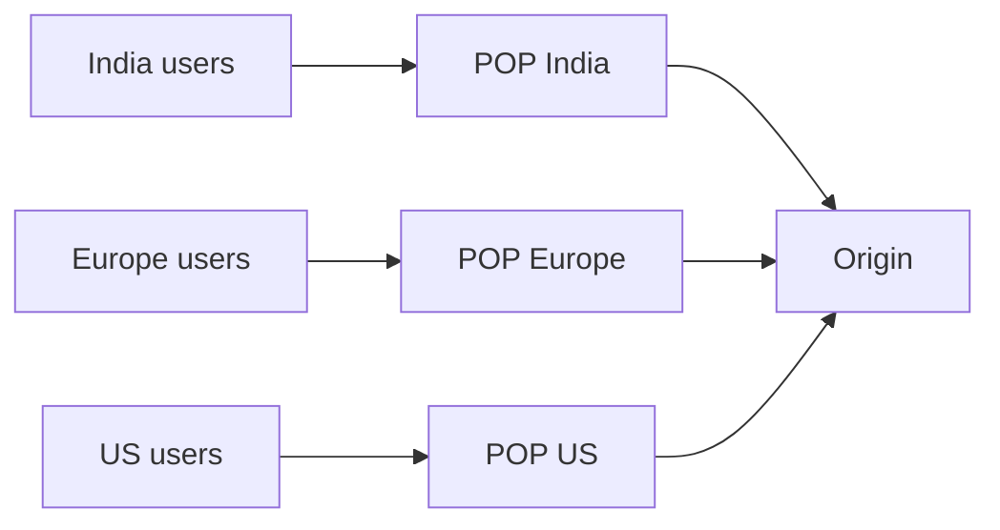

### Real-life

Same Netflix show can be cached in many cities so everyone does not pull from one central place.

---

## 10. TTL and Cache Headers

CDN caching is strongly controlled by headers and configuration.

### TTL

**TTL** = Time To Live = how long an edge may keep a file before revalidating/refetching.

Examples:

- logo: long TTL (days)
- app.js with versioned filename: long TTL
- news homepage HTML: short TTL (seconds/minutes)

### Common headers (beginner view)

| Header idea | Meaning |
|-------------|---------|
| `Cache-Control` | Browser/CDN caching rules |
| `max-age` | How long content can be reused |
| `ETag` / `Last-Modified` | Help revalidation |
| `Vary` | Cache different versions by header (example: encoding) |

### Versioned files trick

Instead of fighting short TTL for JS/CSS, many teams use:

```text
app.v123.js
app.v124.js
```

New deploy = new filename = no stale old JS confusion.

---

## 11. Cache Invalidation / Purging

When content changes, old cached copies can remain at edges.

**Invalidation / purge** means telling CDN: "forget this cached object now."

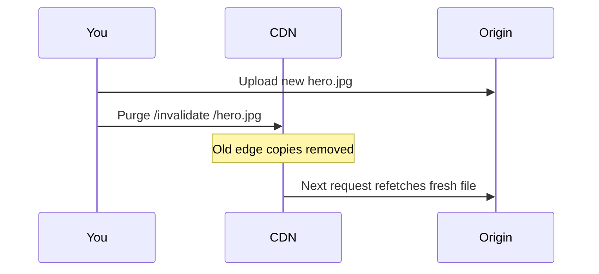

### Real-life

You replaced a poster in the warehouse, but city stores still show the old poster until you call them to replace it.

### Practical tip

Invalidation works, but frequent mass purges can be expensive/slow. Prefer versioned asset names when possible.

---

## 12. CDN + DNS (Simple View)

When user opens `static.myapp.com`:

1. DNS resolves to CDN
2. CDN sends user to a nearby edge IP
3. Edge serves content

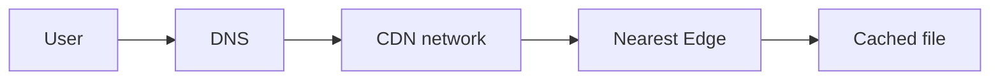

You usually point your asset domain/CNAME to the CDN provider.

---

## 13. Push CDN vs Pull CDN

### Pull CDN (most common)

Edge fetches from origin on first miss and caches it.

```text
User → Edge (miss) → Origin → Edge caches → User
```

Easy to start. Origin stays source of truth.

### Push CDN

You upload/publish content to CDN storage/edges ahead of time.

Useful for large planned releases (big downloads, game packs, major media drops).

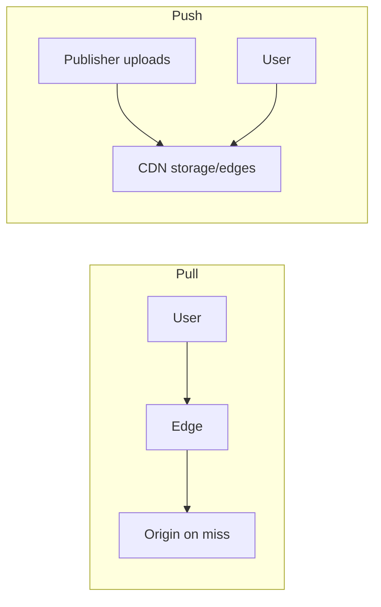

---

## 14. HTTPS, Security, and Extra CDN Benefits

Modern CDNs often also help with:

| Benefit | Easy meaning |
|---------|--------------|
| TLS/HTTPS termination | Secure delivery near edge |
| DDoS absorption | Attack traffic hits CDN first |
| Hotlink protection / tokenized URLs | Restrict who can fetch files |
| Compression | Smaller downloads |
| Image optimization | Resize/compress at edge (provider feature) |
| Bot filtering | Basic protection layers |

CDN is mainly for delivery speed, but security features are a common bonus.

---

## 15. CDN vs Redis Cache

Beginners often mix these up.

| | CDN | Redis |
|--|-----|-------|
| Where | Around the world near users | Near your backend app |
| What | Mostly files/pages/assets | App data/sessions/objects |
| Who benefits first | End users downloading content | App servers reading hot data |
| Example | `logo.png`, videos, JS | user session, product JSON |

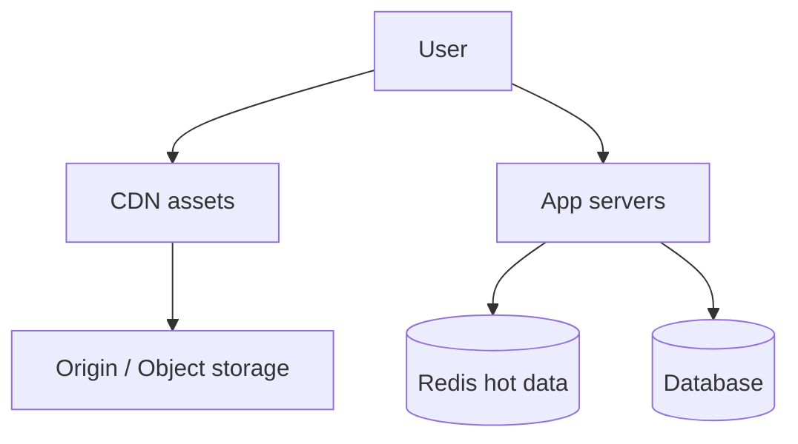

**Both can exist together.** They solve different layers.

---

## 16. Real-life Examples

### Example 1: Instagram / social images

Profile photos, Reels media segments, and static app assets are excellent CDN content. API calls for personalized feed stay dynamic.

### Example 2: Ecommerce product pages

- Product images → CDN
- Product price API → origin/app (maybe Redis cached)
- Checkout/payment → never stale-cache carelessly

### Example 3: Course platform

- Lecture videos → CDN
- Quiz submission API → origin
- Certificates PDF download → CDN or object storage via CDN

### Example 4: Software / game downloads

Large installers are distributed via CDN so launch-day downloads do not melt one origin.

---

## 17. Putting It All Together

A practical beginner architecture:

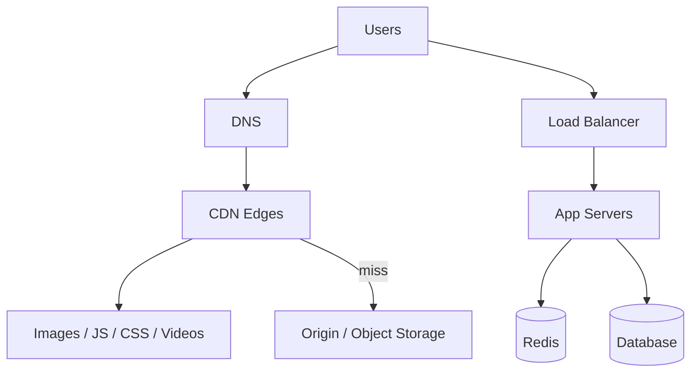

### Request split

| Request | Path |
|---------|------|
| `/static/app.js` | CDN |
| `/images/shoe.png` | CDN |
| `/api/cart` | App servers |
| `/api/pay` | App servers + strict consistency path |

### System design sentence

> "We serve static assets through a CDN to reduce latency and origin load, keep dynamic business APIs on application servers, and use cache headers/versioning to control freshness."

---

## 18. Common Mistakes Beginners Make

| Mistake | Why it hurts | Better thinking |
|---------|--------------|-----------------|
| Caching personalized private pages publicly | Data leak / wrong content | Separate private/dynamic paths |
| No versioning + long TTL on JS | Users keep broken old scripts | Fingerprint/version filenames |
| Putting all API responses on CDN blindly | Stale business data | Cache only safe shareable content |
| Forgetting invalidation after updates | Old images/files keep showing | Purge or versioned URLs |
| Using CDN as replacement for Redis | Different layers | Use both correctly |
| One origin region, no CDN, global audience | Slow UX | Add CDN for static delivery |

---

## 19. Quick Recap

| Term | One-line meaning |
|------|------------------|
| CDN | Global network for fast content delivery |
| Origin | Source of original content |
| Edge / POP | Nearby CDN server location |
| Cache hit | Served from edge |
| Cache miss | Fetched from origin first |
| TTL | How long content stays cached |
| Invalidation | Force-remove stale cached objects |
| Static content | Best CDN fit |
| Dynamic content | Usually origin/app handled |

### Remember this sentence

> **A CDN brings shareable content closer to users, making sites faster and protecting origin servers from repetitive downloads.**

---

## 20. Practice Questions

1. Explain CDN using a warehouse vs city-store analogy.
2. What is the difference between origin and edge?
3. Why are product images a better CDN fit than bank balance APIs?
4. What happens on a CDN cache miss?
5. How do versioned filenames (`app.v123.js`) help caching?
6. When would you purge/invalidate CDN cache?
7. How is CDN different from Redis?
8. Give one security benefit CDN can provide besides speed.

Write answers in your own words.
