# Sharding & Partitioning

> **Who is this for?** Beginners learning system design.
>
> **What you will learn:** What partitioning and sharding mean, why databases split data, shard keys, common strategies, hotspots, rebalancing, and when to shard, with easy examples and diagrams.
>
> **Related:** [Scalability & Load Balancing](./01-scalability-and-load-balancing.md) · [Databases (SQL vs NoSQL)](./03-databases-sql-vs-nosql.md) · [Caching](./02-caching.md)

---

## Table of Contents

1. [The Big Picture](#1-the-big-picture)
2. [Partitioning vs Sharding (Simple Difference)](#2-partitioning-vs-sharding-simple-difference)
3. [Why Split Data At All?](#3-why-split-data-at-all)
4. [Vertical Scaling First (Important Mindset)](#4-vertical-scaling-first-important-mindset)
5. [What is a Shard?](#5-what-is-a-shard)
6. [Shard Key / Partition Key](#6-shard-key--partition-key)
7. [Common Sharding Strategies](#7-common-sharding-strategies)
8. [Directory / Lookup Based Sharding](#8-directory--lookup-based-sharding)
9. [Hotspots and Uneven Load](#9-hotspots-and-uneven-load)
10. [Cross-Shard Queries and Joins](#10-cross-shard-queries-and-joins)
11. [Transactions Across Shards](#11-transactions-across-shards)
12. [Resharding and Rebalancing](#12-resharding-and-rebalancing)
13. [Consistent Hashing (Beginner View)](#13-consistent-hashing-beginner-view)
14. [Partitioning Inside One Database](#14-partitioning-inside-one-database)
15. [Sharding in Real Systems](#15-sharding-in-real-systems)
16. [When to Shard](#16-when-to-shard)
17. [When Not to Shard Yet](#17-when-not-to-shard-yet)
18. [Putting It All Together](#18-putting-it-all-together)
19. [Common Mistakes Beginners Make](#19-common-mistakes-beginners-make)
20. [Quick Recap](#20-quick-recap)
21. [Practice Questions](#21-practice-questions)

---

## 1. The Big Picture

One database can handle a lot. Then one day:

- tables become huge
- indexes get heavy
- disk fills up
- writes slow down
- one machine cannot keep up

You have two broad options:

1. Buy a bigger machine (**vertical scaling**)
2. Split data across multiple machines (**sharding / partitioning**)

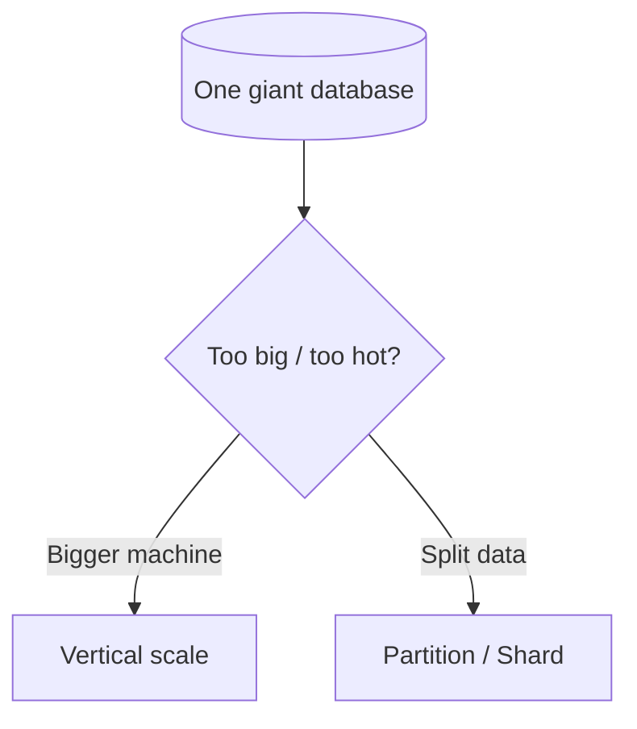

Sharding is powerful, but it adds complexity. Learn the idea carefully.

---

## 2. Partitioning vs Sharding (Simple Difference)

People use these words in overlapping ways. Keep this practical meaning:

| Term | Common beginner meaning |
|------|-------------------------|
| **Partitioning** | Split data into parts (can be on same DB or across nodes) |
| **Sharding** | Split data across multiple database servers/nodes |

### Easy memory trick

- Partitioning = cutting a cake into slices
- Sharding = putting those slices on different plates/tables

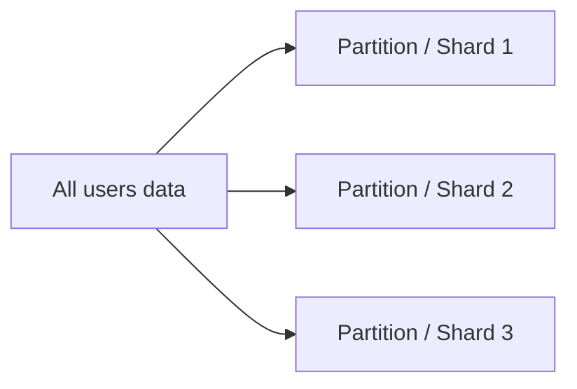

In interviews, explaining the concept clearly matters more than debating exact vocabulary.

---

## 3. Why Split Data At All?

| Reason | Easy meaning |
|--------|--------------|
| Data size too large | One disk/machine not enough |
| Write throughput too high | One primary cannot accept all writes |
| Query performance drops | Huge indexes / table scans hurt |
| Blast radius | One failure should not hold all data |
| Geo needs | Keep regional data closer to users |

### Real-life analogy

One notebook for all customers in India becomes impossible.  
So you keep separate notebooks by state or by customer ID range.

---

## 4. Vertical Scaling First (Important Mindset)

Before sharding, teams usually try cheaper/simpler steps:

1. Better indexes
2. Query optimization
3. Caching (Redis)
4. Read replicas
5. Bigger machine

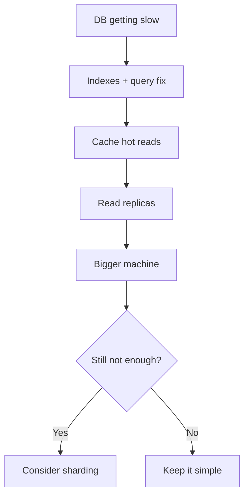

### Beginner rule

> Do not shard on day 1 just because it sounds advanced.

---

## 5. What is a Shard?

A **shard** is one slice of the full dataset, usually living on its own database instance.

Example: users table split into 4 shards

```text
Shard A: users 1 to 1,000,000
Shard B: users 1,000,001 to 2,000,000
Shard C: users 2,000,001 to 3,000,000
Shard D: users 3,000,001 to 4,000,000
```

Or by hash:

```text
hash(userId) % 4 → shard number
```

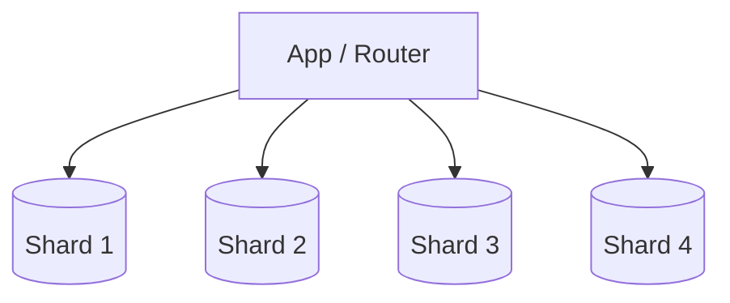

Each shard has only part of the data, so each machine stays smaller and faster.

---

## 6. Shard Key / Partition Key

The **shard key** decides where a row/document lives.

Examples:

- `userId`
- `tenantId`
- `orderId`
- `country`
- `deviceId`

### Why shard key choice is everything

A good key:

- spreads load evenly
- matches common query patterns
- keeps related data together when needed

A bad key:

- creates hotspots
- forces almost every query to hit all shards

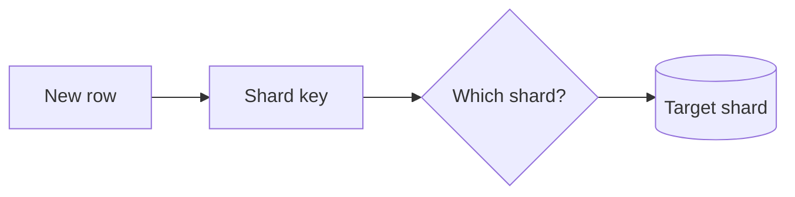

### Real-life

If you split school records by first letter of name, letter `S` may get overloaded. That is a bad key.

---

## 7. Common Sharding Strategies

### 7.1 Range based sharding

Split by continuous ranges.

```text
userId 1-1M     → Shard 1
userId 1M-2M    → Shard 2
userId 2M-3M    → Shard 3
```

**Pros:** simple, good for range queries  
**Cons:** newest range can become hot (all new users go to latest shard)

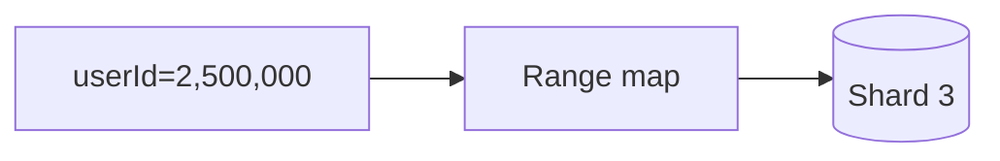

### 7.2 Hash based sharding

```text
shard = hash(userId) % N
```

**Pros:** usually even distribution  
**Cons:** range queries are harder; rehashing when N changes is painful without careful design

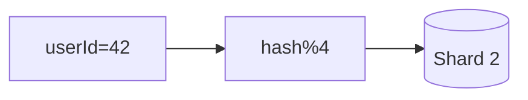

### 7.3 Geo / attribute based sharding

Split by country, region, or tenant.

```text
India users → Shard IN
EU users → Shard EU
US users → Shard US
```

**Pros:** locality, compliance, regional scale  
**Cons:** uneven population (one country much larger)

### Strategy cheat sheet

| Strategy | Good for | Watch out |
|----------|----------|-----------|
| Range | Range scans, simple maps | Hot latest range |
| Hash | Even spread | Resharding complexity |
| Geo/Tenant | Regional/tenant isolation | Uneven sizes |

---

## 8. Directory / Lookup Based Sharding

Keep a lookup service/table:

```text
user 42 → Shard B
user 99 → Shard A
```

App asks directory first, then queries the right shard.

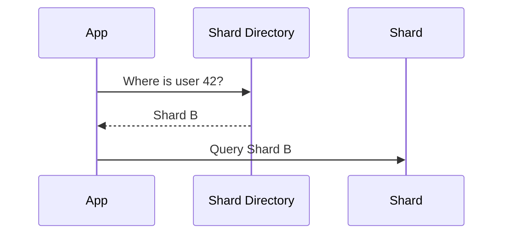

**Pros:** flexible placement/migration  
**Cons:** directory must be fast, highly available, and correct

---

## 9. Hotspots and Uneven Load

A **hotspot** means one shard gets much more traffic than others.

### Examples

- celebrity `userId` gets millions of reads
- all new writes go into the newest range shard
- one large tenant dominates a tenant shard

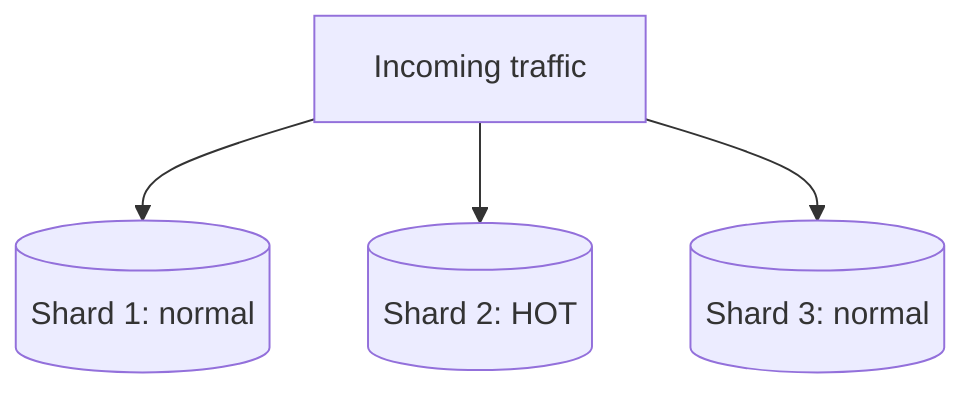

### Ways to reduce hotspots

1. Better shard key (higher cardinality / better spread)
2. Split hot key further (secondary split)
3. Cache hot reads in Redis/CDN where safe
4. Isolate huge tenants onto dedicated shards

---

## 10. Cross-Shard Queries and Joins

On one database, joins are easy.  
Across shards, joins become hard/expensive.

### Example problem

```text
Get all orders for users in city = Pune
```

If users and orders are sharded by `userId`, this may need:

1. find matching users (maybe many shards)
2. fetch orders from many shards
3. merge in application

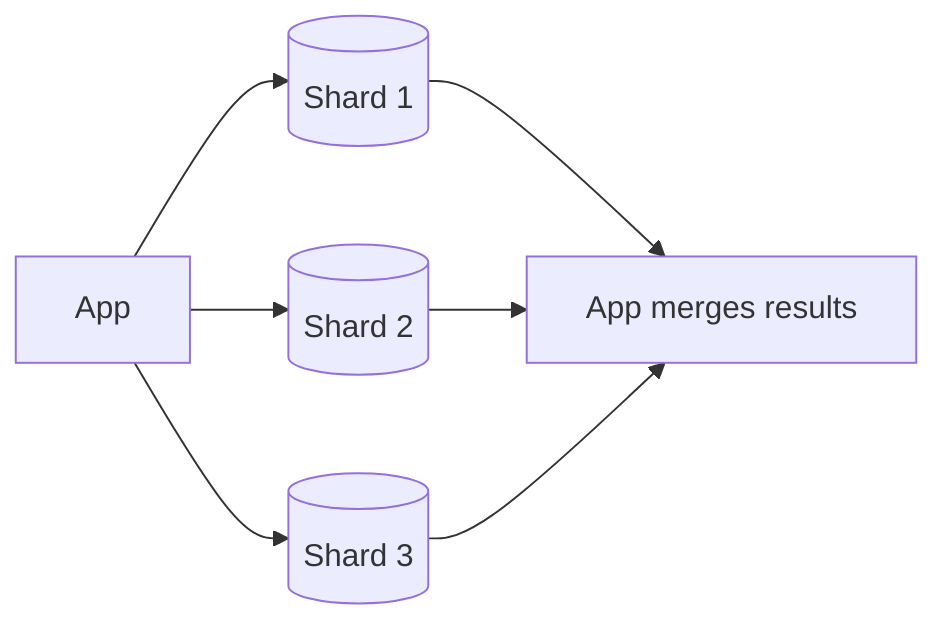

### Design tip

Model data so the most common queries stay **single-shard**.

---

## 11. Transactions Across Shards

Transactions on one shard are easier.  
Transactions across multiple shards are much harder.

### Example

Transfer money between two users on different shards:

- deduct from User A (Shard 1)
- credit User B (Shard 2)

If one succeeds and the other fails, you need careful recovery (saga/compensation patterns, 2PC style systems, etc.).

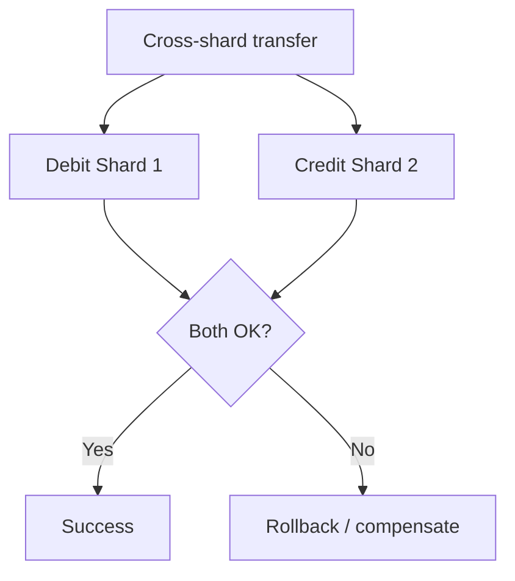

### Beginner takeaway

> Prefer designs where strongly transactional operations stay on one shard when possible.

---

## 12. Resharding and Rebalancing

As data grows, you may need more shards. Moving data is called **resharding / rebalancing**.

### Painful naive example

```text
Old: hash(id) % 4
New: hash(id) % 8
```

Many keys change location. Lots of data moves. Risk of downtime if poorly planned.

### Better thinking

- plan growth early
- use strategies that minimize key movement
- migrate gradually (dual writes / dual reads during transition)
- monitor carefully


Resharding is one reason teams delay sharding until necessary.

---

## 13. Consistent Hashing (Beginner View)

**Consistent hashing** is a technique to place keys on a ring so that when nodes are added/removed, only a portion of keys move.

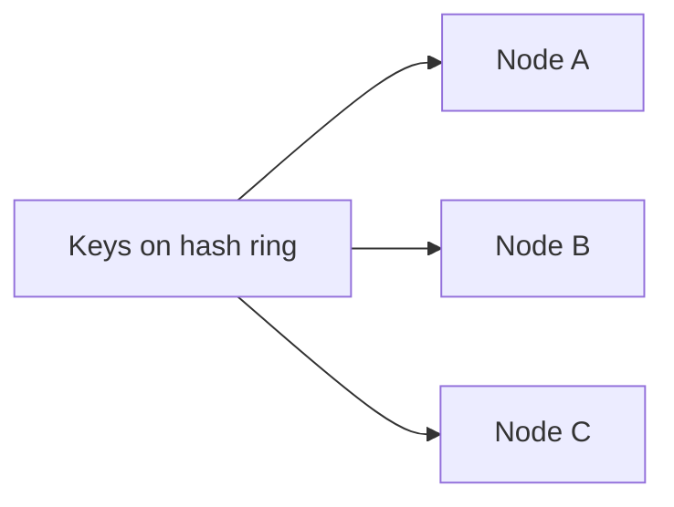

### Why people mention it

- used in many distributed caches/stores
- reduces remapping shock when cluster size changes

You do not need deep math for interviews at beginner level. Know the purpose:

> Move fewer keys when the cluster changes size.

---

## 14. Partitioning Inside One Database

You can partition a large table inside one Postgres/MySQL style system without full app-level sharding.

Examples:

- partition orders by month
- partition logs by day
- partition events by range

```text
orders_2026_01
orders_2026_02
orders_2026_03
...
```

(or native declarative partitions)

### Benefits

- easier maintenance (drop old partitions)
- better pruning for date filters
- still one database to manage

### Limits

Eventually one machine may still be not enough. Then distributed sharding comes back into the conversation.

---

## 15. Sharding in Real Systems

### Example A: Instagram-like users/posts

Possible shard key: `userId`

- user profile, posts, follower edges for that user stay together
- feed generation still complex, but many user-scoped queries become single-shard

### Example B: Multi-tenant SaaS

Possible shard key: `tenantId`

- each company data isolated
- large customers can get dedicated shards

### Example C: Ecommerce orders

Possible shard key: `customerId` or `orderId` depending on query patterns

- if most queries are "orders for this customer" → `customerId`
- if most queries are by exact order lookup and writes are huge → carefully designed `orderId` hashing may fit

### Always ask

> What is my most common lookup path?

Shard for that path first.

---

## 16. When to Shard

Consider sharding when several are true:

1. single primary cannot handle write load
2. dataset/indexes too large for one machine comfortably
3. caching + replicas + vertical scale are no longer enough
4. team can handle routing, rebalancing, and cross-shard complexity
5. clear shard key exists for main access patterns

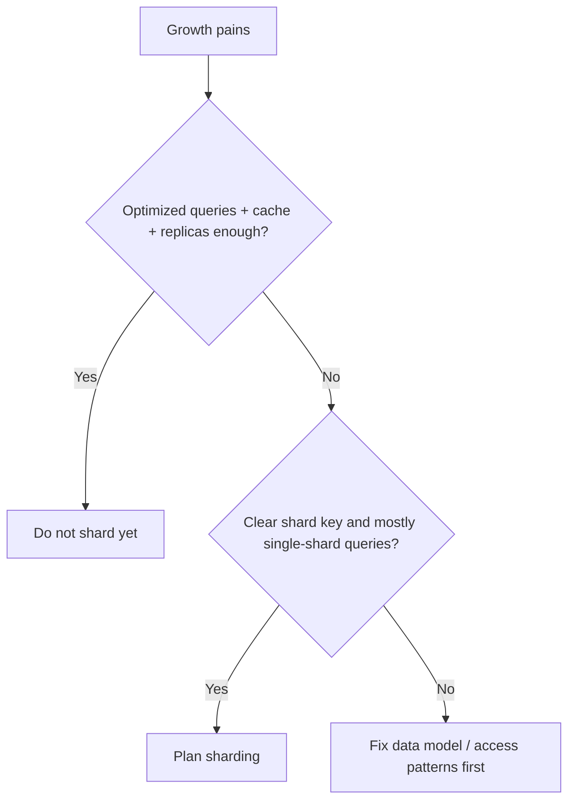

---

## 17. When Not to Shard Yet

Avoid early sharding when:

- traffic is still moderate
- a bigger DB + Redis + replicas will solve it
- your queries are mostly unknown/unstable
- team is not ready for distributed operations
- you chose sharding only because it sounds "scalable"

### Interview gold line

> "I would scale vertically and add caching/replicas first, then shard when write/storage limits become real, using `userId` as shard key because most queries are user-scoped."

That shows mature judgment.

---

## 18. Putting It All Together

A practical evolution path:

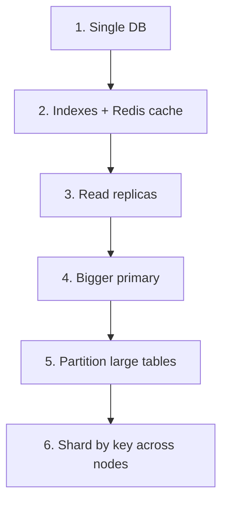

### Example architecture after sharding

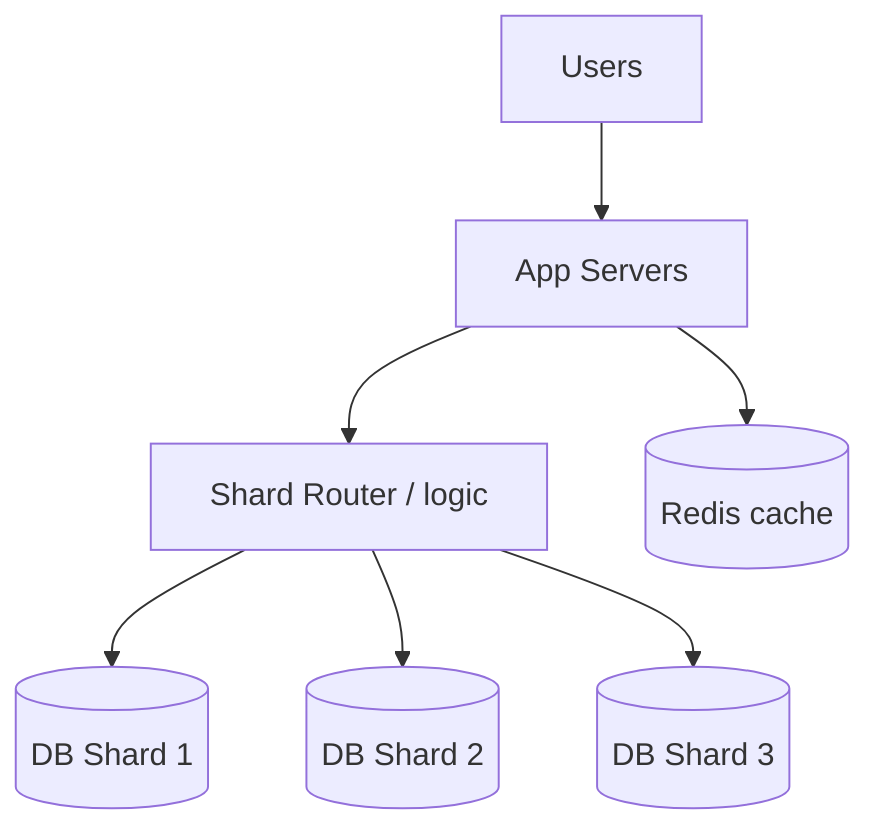

### System design sentence

> "We shard by `userId` using hash-based placement so user-scoped reads/writes stay on one shard, cache hot keys in Redis, and avoid cross-shard transactions for critical paths."

---

## 19. Common Mistakes Beginners Make

| Mistake | Why it hurts | Better thinking |
|---------|--------------|-----------------|
| Sharding too early | Huge complexity tax | Optimize first |
| Bad shard key | Hotspots + scatter queries | Choose by access pattern |
| Ignoring cross-shard joins | Painful app logic | Keep common queries single-shard |
| Assuming hash `% N` is forever | Resharding pain | Plan growth strategy |
| Cross-shard money transactions casually | Consistency nightmares | Co-locate transactional data |
| No hotspot plan for celebrities/tenants | One shard melts | Isolation + caching + splits |
| Treating sharding as only storage trick | It also affects product design | Design APIs around shard locality |

---

## 20. Quick Recap

| Term | One-line meaning |
|------|------------------|
| Partitioning | Split data into parts |
| Sharding | Split data across multiple DB nodes |
| Shard key | Decides where data lives |
| Range sharding | Split by value ranges |
| Hash sharding | Split by hash(key) |
| Hotspot | One shard gets too much load |
| Cross-shard query | Request needing many shards |
| Resharding | Moving data as cluster grows |
| Consistent hashing | Minimize key movement on change |

### Remember this sentence

> **Sharding splits data across machines for scale, but only works well with a smart shard key and mostly single-shard access patterns.**

---

## 21. Practice Questions

1. What is the difference between partitioning and sharding in plain words?
2. Why is shard key selection more important than number of shards?
3. Give one pro and one con of range-based sharding.
4. Why can `hash(id) % N` become painful when N changes?
5. What is a hotspot? Give an example.
6. Why are cross-shard joins hard?
7. When would tenant-based sharding help a SaaS product?
8. List three things to try before sharding.

Write answers in your own words.
