# Availability & Fault Tolerance

> **Who is this for?** Beginners learning system design.
>
> **What you will learn:** What availability means, how downtime is measured, what fault tolerance is, redundancy, failover, health checks, graceful degradation, and practical ways systems survive failures, with easy examples and diagrams.
>
> **Related:** [Scalability & Load Balancing](./01-scalability-and-load-balancing.md) · [CAP Theorem & Consistency](./04-cap-theorem-and-consistency.md) · [Message Queues](./05-message-queues.md) · [Sharding & Partitioning](./07-sharding-and-partitioning.md)

---

## Table of Contents

- [Availability \& Fault Tolerance](#availability--fault-tolerance)
  - [Table of Contents](#table-of-contents)
  - [1. The Big Picture](#1-the-big-picture)
  - [2. What is Availability?](#2-what-is-availability)
    - [Simple formula](#simple-formula)
    - [Real-life analogy](#real-life-analogy)
    - [Important](#important)
  - [3. The Nines of Availability](#3-the-nines-of-availability)
    - [Beginner tip](#beginner-tip)
  - [4. What is Fault Tolerance?](#4-what-is-fault-tolerance)
    - [Real-life analogy](#real-life-analogy-1)
    - [Availability vs Fault Tolerance](#availability-vs-fault-tolerance)
  - [5. Failure is Normal](#5-failure-is-normal)
  - [6. Single Point of Failure (SPOF)](#6-single-point-of-failure-spof)
    - [Goal](#goal)
  - [7. Redundancy](#7-redundancy)
    - [Types (beginner view)](#types-beginner-view)
    - [Real-life](#real-life)
  - [8. Failover and Failback](#8-failover-and-failback)
    - [Failover](#failover)
    - [Failback](#failback)
    - [Good failover needs](#good-failover-needs)
  - [9. Health Checks and Heartbeats](#9-health-checks-and-heartbeats)
    - [Health check examples](#health-check-examples)
    - [Heartbeat](#heartbeat)
  - [10. Replication for Availability](#10-replication-for-availability)
    - [Caution](#caution)
  - [11. Load Balancing and Availability](#11-load-balancing-and-availability)
  - [12. Timeouts, Retries, and Backoff](#12-timeouts-retries-and-backoff)
    - [Timeouts](#timeouts)
    - [Retries](#retries)
    - [Backoff](#backoff)
    - [Beginner rule](#beginner-rule)
  - [13. Circuit Breaker](#13-circuit-breaker)
    - [Real-life](#real-life-1)
  - [14. Bulkheads and Isolation](#14-bulkheads-and-isolation)
    - [Software examples](#software-examples)
  - [15. Graceful Degradation](#15-graceful-degradation)
    - [Product thinking](#product-thinking)
  - [16. Disaster Recovery Basics](#16-disaster-recovery-basics)
    - [Beginner path](#beginner-path)
  - [17. RPO and RTO](#17-rpo-and-rto)
    - [Example](#example)
  - [18. Putting It All Together](#18-putting-it-all-together)
    - [Availability techniques used here](#availability-techniques-used-here)
    - [System design sentence](#system-design-sentence)
  - [19. Common Mistakes Beginners Make](#19-common-mistakes-beginners-make)
  - [20. Quick Recap](#20-quick-recap)
    - [Remember this sentence](#remember-this-sentence)
  - [21. Practice Questions](#21-practice-questions)

---

## 1. The Big Picture

A system that works only on happy days is not enough.

In real life:

- servers crash
- disks fail
- networks drop packets
- deploys go wrong
- a dependency (email, payment, DB) becomes slow

**Availability** asks: can users still use the system?  
**Fault tolerance** asks: can the system survive failures without collapsing?

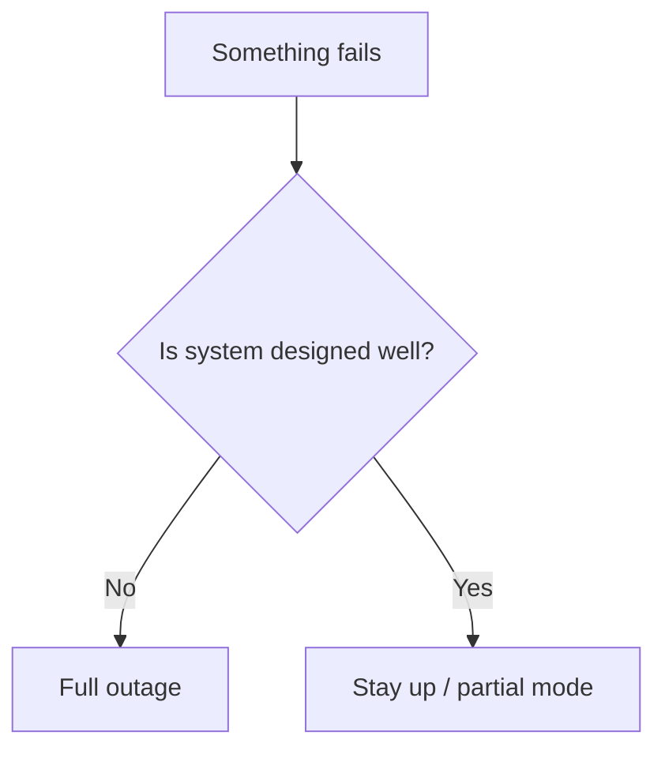

---

## 2. What is Availability?

**Availability** means the system is up and usable when users need it.

### Simple formula

```text
Availability = Uptime / (Uptime + Downtime)
```

Example:

- In 30 days (43,200 minutes), system was down 43.2 minutes
- Availability ≈ 99.9%

### Real-life analogy

A hospital emergency desk is "available" if someone can take your case when you arrive.  
If the desk is closed often, availability is poor, even if the building looks fancy.

### Important

Availability is about **user experience of being able to use the service**, not just "server process is running".

A server can be alive but returning errors. Users still feel downtime.

---

## 3. The Nines of Availability

People say "three nines", "four nines", etc.

| Availability | Downtime per year (approx.) | Common name |
|--------------|-----------------------------|-------------|
| 99% | ~3.65 days | Two nines |
| 99.9% | ~8.77 hours | Three nines |
| 99.99% | ~52.6 minutes | Four nines |
| 99.999% | ~5.26 minutes | Five nines |

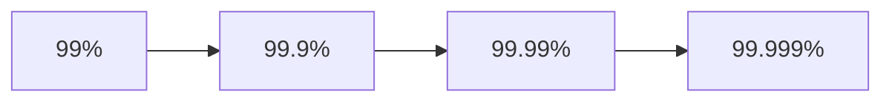

### Beginner tip

Each extra nine is much harder and more expensive.  
Do not promise five nines unless the business truly needs it and can pay for the design/ops.

---

## 4. What is Fault Tolerance?

**Fault tolerance** means the system continues operating (fully or partially) even when some parts fail.

### Real-life analogy

An airplane has multiple engines. One engine failing should not make the whole flight impossible.

### Availability vs Fault Tolerance

| Idea | Focus |
|------|-------|
| Availability | Is the service up for users? |
| Fault Tolerance | Can it absorb component failures? |

Fault-tolerant design is one major way to achieve high availability.

---

## 5. Failure is Normal

In distributed systems, assume failures will happen.

Common failures:

| Failure | Example |
|---------|---------|
| Process crash | App container dies |
| Node failure | VM / machine down |
| Network partition | Zones cannot talk |
| Dependency outage | SMS provider down |
| Slow dependency | DB latency spikes |
| Bad deploy | New version bugs |
| Data center issue | Rack/zone/region problem |

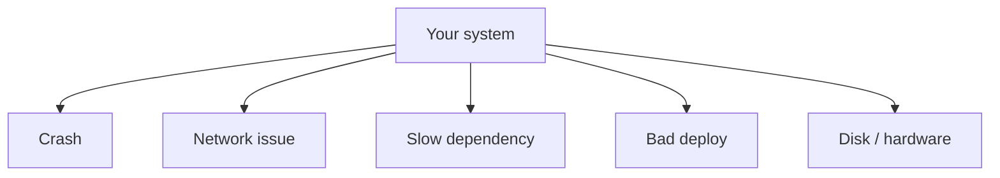

Good system design plans for these instead of hoping they never occur.

---

## 6. Single Point of Failure (SPOF)

A **SPOF** is one component whose failure takes down the whole system.

Examples:

- one app server, no backup
- one database with no replica/failover
- one load balancer appliance with no pair
- one availability zone only

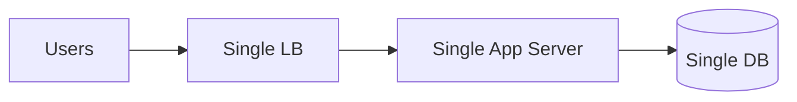

If any one box dies, everything dies.

### Goal

Remove SPOFs with redundancy and failover.

---

## 7. Redundancy

**Redundancy** means keeping extra capacity/components so one failure does not stop service.

### Types (beginner view)

| Type | Meaning | Example |
|------|---------|---------|
| Active-Active | Multiple components serve traffic together | 3 app servers behind LB |
| Active-Passive | Backup waits and takes over on failure | Standby DB |

```mermaid
flowchart TB
    subgraph ActiveActive[Active-Active]
      U1[Users] --> L1[LB]
      L1 --> A1[App 1]
      L1 --> A2[App 2]
    end

    subgraph ActivePassive[Active-Passive]
      P[(Primary DB)] sn--> S[(Standby DB)]
    end
```

### Real-life

Two cashiers in a store (active-active).  
One spare generator ready if power fails (active-passive).

---

## 8. Failover and Failback

### Failover

When primary fails, traffic/work moves to backup automatically or quickly.

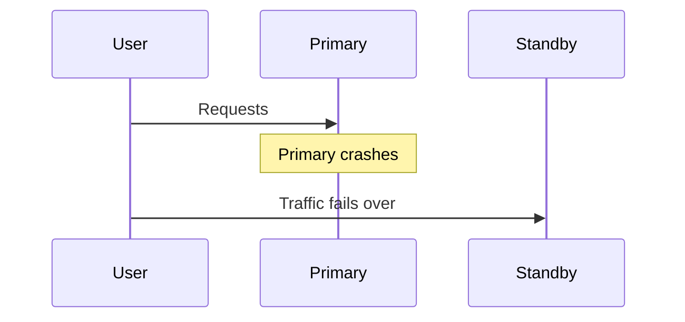

### Failback

Later, after primary recovers, traffic may return to original primary (optional, carefully).

### Good failover needs

1. health detection
2. promotion/switch logic
3. DNS/LB updates or connection reroute
4. tested recovery procedure

Untested failover is hope, not reliability.

---

## 9. Health Checks and Heartbeats

Systems need a way to know: "Are you alive and healthy?"

### Health check examples

- `GET /health` returns 200
- can connect to DB
- disk not full
- dependency checks (careful: too strict can cause cascades)

### Heartbeat

Component periodically says "I am alive".

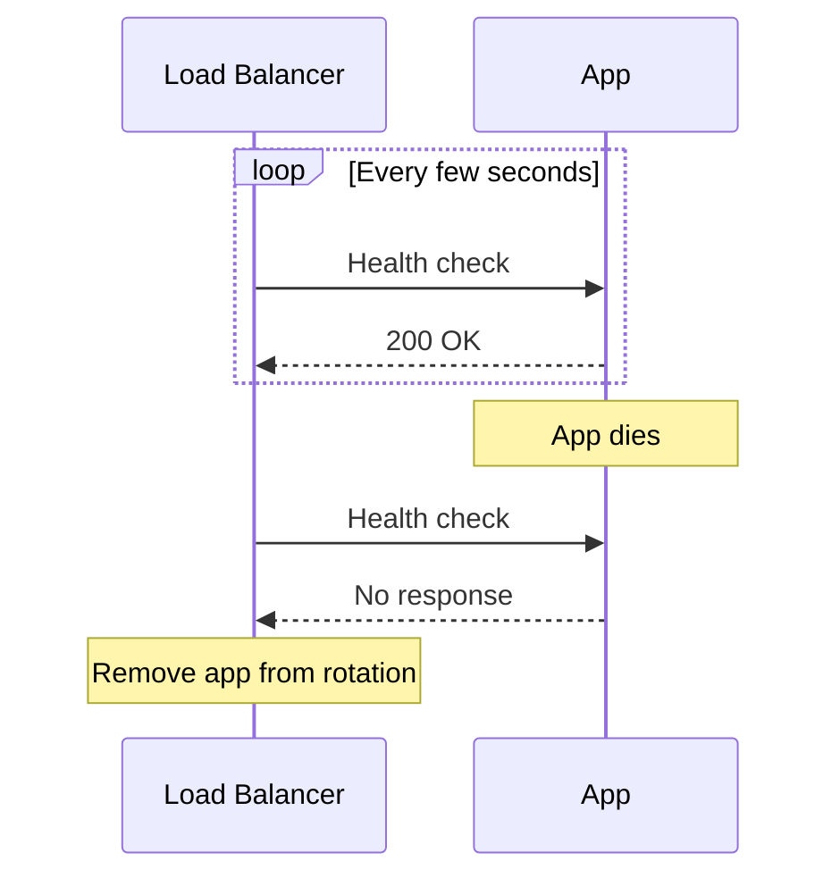

This connects directly to load balancing from earlier fundamentals.

---

## 10. Replication for Availability

Copies of data improve survival.

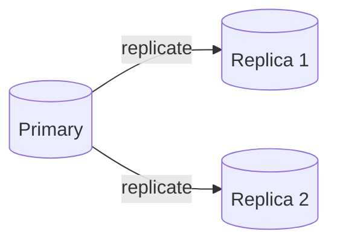

If primary fails, promote a replica (with proper tooling/process).

### Caution

Replication helps availability, but also brings lag/consistency trade-offs.  
See [CAP Theorem & Consistency](./04-cap-theorem-and-consistency.md).

---

## 11. Load Balancing and Availability

A load balancer improves availability by:

- spreading traffic across healthy instances
- removing unhealthy instances
- allowing rolling deploys (take one server down without full outage)

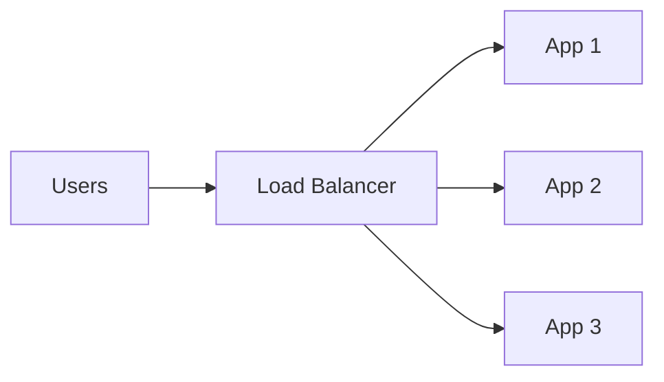

One app crash should not take the whole service down.

Details: [Scalability & Load Balancing](./01-scalability-and-load-balancing.md)

---

## 12. Timeouts, Retries, and Backoff

When a dependency is slow/failing, bad clients make things worse.

### Timeouts

Do not wait forever.

```text
DB call timeout = 2s
Payment call timeout = 3s
```

### Retries

Retry transient failures, but not infinitely.

### Backoff

Wait longer between retries:

```text
0.5s → 1s → 2s → 4s
```

Add jitter (randomness) so all clients do not retry at the same instant.

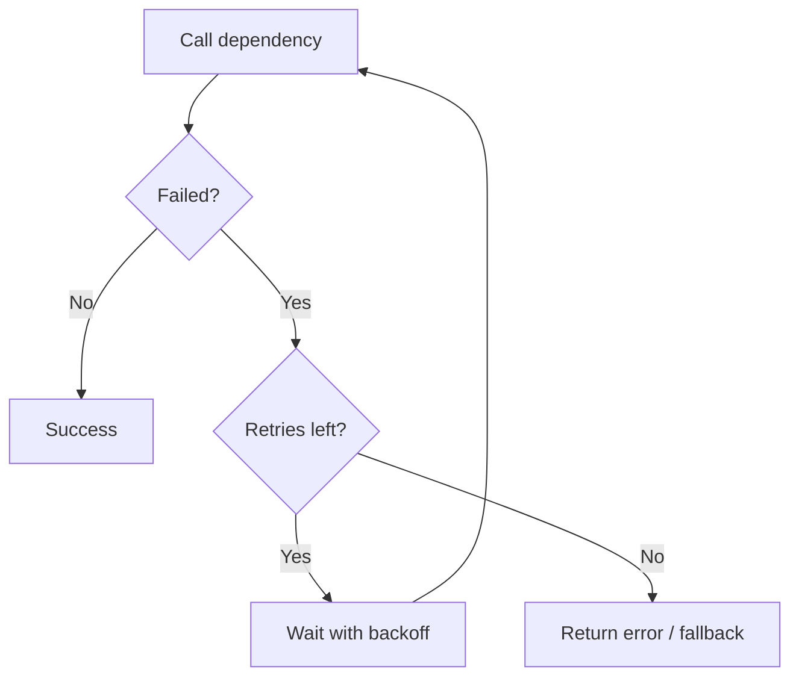

### Beginner rule

Retries without backoff can turn a small outage into a full meltdown.

---

## 13. Circuit Breaker

A **circuit breaker** stops calling a failing dependency for a while.

States:

1. **Closed** = normal calls allowed
2. **Open** = fail fast, do not call dependency
3. **Half-open** = try a few probe calls

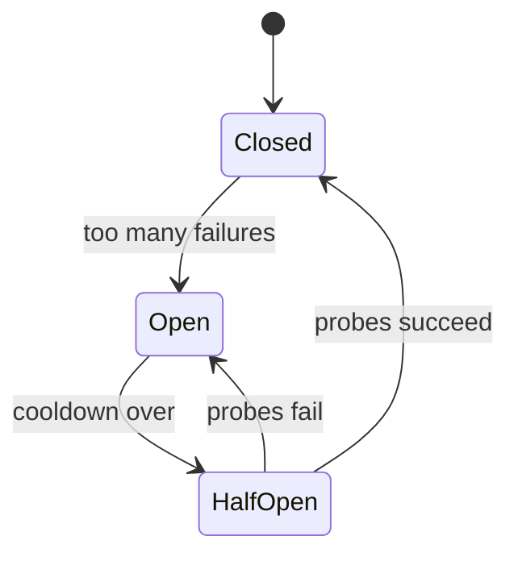

### Real-life

If electricity line is sparking, you switch off the circuit instead of forcing power through again and again.

This protects your service and gives the dependency time to recover.

---

## 14. Bulkheads and Isolation

**Bulkhead** means isolating failures so one bad part does not sink everything.

Ship analogy: compartments prevent one leak from flooding the whole ship.

### Software examples

- separate thread pools for different dependencies
- separate queues for email vs payments
- separate DB pools / services by domain
- limit connections per dependency

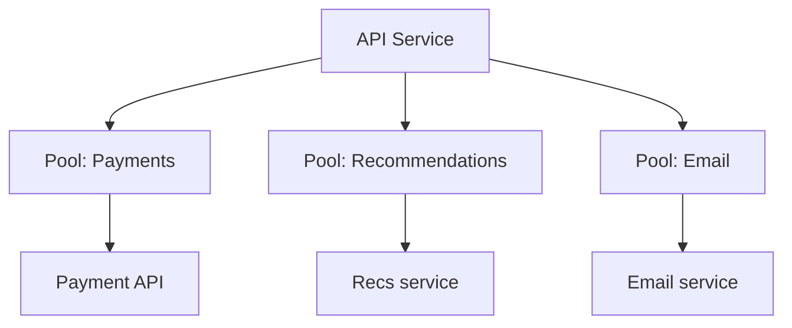

If recommendations melt, payments can still work.

---

## 15. Graceful Degradation

When something fails, offer a reduced but useful experience instead of total outage.

| Failure | Degraded mode |
|---------|---------------|
| Recommendation service down | Show default/trending list |
| Search slow | Show cached top results |
| Image CDN issue | Show lower-res placeholders |
| Reviews service down | Product page still buysable |

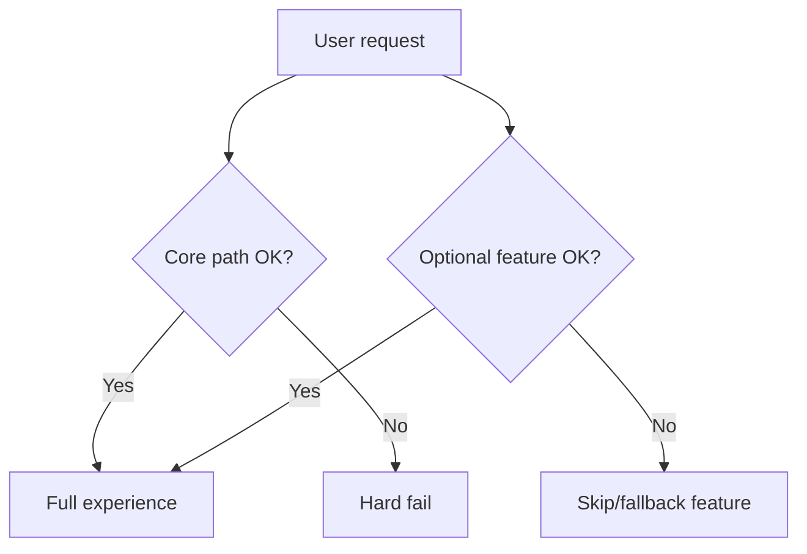

### Product thinking

Keep checkout working even if "similar products" widget dies.

---

## 16. Disaster Recovery Basics

Fault tolerance handles component failures.  
**Disaster recovery (DR)** handles bigger events (region loss, major outage).

Common ideas:

- backups
- multi-AZ deployment
- multi-region strategy (more complex)
- documented recovery runbooks
- regular restore drills

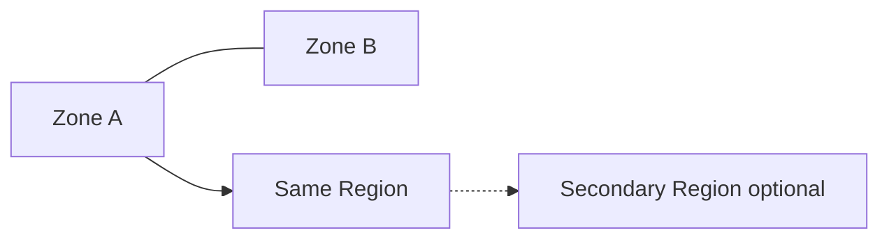

### Beginner path

1. multi-instance + multi-AZ first
2. tested backups
3. then consider multi-region if business requires it

---

## 17. RPO and RTO

Two important DR terms:

| Term | Meaning | Question it answers |
|------|---------|---------------------|
| **RPO** Recovery Point Objective | How much data loss is acceptable | "How far back can we lose data?" |
| **RTO** Recovery Time Objective | How fast service must return | "How long can we be down?" |

### Example

- RPO = 5 minutes → can lose up to 5 minutes of data
- RTO = 30 minutes → must restore service within 30 minutes

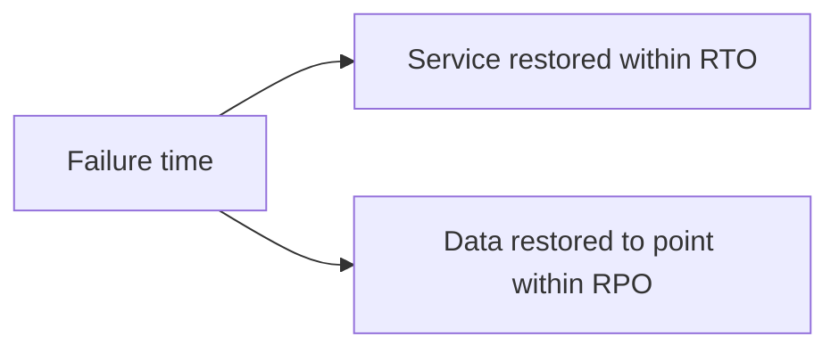

These numbers drive backup frequency and architecture cost.

---

## 18. Putting It All Together

A practical highly-available beginner architecture:

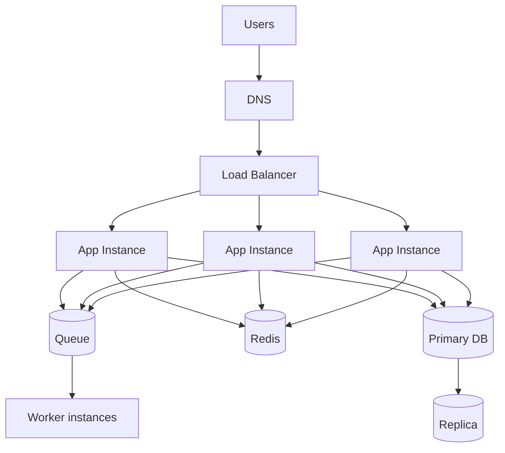

### Availability techniques used here

| Technique | Where |
|-----------|-------|
| Redundancy | multiple apps/workers |
| Health checks + LB | remove bad instances |
| Replication | DB replica |
| Queue buffering | absorb dependency failures/spikes |
| Cache | reduce pressure / possible fallbacks |
| Isolation | workers separate from API path |

### System design sentence

> "We remove single points of failure with redundant instances across zones, use health-checked load balancing, replicate data for failover, isolate dependencies with timeouts/circuit breakers, and degrade non-critical features instead of failing the whole product."

---

## 19. Common Mistakes Beginners Make

| Mistake | Why it hurts | Better thinking |
|---------|--------------|-----------------|
| One server "for now" forever | Hidden SPOF | Plan redundancy early enough |
| Retries with no backoff | Cascading outage | Timeout + backoff + jitter |
| No health checks | Traffic hits dead nodes | Active health checks |
| Untested backups/failover | Surprise failure in real incident | Regular drills |
| Treating all features as critical | Bigger outage surface | Graceful degradation |
| Chasing five nines blindly | Cost/complexity explosion | Match business need |
| Ignoring dependency failure | Your uptime depends on them too | Circuit breakers + fallbacks |

---

## 20. Quick Recap

| Term | One-line meaning |
|------|------------------|
| Availability | System is usable when needed |
| Fault tolerance | Continues despite failures |
| SPOF | One failure brings all down |
| Redundancy | Extra components for safety |
| Failover | Switch to backup on failure |
| Health check | Detect unhealthy instances |
| Circuit breaker | Stop calling failing dependency |
| Bulkhead | Isolate failure domains |
| Graceful degradation | Partial service instead of total outage |
| RPO/RTO | Data-loss and downtime targets |

### Remember this sentence

> **High availability comes from expecting failure: remove SPOFs, add redundancy, detect quickly, fail over safely, and keep core user journeys working even when non-critical parts break.**

---

## 21. Practice Questions

1. What is the difference between availability and fault tolerance?
2. What does 99.9% availability roughly mean in yearly downtime?
3. Give two SPOF examples in a small web app.
4. Why are timeouts and backoff important?
5. Explain circuit breaker with a real-life analogy.
6. What is graceful degradation? Give one product example.
7. What is the difference between RPO and RTO?
8. How do load balancers and health checks improve availability?

Write answers in your own words.
