# Redis (Complete Guide)

> **Who is this for?** Beginners who already know *what caching is*, and now want to understand Redis deeply.
>
> **Related fundamental:** [Caching](../fundamentals/02-caching.md)
>
> **What you will learn:** What Redis is, how it works, data types, commands, persistence, eviction, patterns, clustering, pros/cons, and when to use it, with easy examples and diagrams.

---

## Table of Contents

1. [What is Redis?](#1-what-is-redis)
2. [Why Redis Exists](#2-why-redis-exists)
3. [How Redis Works (Simple Mental Model)](#3-how-redis-works-simple-mental-model)
4. [Redis Architecture Basics](#4-redis-architecture-basics)
5. [Data Types in Redis](#5-data-types-in-redis)
6. [Important Commands (Beginner Set)](#6-important-commands-beginner-set)
7. [Keys, Namespaces, and TTL](#7-keys-namespaces-and-ttl)
8. [Persistence (Will Data Survive Restart?)](#8-persistence-will-data-survive-restart)
9. [Eviction Policies](#9-eviction-policies)
10. [Common Use Cases](#10-common-use-cases)
11. [Caching Patterns with Redis](#11-caching-patterns-with-redis)
12. [Pub/Sub and Streams (Simple View)](#12-pubsub-and-streams-simple-view)
13. [Transactions and Pipelines](#13-transactions-and-pipelines)
14. [Replication and High Availability](#14-replication-and-high-availability)
15. [Clustering and Sharding](#15-clustering-and-sharding)
16. [Security Basics](#16-security-basics)
17. [Monitoring and Memory Tips](#17-monitoring-and-memory-tips)
18. [Pros and Cons](#18-pros-and-cons)
19. [When to Use Redis vs When Not To](#19-when-to-use-redis-vs-when-not-to)
20. [Redis vs Memcached (Quick)](#20-redis-vs-memcached-quick)
21. [Putting It All Together](#21-putting-it-all-together)
22. [Common Mistakes](#22-common-mistakes)
23. [Quick Recap](#23-quick-recap)
24. [Practice Questions](#24-practice-questions)

---

## 1. What is Redis?

**Redis** means **Re**mote **Di**ctionary **S**erver.

In simple words:

> Redis is a very fast database that mostly keeps data in **memory (RAM)**, and stores data as **keys and values**.

### Real-life example

Think of Redis as a **super fast shared whiteboard** in an office:

- Anyone (any app server) can quickly write and read notes
- Notes are organized by title (key)
- Some notes expire after a time (TTL)
- It is much faster than going to the big filing room (main database)

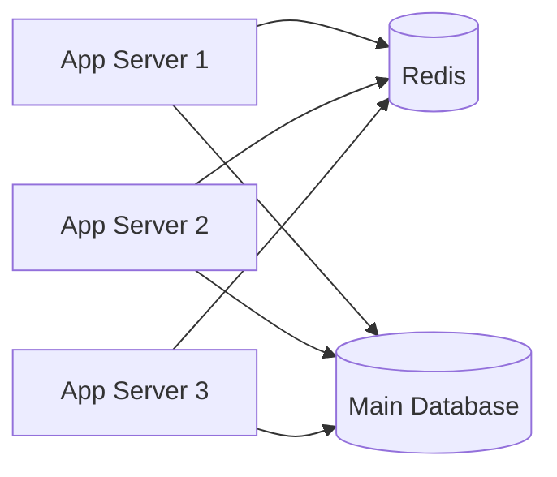

### One line to remember

**Database = source of truth (slower, durable)**  
**Redis = speed layer (very fast, often temporary or replicated carefully)**

---

## 2. Why Redis Exists

Without Redis, apps often do this:

```text
Every request → hit database → wait → respond
```

Under high traffic, the database becomes tired (high CPU, too many connections, slow queries).

With Redis:

```text
Hot data → Redis (fast)
Cold / permanent data → Database
```

### Real-life: Restaurant menu

- Menu changes maybe twice a day
- 10,000 customers open menu every hour
- Store menu in Redis for 30 minutes
- Database is asked much less

### Problems Redis helps solve

| Problem | Redis help |
|---------|------------|
| Repeated reads are slow | Cache hot data |
| Multiple servers need shared sessions | Store sessions in Redis |
| Need fast counters | `INCR` in memory |
| Need short-lived data (OTP) | Key + TTL |
| Need leaderboard | Sorted sets |

---

## 3. How Redis Works (Simple Mental Model)

Redis is basically a giant **HashMap in RAM**:

```text
key → value
```

Examples:

```text
"user:42"        →  {name: "Asha", city: "Pune"}
"session:abc"    →  "userId=42"
"product:101"    →  "{price:499, stock:20}"
"otp:9876543210" →  "482913"   (expires in 5 min)
```

### Request flow (cache style)

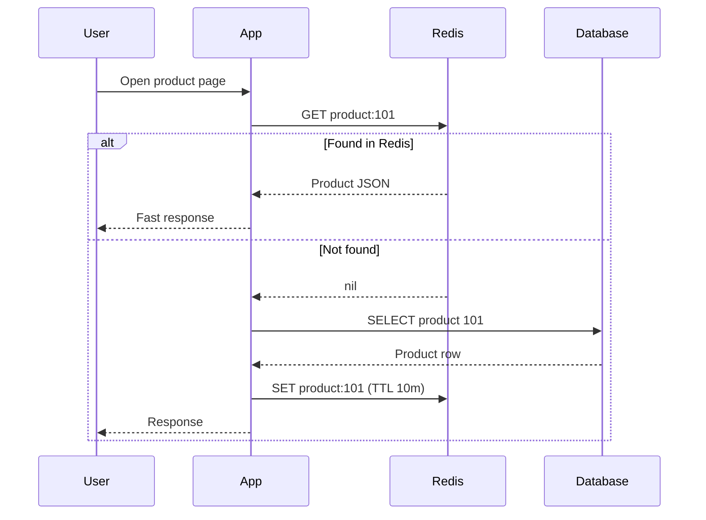

---

## 4. Redis Architecture Basics

### Single Redis instance (starting point)

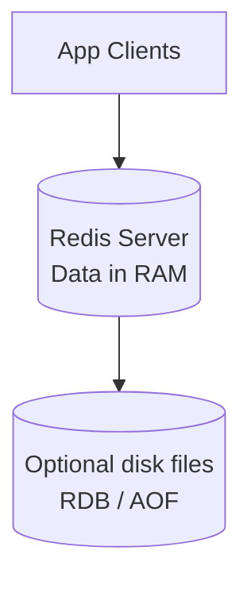

### Important properties

| Property | Meaning |
|----------|---------|
| In-memory | Data lives in RAM → very fast |
| Single-threaded command execution | Commands are processed one by one (simple and predictable) |
| Rich data structures | Not only strings |
| Optional persistence | Can save to disk |
| Network service | Apps talk to Redis over TCP (default port `6379`) |

### Why "single-threaded" is not always bad

Redis is fast because:

- Memory operations are cheap
- No lock complexity for many cases
- Efficient event loop

But: **slow commands** (huge keys, `KEYS *`) can block others. Avoid them in production.

---

## 5. Data Types in Redis

This is where Redis shines. It is not only `string → string`.

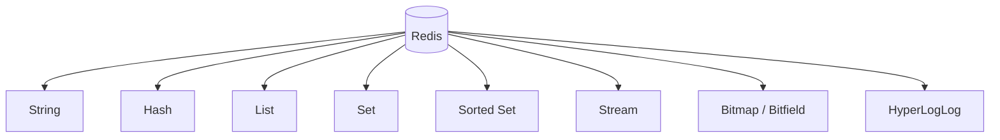

### 5.1 String

Simplest type. Can store text, numbers, or JSON string.

**Use for:** cache blobs, counters, flags, OTP

```text
SET user:42:name "Asha"
GET user:42:name
INCR pageviews:home
```

**Real life:** A sticky note with one value.

---

### 5.2 Hash

A key that contains multiple field-value pairs (like a small object).

**Use for:** user profile fields, product attributes

```text
HSET user:42 name "Asha" city "Pune" age 24
HGET user:42 city
HGETALL user:42
```

**Real life:** One folder labeled `user:42` with papers inside: name, city, age.

---

### 5.3 List

Ordered list of values (can act like queue or recent feed).

**Use for:** recent activity, simple queues

```text
LPUSH notifications:42 "Order shipped"
LRANGE notifications:42 0 9
```

**Real life:** A stack of message slips.

---

### 5.4 Set

Unordered unique values.

**Use for:** tags, unique visitors, “users who liked this”

```text
SADD post:9:likes user:1 user:2 user:5
SISMEMBER post:9:likes user:2
SCARD post:9:likes
```

**Real life:** A basket where duplicates are not allowed.

---

### 5.5 Sorted Set (ZSet)

Like a set, but each member has a **score**. Sorted by score.

**Use for:** leaderboards, ranked feeds, time-ordered indexes

```text
ZADD game:scores 1500 "player:asha"
ZADD game:scores 1800 "player:ravi"
ZREVRANGE game:scores 0 9 WITHSCORES
```

**Real life:** Exam rank list (name + marks).

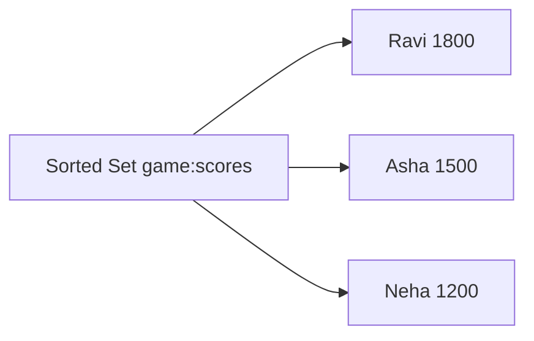

---

### 5.6 Stream (overview)

Append-only log of messages. Useful for event flows.

**Use for:** activity streams, simple event processing

(You can learn Streams deeply later. For system design basics, know: “Redis can also move event-like data.”)

---

### Data type cheat sheet

| Type | Best for | Example |
|------|----------|---------|
| String | Cache value, counter, OTP | `product:101` |
| Hash | Object fields | `user:42` |
| List | Recent items / queue | notifications |
| Set | Unique membership | post likes |
| Sorted Set | Ranking by score | leaderboard |
| Stream | Event log | order events |

---

## 6. Important Commands (Beginner Set)

You do not need all commands. Learn these first.

### Strings

| Command | What it does |
|---------|--------------|
| `SET key value` | Save value |
| `GET key` | Read value |
| `DEL key` | Delete key |
| `EXISTS key` | Check if key exists |
| `INCR key` | +1 counter |
| `SET key value EX 60` | Save with 60 second expiry |

### Hashes

| Command | What it does |
|---------|--------------|
| `HSET key field value` | Set field |
| `HGET key field` | Get one field |
| `HGETALL key` | Get all fields |
| `HDEL key field` | Delete field |

### Expiry

| Command | What it does |
|---------|--------------|
| `EXPIRE key 120` | Expire after 120 seconds |
| `TTL key` | Seconds left (-1 no expiry, -2 missing) |
| `PERSIST key` | Remove expiry |

### Generic useful

| Command | What it does |
|---------|--------------|
| `TYPE key` | Shows data type |
| `SCAN` | Safely iterate keys (prefer over `KEYS`) |
| `FLUSHDB` | Deletes all keys in DB (dangerous!) |

### Dangerous in production

- `KEYS *` (can freeze Redis on large datasets)
- `FLUSHALL` / `FLUSHDB` without care
- Very large `HGETALL` / huge lists without limits

---

## 7. Keys, Namespaces, and TTL

### Good key naming

Use clear prefixes:

```text
user:42
user:42:session
product:101
product:101:stock
otp:91XXXXXXXXXX
rate:api:user:42
```

**Why?** Easy to understand, easy to invalidate (`DEL user:42`), easy to debug.

### TTL (Time To Live)

TTL auto-deletes a key after some time.

```text
SET session:abc "user:42" EX 3600
```

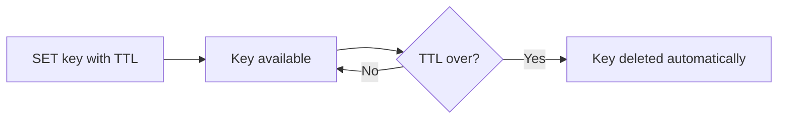

### Real-life

OTP valid for 5 minutes. After that, Redis removes it. No manual cleanup job needed for that key.

---

## 8. Persistence (Will Data Survive Restart?)

By default Redis is in memory. If process dies, memory is gone unless persistence/replication is configured.

Redis has two main persistence options:

### 8.1 RDB (snapshots)

Redis takes point-in-time snapshots and writes a `.rdb` file.

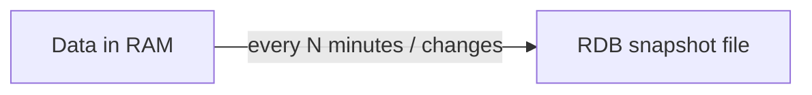

**Pros:** Compact, faster restarts  
**Cons:** Can lose data between snapshots

**Real life:** Taking a photo of your notebook every hour. If fire happens at 12:50, you only have the 12:00 photo.

---

### 8.2 AOF (Append Only File)

Redis logs every write operation to a file.

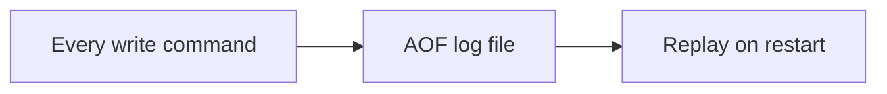

**Pros:** Better durability  
**Cons:** Larger file, can be slower depending on fsync policy

**Real life:** Writing every change in a diary, line by line.

---

### 8.3 RDB + AOF together

Many production setups use both for balance.

### Important mindset

Even with persistence:

> For most apps, keep **important business data in your main database**. Use Redis for speed, sessions, short-lived state, and carefully chosen durable cases.

---

## 9. Eviction Policies

RAM is limited. When Redis is full, it must remove something (if configured).

Common policies:

| Policy | Meaning |
|--------|---------|
| `noeviction` | New writes fail when memory full |
| `allkeys-lru` | Remove least recently used keys |
| `volatile-lru` | LRU only among keys with TTL |
| `allkeys-lfu` | Remove least frequently used |
| `volatile-ttl` | Remove keys closest to expiry |

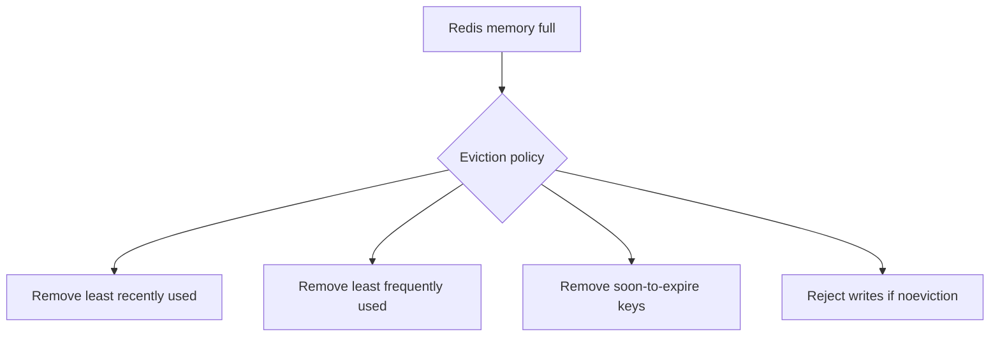

**Beginner default for cache:** `allkeys-lru` (or volatile variant if only some keys should expire).

---

## 10. Common Use Cases

### 10.1 Caching

Store expensive query results.

```text
GET product:101
(miss) → DB → SET product:101 ... EX 600
```

### 10.2 Session store

With many app servers, keep login session in Redis so any server can serve the user.

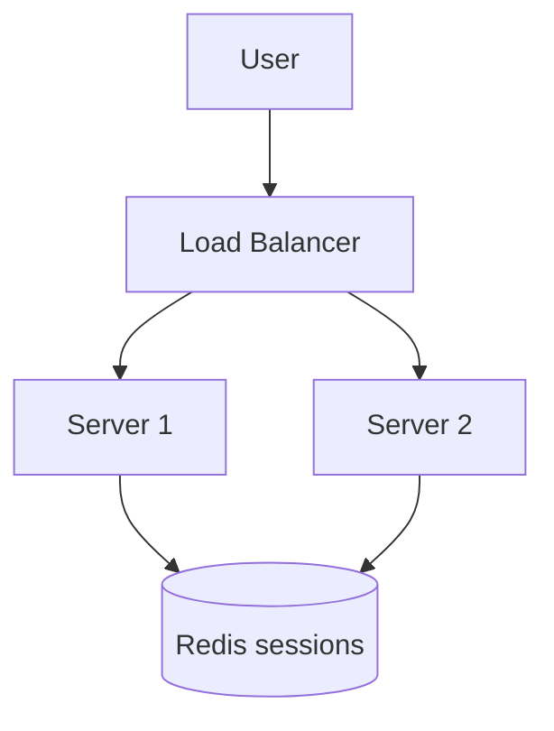

### 10.3 Rate limiting

Limit API calls: max 100 requests / minute / user.

Idea:

```text
INCR rate:user:42
EXPIRE rate:user:42 60   (set expiry on first hit)
if count > 100 → block
```

### 10.4 OTP / temporary tokens

```text
SET otp:98765 482913 EX 300
```

### 10.5 Leaderboards

Use Sorted Sets.

### 10.6 Distributed locks (careful)

Use only with a known safe pattern (for example Redlock discussion / libraries). Easy to get wrong. Learn carefully before production.

### 10.7 Pub/Sub notifications

Broadcast events to many subscribers (see next section).

### 10.8 Job / background queues

Use Lists or Streams to hold tasks that workers process later.

```text
LPUSH email:queue "{to:asha@mail.com, template:welcome}"
BRPOP email:queue 5
```

**Real life:** Restaurant order tickets stacked for the kitchen. Waiter adds tickets; chefs pick them one by one.

**Examples:** send email, resize image, generate invoice, push notification.

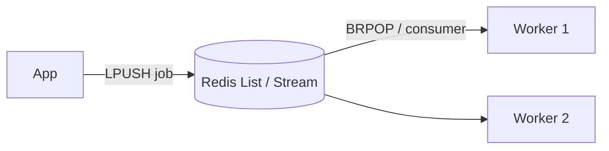

> For very large, durable event systems, teams often prefer Kafka. Redis queues are great for simpler background jobs.

### 10.9 Real-time counters and analytics

Count likes, views, clicks, active users instantly with `INCR` / bitmaps / HyperLogLog.

| Need | Redis approach |
|------|----------------|
| Page view counter | `INCR views:post:9` |
| Unique visitors estimate | HyperLogLog |
| Daily active users style flags | Bitmap |

**Real life:** A cricket scoreboard updating live, not waiting for end-of-day reports.

### 10.10 Geospatial (nearby users / drivers)

Redis can store locations and find nearby points (`GEOADD`, `GEOSEARCH`).

**Examples:**

- Find drivers near a rider (Uber-like)
- Show nearby restaurants / stores
- "People near me" features

```text
GEOADD drivers 72.8777 19.0760 driver:11
GEOSEARCH drivers FROMLONLAT 72.88 19.08 BYRADIUS 3 km
```

### 10.11 Autocomplete / suggestions

Use Sorted Sets (or Redis Search module) for prefix suggestions.

**Examples:** search box suggestions, hashtag autocomplete, city name typeahead.

### 10.12 Shopping cart

Keep cart items in a Hash or JSON-like string with TTL.

```text
HSET cart:user:42 product:101 2
HSET cart:user:42 product:55 1
EXPIRE cart:user:42 86400
```

**Why Redis?** Fast updates, shared across servers, can expire abandoned carts.

### 10.13 Online presence (who is online)

Track active users with keys + short TTL, refreshed by heartbeat.

```text
SET presence:user:42 "online" EX 60
```

App refreshes every 30 seconds. If refresh stops, key expires → user appears offline.

**Real life:** Green "online" dot on chat apps.

### 10.14 Idempotency keys

Prevent duplicate payments / duplicate order creation.

```text
SETNX idempotency:pay:abc123 "processing" EX 300
```

If key already exists, reject duplicate request.

### 10.15 Feature flags / config cache

Store feature toggles for quick checks.

```text
SET feature:new_checkout "on"
```

Apps read flags from Redis without hitting main DB every time.

### 10.16 Deduplication

Remember already-processed event IDs (with TTL).

```text
SADD processed:events evt_9981
EXPIRE processed:events 86400
```

Useful in webhook handling and at-least-once delivery systems.

### 10.17 Feed / timeline helpers

Cache home feed pages, or keep recent post IDs in Lists / Sorted Sets.

**Example:** Instagram-like "first page of feed" cached for a short time.

### 10.18 Waiting room / fair queue

During huge sales (IPL tickets, phone launch), put users in a Redis queue and allow entry in batches.

### 10.19 API response cache

Cache full or partial API JSON responses for expensive endpoints.

### 10.20 Distributed coordination helpers

Besides locks:

- rate limit windows
- leader election style flags (advanced)
- circuit breaker state (open/closed counts)

### Use cases map (big picture)

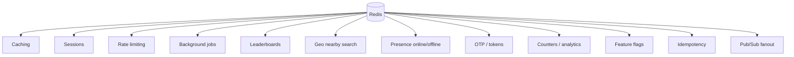

### Quick "what should I use Redis for?" table

| Use case | Good fit? | Notes |
|----------|-----------|-------|
| Hot product/profile cache | Yes | Classic |
| Login sessions | Yes | Shared across servers |
| OTP / reset tokens | Yes | TTL perfect |
| Rate limiting | Yes | Fast counters |
| Leaderboards | Yes | Sorted sets |
| Nearby drivers | Yes | Geo commands |
| Background email jobs | Yes (simple) | Streams/Lists; Kafka for huge scale |
| Online presence | Yes | Short TTL keys |
| Shopping cart | Often yes | Fast + expiry |
| Primary bank ledger | Usually no | Use main DB as source of truth |
| Long durable event bus | Maybe no | Prefer Kafka / SQS style systems |

---

## 11. Caching Patterns with Redis

### Cache-Aside (most common)

App checks Redis → on miss loads DB → writes Redis.

### Write-Through

App writes Redis and DB together (or through a layer that does both).

### Cache invalidation on update

When product price changes in DB:

```text
1) UPDATE products SET price=... WHERE id=101
2) DEL product:101
```

Next read rebuilds fresh cache.

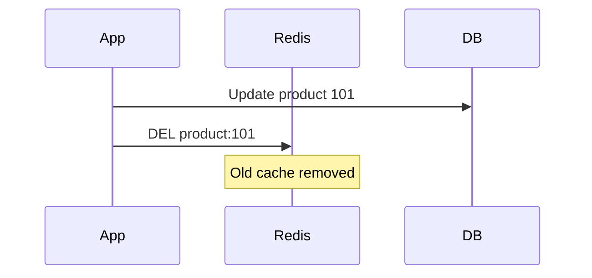

### Cache stampede (thundering herd)

Many requests miss the same key at once and all hit DB.

**Simple protections:**

- Short random jitter in TTL
- Lock around rebuild for that key
- Serve slightly stale data while refreshing (advanced)

---

## 12. Pub/Sub and Streams (Simple View)

### Pub/Sub

One publisher sends a message. Many subscribers receive it.

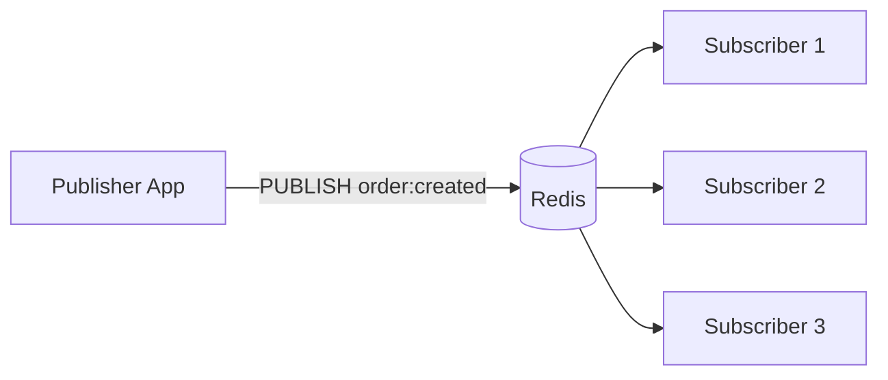

**Real life:** Announcement speaker in a mall. If you were not present, you missed it.

**Limitation:** If a subscriber is offline, it usually misses the message. Not a full durable queue like Kafka.

### Streams (short)

Streams are better when you need an append log and consumer groups. Closer to event-log style than pure Pub/Sub.

**System design tip:**  
For mission-critical durable messaging at scale, teams often choose **Kafka / SQS / RabbitMQ**. Redis Pub/Sub is great for lightweight realtime fanout.

---

## 13. Transactions and Pipelines

### Pipeline

Send many commands together to reduce network round trips.

**Real life:** Instead of 20 separate trips to the shop, give one list and buy all items once.

### MULTI / EXEC (transaction style)

Group commands to run one after another without interleaving from other clients between them.

Notes for beginners:

- Redis transactions are not exactly like full SQL ACID transactions
- There is also Lua scripting for atomic custom logic on server side

Learn this when you start advanced Redis usage.

---

## 14. Replication and High Availability

### Replica (slave/replica node)

One primary (master) takes writes. Replicas copy data and serve reads.

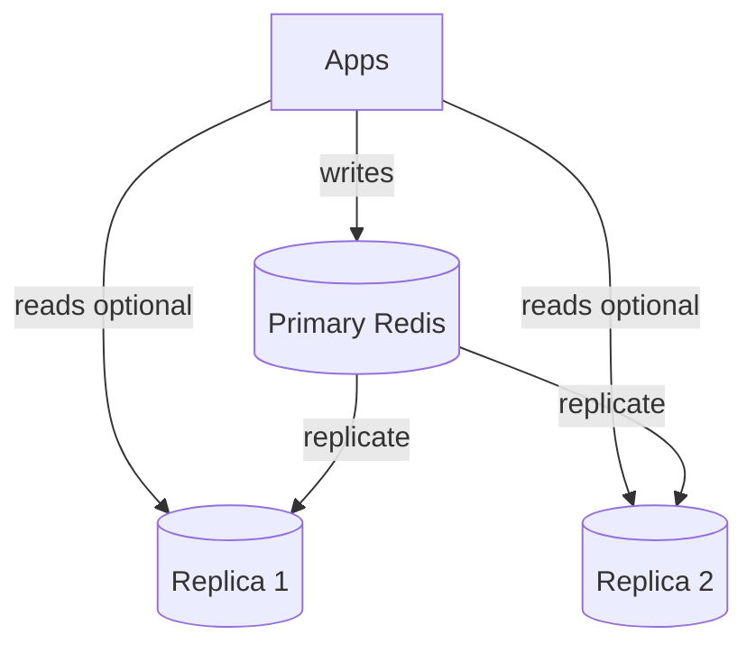

**Benefits:**

- More read capacity
- Backup-ish copy if primary dies (with failover setup)

### Redis Sentinel

Watches Redis nodes and can promote a replica if primary fails.

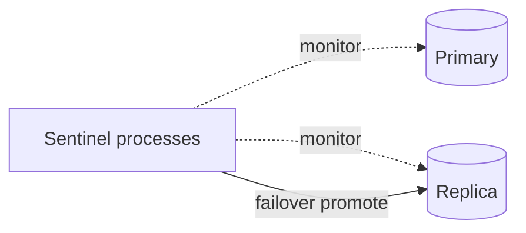

**Real life:** Supervisors notice the main cashier left, and assign another cashier as main.

---

## 15. Clustering and Sharding

One Redis machine has memory limits. For huge data / throughput, use **Redis Cluster**.

Cluster splits keys across multiple nodes (sharding by hash slots).

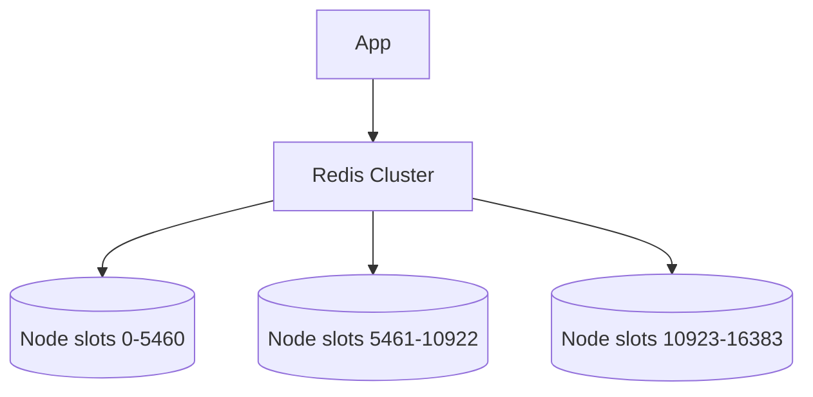

### Beginner takeaway

| Setup | When |
|-------|------|
| Single Redis | Learning, small apps |
| Primary + replicas + Sentinel | High availability |
| Redis Cluster | Large scale / more memory & throughput |

You do not need Cluster on day 1.

---

## 16. Security Basics

Do these at minimum in real projects:

1. **Require password / ACL** (do not leave open Redis on internet)
2. Bind to private network / VPC
3. Use TLS where needed
4. Avoid exposing port `6379` publicly
5. Limit dangerous commands for app users

**Real life:** Do not leave your office safe on the street with no lock.

---

## 17. Monitoring and Memory Tips

### Watch these

| Metric / idea | Why |
|---------------|-----|
| Memory used | Avoid sudden eviction storms |
| Hit rate | Is cache useful? |
| Connected clients | Connection leaks? |
| Evicted keys | Memory pressure |
| Slow commands | Latency spikes |
| Replication lag | Stale reads from replica |

### Memory tips

- Set maxmemory
- Choose eviction policy intentionally
- Do not store huge unused objects
- Prefer smaller keys/values when possible
- Use hashes efficiently for many small fields
- Always set TTL for pure cache data

---

## 18. Pros and Cons

### Pros

| Pro | Why it matters |
|-----|----------------|
| Extremely fast | Great UX and lower DB load |
| Simple to start | `GET` / `SET` mental model |
| Rich data types | Leaderboards, sets, sessions, etc. |
| TTL built-in | Perfect for temporary data |
| Shared across servers | Helps horizontal scaling |
| Huge ecosystem | Every major language has clients |

### Cons

| Con | Why it matters |
|-----|----------------|
| RAM cost | Memory is expensive |
| Can lose data if misconfigured | Not automatic durability like a typical SQL DB |
| Operational care needed | Persistence, failover, memory, security |
| Bad commands can block | `KEYS *`, huge values |
| Stale cache risk | Need TTL / invalidation discipline |
| Not ideal as only database for complex relational data | Joins/queries/constraints are different world |

---

## 19. When to Use Redis vs When Not To

### Use Redis when

- Data is read very often
- Speed matters a lot
- Data can be rebuilt from DB if missing
- You need shared sessions / rate limits / rankings / OTP
- Temporary state with expiry fits naturally

### Avoid Redis (as main store) when

- You need complex relational queries as source of truth
- Strong multi-row business transactions are central
- Dataset is large and mostly cold (wastes RAM)
- Team is not ready to operate memory + eviction + failover

### Practical rule

```text
Ask: "If Redis restarts and this key disappears, is it okay?"
Yes → good Redis cache/session candidate
No  → store in primary DB (maybe also mirror in Redis for speed)
```

---

## 20. Redis vs Memcached (Quick)

| | Redis | Memcached |
|--|-------|-----------|
| Data types | Many (string, hash, zset...) | Mostly simple key-value |
| Persistence | Optional | Generally no |
| Use cases | Cache + more | Mostly simple cache |
| Popularity in system design | Very high | Still used, simpler niche |

For learning system design today, **Redis is the default tool to know well**.

---

## 21. Putting It All Together

A common production-style picture:

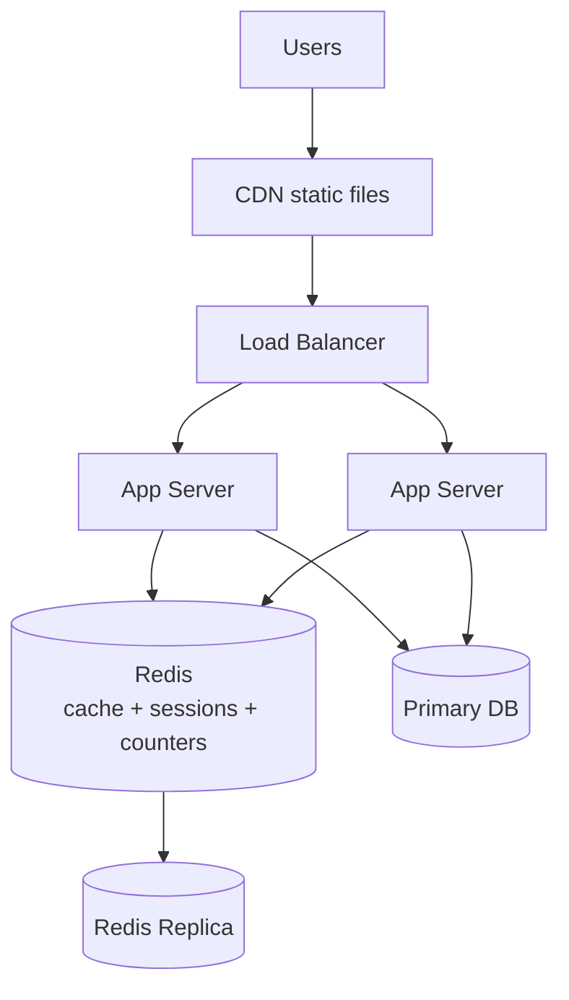

### Example path: "Get my profile"

1. App looks for `user:42` in Redis
2. If hit, return fast
3. If miss, load SQL/NoSQL DB
4. Store in Redis with TTL (example: 15 minutes)
5. On profile update: update DB, then `DEL user:42`

---

## 22. Common Mistakes

| Mistake | Better approach |
|---------|-----------------|
| No TTL on cache keys | Always expire pure cache data |
| Update DB but forget cache | Invalidate / update Redis key |
| Store entire DB in Redis | Cache hot keys only |
| Open Redis to public internet | Private network + auth |
| Use `KEYS *` in production | Use `SCAN` |
| One giant key for everything | Design smaller keyed objects |
| Expect Redis alone to be perfect durable DB | Keep source of truth clear |
| No maxmemory policy | Set memory limit + eviction |

---

## 23. Quick Recap

| Topic | One-line takeaway |
|-------|-------------------|
| Redis | Fast in-memory key-value store with rich types |
| Main superpower | Speed + shared state across servers |
| Core types | String, Hash, List, Set, Sorted Set |
| TTL | Auto-expire keys |
| Persistence | RDB snapshots and/or AOF logs |
| HA | Replicas + Sentinel |
| Scale-out | Redis Cluster |
| Best role | Cache, sessions, counters, rankings, temp data |

### Remember this sentence

> **Redis is your system's fast shared memory. Use it to accelerate hot data and short-lived state, and keep your main database as the source of truth unless you deliberately design otherwise.**

---

## 24. Practice Questions

1. Why is Redis faster than a typical database for repeated reads?
2. Which data type would you use for a game leaderboard, and why?
3. User updates their profile photo URL. What should happen to the Redis key?
4. What is the risk of Write-Behind style caching if Redis crashes?
5. When would you choose Redis Pub/Sub vs Kafka?
6. Your Redis memory is full. What does `allkeys-lru` do?
7. Why can `KEYS *` be dangerous?
8. You have 5 app servers behind a load balancer. Where should sessions live, and why?

Write answers in your own words. Teaching yourself is the best way to remember.
