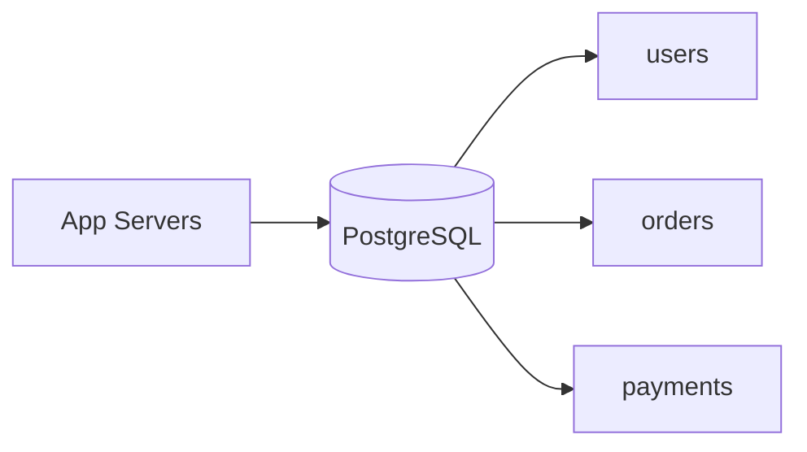
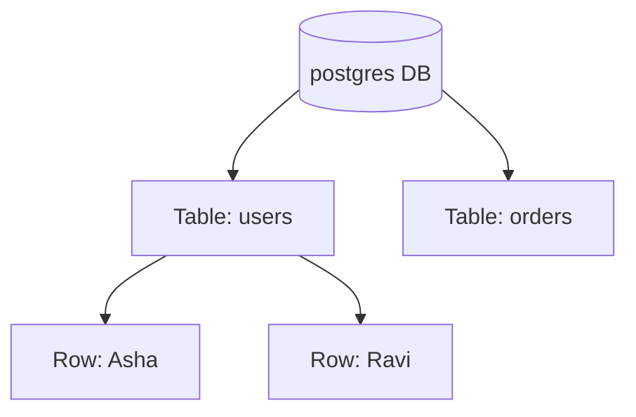
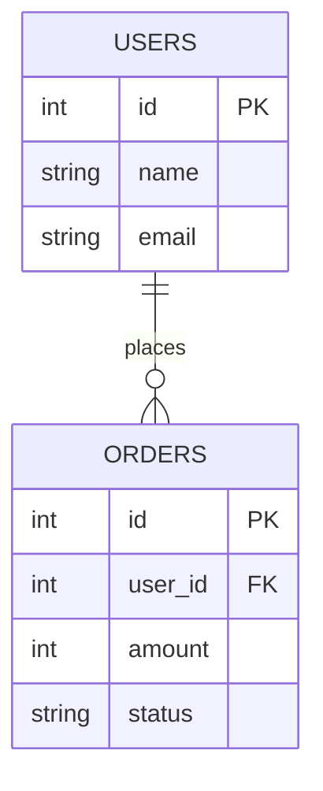
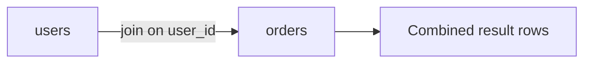
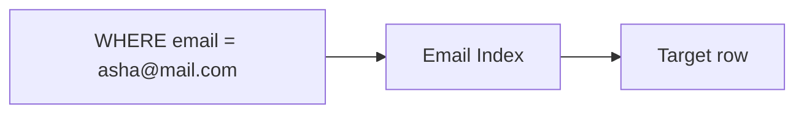
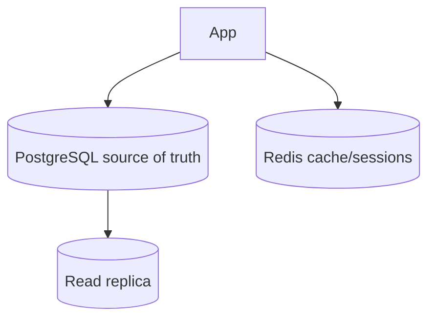
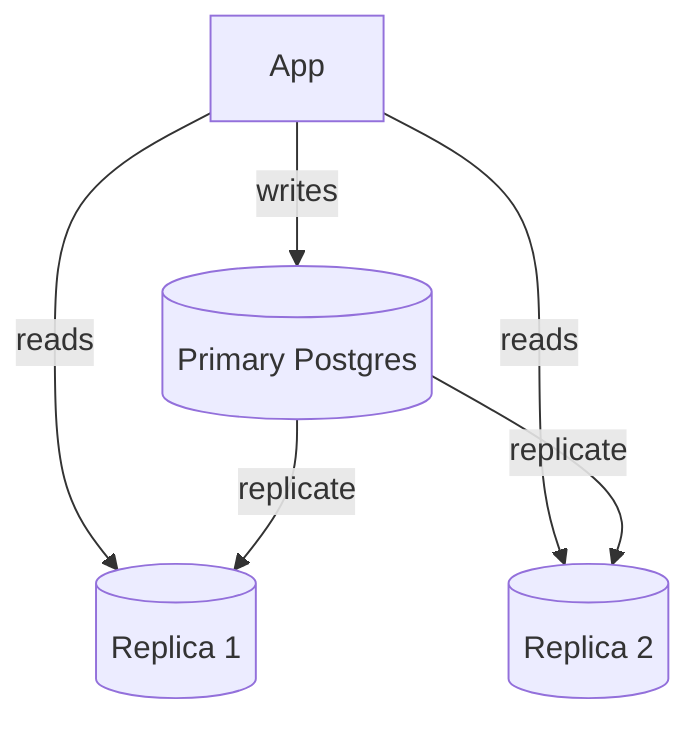
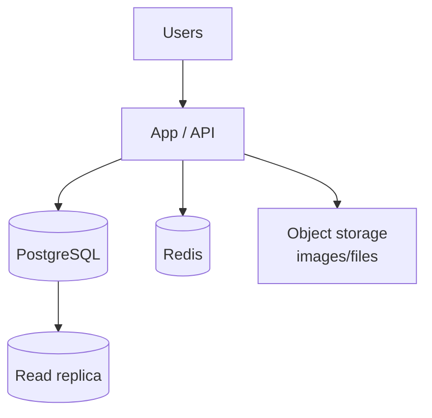

# PostgreSQL (Complete Guide)

> **Who is this for?** Beginners who know SQL vs NoSQL basics, and now want to understand PostgreSQL deeply.
>
> **Related fundamental:** [Databases (SQL vs NoSQL)](../fundamentals/03-databases-sql-vs-nosql.md)
>
> **What you will learn:** What PostgreSQL is, how tables/relations work, SQL basics, indexes, transactions, ACID, replication, when to use it, pros/cons, with easy examples and diagrams.

---

## Table of Contents

- [PostgreSQL (Complete Guide)](#postgresql-complete-guide)
  - [Table of Contents](#table-of-contents)
  - [1. What is PostgreSQL?](#1-what-is-postgresql)
    - [Real-life example](#real-life-example)
    - [One line to remember](#one-line-to-remember)
  - [2. Why PostgreSQL is Popular](#2-why-postgresql-is-popular)
  - [3. Core Mental Model](#3-core-mental-model)
    - [Real-life](#real-life)
  - [4. Tables, Rows, Columns](#4-tables-rows-columns)
    - [Example: users table](#example-users-table)
    - [Example: orders table](#example-orders-table)
  - [5. Primary Keys and Foreign Keys](#5-primary-keys-and-foreign-keys)
    - [Primary Key](#primary-key)
    - [Foreign Key](#foreign-key)
    - [Why this matters](#why-this-matters)
  - [6. SQL Basics You Must Know](#6-sql-basics-you-must-know)
    - [Create / insert / read / update / delete](#create--insert--read--update--delete)
    - [Filtering and sorting](#filtering-and-sorting)
    - [Aggregations](#aggregations)
  - [7. Joins (Connecting Tables)](#7-joins-connecting-tables)
    - [Join types (beginner view)](#join-types-beginner-view)
  - [8. Indexes](#8-indexes)
    - [Useful index examples](#useful-index-examples)
    - [Index trade-off](#index-trade-off)
  - [9. Constraints](#9-constraints)
  - [10. Transactions and ACID](#10-transactions-and-acid)
    - [Classic example: money transfer](#classic-example-money-transfer)
    - [ACID in plain words](#acid-in-plain-words)
  - [11. MVCC (Why Reads Do Not Block Everything)](#11-mvcc-why-reads-do-not-block-everything)
  - [12. Schema and Migrations](#12-schema-and-migrations)
    - [Beginner tip](#beginner-tip)
  - [13. JSON in PostgreSQL](#13-json-in-postgresql)
    - [Why this is powerful](#why-this-is-powerful)
  - [14. Common Use Cases](#14-common-use-cases)
  - [15. Scaling PostgreSQL](#15-scaling-postgresql)
    - [Step 1: Optimize first](#step-1-optimize-first)
    - [Step 2: Vertical scale](#step-2-vertical-scale)
    - [Step 3: Read replicas](#step-3-read-replicas)
    - [Step 4: Partitioning / sharding (later)](#step-4-partitioning--sharding-later)
  - [16. Backup and Recovery Basics](#16-backup-and-recovery-basics)
  - [17. Security Basics](#17-security-basics)
  - [18. Pros and Cons](#18-pros-and-cons)
    - [Pros](#pros)
    - [Cons](#cons)
  - [19. PostgreSQL vs MySQL vs MongoDB (Quick)](#19-postgresql-vs-mysql-vs-mongodb-quick)
  - [20. When to Use PostgreSQL](#20-when-to-use-postgresql)
    - [Use Postgres when](#use-postgres-when)
    - [Consider something else when](#consider-something-else-when)
  - [21. Putting It All Together](#21-putting-it-all-together)
    - [Example: Food delivery core data in Postgres](#example-food-delivery-core-data-in-postgres)
  - [22. Common Mistakes](#22-common-mistakes)
  - [23. Quick Recap](#23-quick-recap)
    - [Remember this sentence](#remember-this-sentence)
  - [24. Practice Questions](#24-practice-questions)

---

## 1. What is PostgreSQL?

**PostgreSQL** (often called **Postgres**) is a powerful **open-source relational (SQL) database**.

In simple words:

> PostgreSQL stores data in tables (rows and columns), supports strong relationships, and is excellent when correctness and structured data matter.

### Real-life example

Think of Postgres as a well-organized school office:

- Every student form has fixed fields
- Roll numbers are unique
- Attendance sheets link to student IDs
- Rules are enforced (no empty mandatory fields)



### One line to remember

**Postgres = reliable relational source of truth for business data.**

---

## 2. Why PostgreSQL is Popular

| Reason | Easy meaning |
|--------|--------------|
| Open source and mature | Trusted for many years |
| Strong SQL support | Powerful queries |
| ACID transactions | Great for money and bookings |
| Rich features | Indexes, JSON, full-text, extensions |
| Great ecosystem | ORMs, cloud managed services, tools |
| Reliable defaults | Good balance of safety and power |

Used widely for:

- SaaS apps
- E-commerce
- Fintech backends
- Internal admin systems
- Many startup MVPs and large production systems

---

## 3. Core Mental Model

```text
Database
  └── Schemas (optional grouping)
        └── Tables
              └── Rows (records)
                    └── Columns (fields)
```

### Real-life

- Database = whole school office cabinet
- Table = one register book (Students, Fees, Attendance)
- Row = one student entry
- Column = one field (name, email, phone)



---

## 4. Tables, Rows, Columns

### Example: users table

| id | name | email | created_at |
|----|------|-------|------------|
| 1 | Asha | asha@mail.com | 2026-01-10 |
| 2 | Ravi | ravi@mail.com | 2026-01-12 |

### Example: orders table

| id | user_id | amount | status |
|----|---------|--------|--------|
| 101 | 1 | 499 | paid |
| 102 | 1 | 150 | pending |

Each column has a **data type**:

| Type examples | Used for |
|---------------|----------|
| `INT`, `BIGINT` | IDs, counts |
| `VARCHAR`, `TEXT` | names, emails |
| `BOOLEAN` | true/false flags |
| `NUMERIC` / `DECIMAL` | money (safer than float) |
| `TIMESTAMP` | dates and times |
| `UUID` | globally unique IDs |
| `JSONB` | flexible JSON data |

---

## 5. Primary Keys and Foreign Keys

### Primary Key

Uniquely identifies a row.

```text
users.id = 1  → only one such user
```

### Foreign Key

A column that points to another table's primary key.

```text
orders.user_id → users.id
```



### Why this matters

Foreign keys help prevent orphan data like:

- order for `user_id = 999` when user 999 does not exist

---

## 6. SQL Basics You Must Know

### Create / insert / read / update / delete

```sql
CREATE TABLE users (
  id BIGSERIAL PRIMARY KEY,
  name TEXT NOT NULL,
  email TEXT UNIQUE NOT NULL,
  created_at TIMESTAMPTZ DEFAULT now()
);

INSERT INTO users (name, email)
VALUES ('Asha', 'asha@mail.com');

SELECT id, name, email
FROM users
WHERE email = 'asha@mail.com';

UPDATE users
SET name = 'Asha Patil'
WHERE id = 1;

DELETE FROM users
WHERE id = 1;
```

### Filtering and sorting

```sql
SELECT *
FROM orders
WHERE status = 'paid'
ORDER BY amount DESC
LIMIT 10;
```

### Aggregations

```sql
SELECT user_id, COUNT(*) AS order_count, SUM(amount) AS total_spent
FROM orders
GROUP BY user_id;
```

---

## 7. Joins (Connecting Tables)

Joins combine related rows from multiple tables.

```sql
SELECT users.name, orders.amount, orders.status
FROM users
JOIN orders ON users.id = orders.user_id
WHERE users.id = 1;
```



### Join types (beginner view)

| Join | Meaning |
|------|---------|
| `INNER JOIN` | Only matching rows from both |
| `LEFT JOIN` | All left rows + matches from right |
| `RIGHT JOIN` | All right rows + matches from left |

**Real life:**  
Match student register with fee receipts. Inner join = only students who paid. Left join = all students, paid or not.

---

## 8. Indexes

An **index** makes lookups faster, like a book index.

Without index:

```text
Find email asha@mail.com → scan many rows
```

With index on email:

```text
Jump closer to the matching row quickly
```



### Useful index examples

```sql
CREATE INDEX idx_orders_user_id ON orders(user_id);
CREATE UNIQUE INDEX idx_users_email ON users(email);
```

### Index trade-off

| Benefit | Cost |
|---------|------|
| Faster reads/filters | Extra storage |
| Faster joins/lookups | Slightly slower writes |

**Tip:** Index columns used often in `WHERE`, `JOIN`, and `ORDER BY`. Do not index everything blindly.

---

## 9. Constraints

Constraints are database rules.

| Constraint | Meaning | Example |
|------------|---------|---------|
| `NOT NULL` | Value required | name cannot be empty |
| `UNIQUE` | No duplicates | email unique |
| `PRIMARY KEY` | Unique row id | users.id |
| `FOREIGN KEY` | Must exist in other table | orders.user_id |
| `CHECK` | Custom rule | amount > 0 |

```sql
ALTER TABLE orders
ADD CONSTRAINT chk_amount_positive CHECK (amount > 0);
```

**Real life:** Form validation, but enforced by the database itself.

---

## 10. Transactions and ACID

A **transaction** groups multiple steps into one unit: all succeed or all fail.

### Classic example: money transfer

```sql
BEGIN;

UPDATE accounts SET balance = balance - 100 WHERE id = 1;
UPDATE accounts SET balance = balance + 100 WHERE id = 2;

COMMIT;  -- or ROLLBACK on error
```

### ACID in plain words

| Letter | Meaning | Easy example |
|--------|---------|--------------|
| Atomicity | All or nothing | Debit and credit both happen, or neither |
| Consistency | Rules stay valid | Balances never break constraints |
| Isolation | Concurrent txs do not corrupt each other | Two transfers handled safely |
| Durability | Committed data stays | Survives crash after commit |

This is one of Postgres' biggest strengths.

---

## 11. MVCC (Why Reads Do Not Block Everything)

PostgreSQL uses **MVCC** (Multi-Version Concurrency Control).

Simple idea:

> Readers can see a snapshot of data without waiting for every writer to finish.

**Real life:**  
While office staff update a register, visitors can still read a photocopy of the previous valid page.

You do not need deep internals on day 1. Just know:

- Postgres handles concurrent reads/writes well
- Isolation levels control how strict concurrent behavior is

---

## 12. Schema and Migrations

Postgres likes a defined schema. When product changes, you evolve schema with migrations.

Examples:

- add column `phone` to users
- create new table `addresses`
- add index on `orders.status`

```sql
ALTER TABLE users ADD COLUMN phone TEXT;
```

### Beginner tip

Treat migrations as versioned steps (like git commits for database structure). Never "hand edit production schema" randomly.

---

## 13. JSON in PostgreSQL

Postgres can store JSON with `JSON` / `JSONB`.

```sql
ALTER TABLE products ADD COLUMN attributes JSONB;

UPDATE products
SET attributes = '{"color":"black","ram":"8GB"}'
WHERE id = 10;

SELECT *
FROM products
WHERE attributes->>'color' = 'black';
```

### Why this is powerful

You get relational strength **plus** flexible document-like fields when needed.

Still: for core business relations (users/orders/payments), normal columns are usually clearer.

---

## 14. Common Use Cases

| Use case | Why Postgres fits |
|----------|-------------------|
| User accounts and roles | Relations + constraints |
| Orders and payments | Transactions |
| Inventory systems | Strong correctness |
| SaaS subscriptions/billing | Structured business data |
| Admin dashboards / reports | Rich SQL queries |
| App source of truth + Redis cache | Classic production pattern |



---

## 15. Scaling PostgreSQL

### Step 1: Optimize first

- proper indexes
- better queries
- connection pooling
- caching hot reads in Redis

### Step 2: Vertical scale

More CPU/RAM/disk for the primary database.

### Step 3: Read replicas

Primary for writes. Replicas for heavy reads.



### Step 4: Partitioning / sharding (later)

- Table partitioning by date/range
- Sharding by key across multiple DBs (more complex)

**Beginner rule:** Do not jump to sharding early.

---

## 16. Backup and Recovery Basics

Common approaches:

| Method | Meaning |
|--------|---------|
| Logical backup (`pg_dump`) | Export SQL/data |
| Physical backups | Copy data files / base backup |
| WAL archiving / PITR | Restore to a point in time |

**Real life:**  
Keep photocopies of office registers, and also keep a diary of every change so you can rebuild to yesterday 5 PM if needed.

---

## 17. Security Basics

1. Use strong auth (and managed IAM where possible)
2. Least privilege roles (app user != superuser)
3. Encrypted connections (TLS)
4. Restrict network access (private VPC / firewall)
5. Careful with raw SQL (prevent injection via parameterized queries)

```text
Bad mental model: one superuser for everything
Good mental model: app role can only do what app needs
```

---

## 18. Pros and Cons

### Pros

| Pro | Why it matters |
|-----|----------------|
| Strong consistency and ACID | Safe for critical data |
| Excellent SQL | Complex queries and reporting |
| Relations + constraints | Clean data integrity |
| JSONB flexibility | Hybrid needs supported |
| Mature and trusted | Huge community and tooling |
| Extensions | Extra powers when needed |

### Cons

| Con | Why it matters |
|-----|----------------|
| Horizontal scaling is harder than some NoSQL systems | Needs careful design |
| Schema migrations require discipline | Changing structure needs planning |
| Very large write-heavy global workloads may need extra architecture | Replicas/sharding/CQRS etc. |
| Wrong indexes/queries can still make it slow | Skill matters |

---

## 19. PostgreSQL vs MySQL vs MongoDB (Quick)

| | PostgreSQL | MySQL | MongoDB |
|--|------------|-------|---------|
| Model | Relational | Relational | Document |
| Transactions | Excellent | Good (improved a lot) | Supports multi-doc, different design style |
| JSON support | Excellent (`JSONB`) | Good | Native documents |
| Best default for | Serious relational apps | Web apps / simple relational | Flexible document data |
| Learning value | Very high for system design | High | High for NoSQL path |

For many modern backends, **Postgres is the default SQL choice**.

---

## 20. When to Use PostgreSQL

### Use Postgres when

- data is structured and relational
- transactions matter (payments, bookings, inventory)
- you need strong constraints and reporting
- you want one solid source-of-truth database
- team understands SQL

### Consider something else when

- pure temporary cache/session speed layer → Redis
- highly variable document trees as main model and team prefers that → MongoDB
- specialized graph relationship traversal → Neo4j
- massive write-optimized multi-region event patterns → Cassandra/Dynamo-style systems

---

## 21. Putting It All Together

A common production shape:



### Example: Food delivery core data in Postgres

| Data | Why Postgres |
|------|--------------|
| Users / restaurants | Relational + constraints |
| Orders / payments | Transactions |
| Delivery assignment state | Strong updates |
| Coupon redemptions | Correctness matters |

Menu content cache and sessions can still sit in Redis.

---

## 22. Common Mistakes

| Mistake | Better approach |
|---------|-----------------|
| No indexes on foreign keys / filters | Index real query paths |
| Using `FLOAT` for money | Use `NUMERIC`/`DECIMAL` |
| Huge `SELECT *` everywhere | Select needed columns |
| Skipping transactions for multi-step writes | Use transactions |
| Premature sharding | Optimize + replicas first |
| App DB user has superuser rights | Least privilege |
| Putting all files/images in DB blobs by default | Object storage often better |

---

## 23. Quick Recap

| Concept | One-line takeaway |
|---------|-------------------|
| PostgreSQL | Powerful open-source relational DB |
| Table | Structured collection of rows |
| Primary key | Unique row identity |
| Foreign key | Link between tables |
| Index | Faster lookups |
| Transaction | All-or-nothing unit of work |
| ACID | Correctness guarantees |
| Replica | Extra read copy |
| JSONB | Flexible fields inside SQL world |

### Remember this sentence

> **PostgreSQL is your reliable relational source of truth. Use it when relationships, constraints, and transactions matter.**

---

## 24. Practice Questions

1. Why is a foreign key useful in an orders/users design?
2. What problem do transactions solve in a money transfer?
3. When should you add an index, and what is the cost?
4. Why is Postgres a strong default for payments and bookings?
5. What is the difference between vertical scaling and read replicas?
6. Give one case for `JSONB`, and one case where normal columns are better.
7. Why should the app DB user not be a superuser?
8. How can Redis and Postgres work together in one system?

Write answers in your own words.
