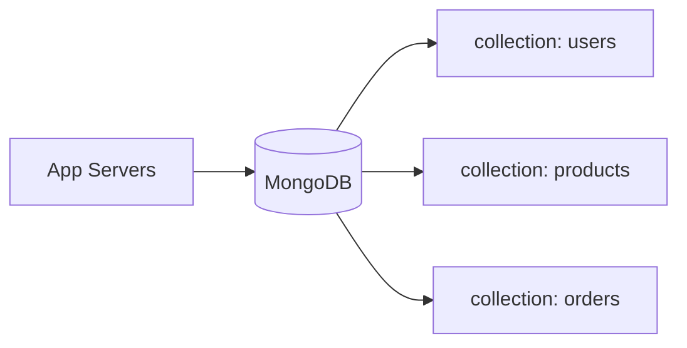
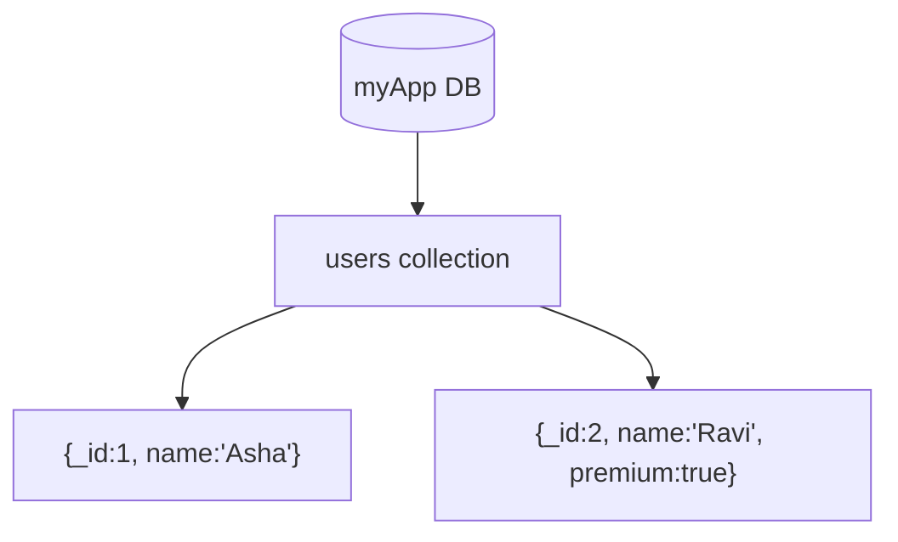
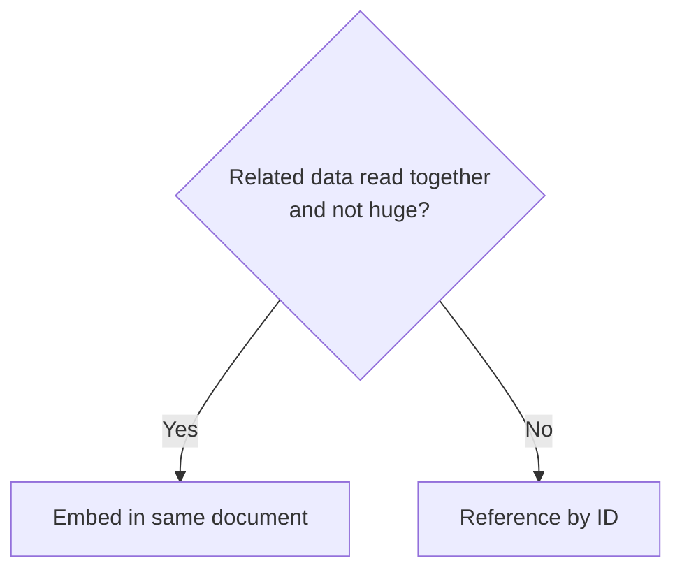
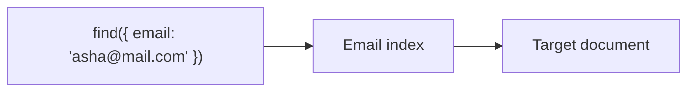
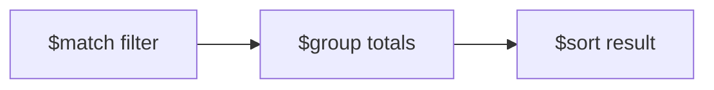
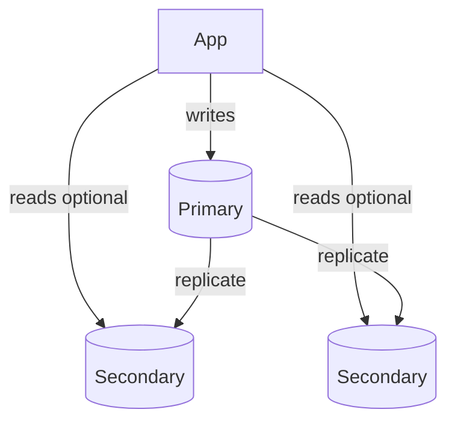
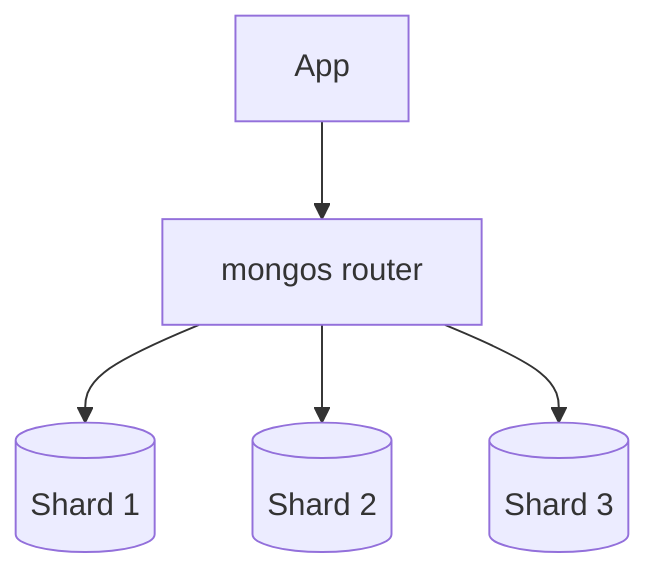
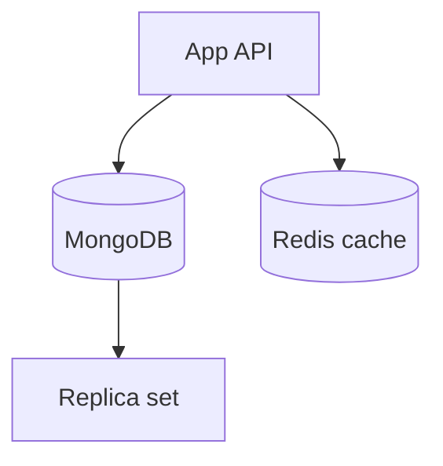
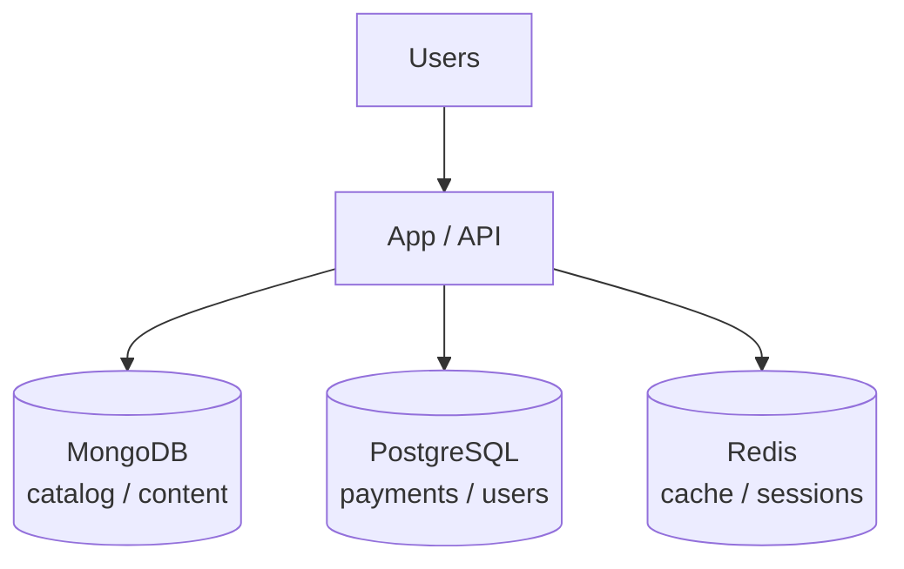

# MongoDB (Complete Guide)

> **Who is this for?** Beginners who know SQL vs NoSQL basics, and now want to understand MongoDB deeply.
>
> **Related fundamental:** [Databases (SQL vs NoSQL)](../fundamentals/03-databases-sql-vs-nosql.md) · [PostgreSQL](./02-postgresql.md)
>
> **What you will learn:** What MongoDB is, documents/collections, queries, indexes, embedding vs referencing, aggregation, replication, sharding, when to use it, pros/cons, with easy examples and diagrams.

---

## Table of Contents

- [MongoDB (Complete Guide)](#mongodb-complete-guide)
  - [Table of Contents](#table-of-contents)
  - [1. What is MongoDB?](#1-what-is-mongodb)
    - [Real-life example](#real-life-example)
    - [One line to remember](#one-line-to-remember)
  - [2. Why MongoDB Exists](#2-why-mongodb-exists)
  - [3. Core Mental Model](#3-core-mental-model)
  - [4. Documents and Collections](#4-documents-and-collections)
    - [Example document](#example-document)
    - [Collection example: `products`](#collection-example-products)
  - [5. MongoDB vs SQL Words](#5-mongodb-vs-sql-words)
  - [6. Basic CRUD Operations](#6-basic-crud-operations)
    - [Insert](#insert)
    - [Find](#find)
    - [Update](#update)
    - [Delete](#delete)
    - [Useful operators](#useful-operators)
  - [7. Flexible Schema](#7-flexible-schema)
    - [Pros](#pros)
    - [Cons](#cons)
  - [8. Embedding vs Referencing](#8-embedding-vs-referencing)
    - [Embedding (store related data inside one document)](#embedding-store-related-data-inside-one-document)
    - [Referencing (store IDs and fetch separately)](#referencing-store-ids-and-fetch-separately)
    - [Rule of thumb](#rule-of-thumb)
  - [9. Indexes](#9-indexes)
    - [Common index types (beginner view)](#common-index-types-beginner-view)
  - [10. Aggregation Framework](#10-aggregation-framework)
  - [11. Transactions in MongoDB](#11-transactions-in-mongodb)
  - [12. Replication (Replica Set)](#12-replication-replica-set)
  - [13. Sharding](#13-sharding)
  - [14. Common Use Cases](#14-common-use-cases)
  - [15. Data Modeling Tips](#15-data-modeling-tips)
    - [Example: food delivery](#example-food-delivery)
  - [16. Pros and Cons](#16-pros-and-cons)
    - [Pros](#pros-1)
    - [Cons](#cons-1)
  - [17. MongoDB vs PostgreSQL (Quick)](#17-mongodb-vs-postgresql-quick)
  - [18. When to Use MongoDB](#18-when-to-use-mongodb)
    - [Use MongoDB when](#use-mongodb-when)
    - [Avoid as default when](#avoid-as-default-when)
  - [19. Putting It All Together](#19-putting-it-all-together)
    - [Example sentence for system design](#example-sentence-for-system-design)
  - [20. Common Mistakes](#20-common-mistakes)
  - [21. Quick Recap](#21-quick-recap)
    - [Remember this sentence](#remember-this-sentence)
  - [22. Practice Questions](#22-practice-questions)

---

## 1. What is MongoDB?

**MongoDB** is a popular **document NoSQL database**.

In simple words:

> MongoDB stores data as JSON-like documents (BSON), not as fixed table rows.

### Real-life example

Postgres is like a government form with fixed fields.  
MongoDB is like a student file folder:

- one student has sports certificates
- another has music certificates
- another has both
- folders can look different, but still live in one cabinet



### One line to remember

**MongoDB = flexible document store designed around how your app reads and writes data.**

---

## 2. Why MongoDB Exists

Relational tables are great, but some data is naturally document-shaped:

- product catalogs with different attributes per category
- user profiles with optional nested fields
- content posts (text, images, polls, different metadata)
- event-style records that evolve quickly

MongoDB aims for:

- flexible documents
- horizontal scaling options
- developer-friendly JSON-like model
- fast iteration when fields change often

---

## 3. Core Mental Model

```text
Database
  └── Collections
        └── Documents (JSON-like objects)
```

| MongoDB term | Feels like |
|--------------|------------|
| Database | Cabinet |
| Collection | Folder / drawer |
| Document | One file / one JSON object |
| Field | One key inside JSON |



---

## 4. Documents and Collections

### Example document

```json
{
  "_id": "64f1...",
  "name": "Asha",
  "email": "asha@mail.com",
  "city": "Pune",
  "tags": ["seller", "premium"],
  "address": {
    "line1": "MG Road",
    "pincode": "411001"
  }
}
```

Notes:

- `_id` is the unique document id (auto-created if you do not provide one)
- nested objects and arrays are natural
- documents in the same collection can have different fields

### Collection example: `products`

Phone document and sofa document can both live in `products`, with different attributes.

---

## 5. MongoDB vs SQL Words

| SQL | MongoDB |
|-----|---------|
| Database | Database |
| Table | Collection |
| Row | Document |
| Column | Field |
| Join | Often embed, `$lookup`, or app-side combine |
| Primary key | `_id` |

This mapping helps SQL beginners learn faster.

---

## 6. Basic CRUD Operations

Examples in MongoDB shell style:

### Insert

```js
db.users.insertOne({
  name: "Asha",
  email: "asha@mail.com",
  city: "Pune"
})
```

### Find

```js
db.users.find({ city: "Pune" })
db.users.findOne({ email: "asha@mail.com" })
```

### Update

```js
db.users.updateOne(
  { email: "asha@mail.com" },
  { $set: { city: "Mumbai" } }
)
```

### Delete

```js
db.users.deleteOne({ email: "asha@mail.com" })
```

### Useful operators

| Operator | Meaning |
|----------|---------|
| `$set` | Set field value |
| `$inc` | Increment number |
| `$push` | Add to array |
| `$pull` | Remove from array |
| `$gt` / `$lt` | Greater / less than |
| `$in` | Match any value in list |

---

## 7. Flexible Schema

MongoDB does not force every document to have the same fields.

```json
{ "name": "Asha", "email": "asha@mail.com" }
```

```json
{ "name": "Ravi", "email": "ravi@mail.com", "phone": "99999", "premium": true }
```

### Pros

- fast product iteration
- easy optional fields
- natural nested data

### Cons

- messy data if team has no discipline
- app must handle missing fields
- "flexible" does not mean "no design"

**Beginner tip:** Flexible schema still needs clear modeling rules.

---

## 8. Embedding vs Referencing

This is the most important MongoDB design choice.

### Embedding (store related data inside one document)

```json
{
  "_id": 101,
  "amount": 499,
  "status": "paid",
  "user": {
    "id": 1,
    "name": "Asha"
  },
  "items": [
    { "productId": 10, "qty": 1 },
    { "productId": 12, "qty": 2 }
  ]
}
```

**Good when:**

- data is read together often
- nested data is not huge
- child data rarely reused elsewhere independently

**Real life:** One order slip includes customer name and item list on the same paper.

### Referencing (store IDs and fetch separately)

```json
{
  "_id": 101,
  "userId": 1,
  "itemIds": [10, 12],
  "amount": 499
}
```

**Good when:**

- data is reused in many places
- nested arrays can grow very large
- related data changes independently often



### Rule of thumb

> Model around your most common queries, not around "make it look like SQL tables".

---

## 9. Indexes

Indexes speed up reads, just like in SQL.

```js
db.users.createIndex({ email: 1 }, { unique: true })
db.orders.createIndex({ userId: 1, createdAt: -1 })
```



### Common index types (beginner view)

| Type | Use |
|------|-----|
| Single field | `email`, `userId` |
| Compound | `userId + createdAt` |
| Text | search titles/descriptions |
| TTL index | auto-delete old docs (sessions, logs) |

**Trade-off:** Faster reads, extra storage, slightly heavier writes.

---

## 10. Aggregation Framework

Aggregation is MongoDB's pipeline for transforming data (similar spirit to SQL `GROUP BY` + processing steps).

```js
db.orders.aggregate([
  { $match: { status: "paid" } },
  { $group: { _id: "$userId", total: { $sum: "$amount" } } },
  { $sort: { total: -1 } }
])
```



**Real life:**  
Take all paid bills, group by customer, sort biggest spenders first.

---

## 11. Transactions in MongoDB

Older mental model: "MongoDB has no transactions" (outdated).

Modern MongoDB supports **multi-document ACID transactions** (with replica set / suitable deployment).

Use them when multiple documents must update together.

Still:

- single-document writes are already atomic
- good document design often reduces need for heavy multi-doc transactions
- for complex relational transaction-heavy systems, Postgres may still feel more natural

---

## 12. Replication (Replica Set)

A **replica set** is a MongoDB high-availability setup:

- 1 primary (writes)
- multiple secondaries (copies)



If primary fails, a secondary can be elected as new primary.

**Real life:** Main cashier + backup cashiers with copied ledger.

---

## 13. Sharding

**Sharding** splits data across multiple machines for scale.



You choose a **shard key** (very important).

Bad shard key → uneven data/load ("hot shard").  
Good shard key → balanced growth.

**Beginner rule:** Learn modeling + indexes + replica sets first. Shard when needed.

---

## 14. Common Use Cases

| Use case | Why MongoDB fits |
|----------|------------------|
| Product catalog with varying attributes | Flexible documents |
| Content / posts / CMS style data | Nested metadata |
| User profile with optional fields | Easy evolution |
| Event logs / activity streams (moderate scale) | Append-style documents |
| Rapidly changing startup schemas | Faster iteration |
| Mobile app backends with JSON APIs | Natural JSON mapping |



---

## 15. Data Modeling Tips

1. Design for top queries first  
2. Prefer embed for "together" data  
3. Prefer reference for shared/large/independent data  
4. Avoid unbounded arrays that grow forever inside one document  
5. Use indexes for real filters  
6. Keep document structure consistent enough for the team  
7. Do not copy SQL schema blindly into collections

### Example: food delivery

| Data | Possible model |
|------|----------------|
| Restaurant profile + menu | Often embed menu sections if size is reasonable |
| Orders | Separate collection (grow fast, independent lifecycle) |
| User account | Separate users collection |
| Delivery status updates | Order document fields or status history carefully designed |

---

## 16. Pros and Cons

### Pros

| Pro | Why it matters |
|-----|----------------|
| Flexible documents | Easy evolving fields |
| JSON-like developer experience | Natural for many apps |
| Horizontal scale options | Replica sets + sharding |
| Great for nested data | Less join gymnastics for some use cases |
| Fast iteration | Good for changing products |

### Cons

| Con | Why it matters |
|-----|----------------|
| Easy to create messy data | Needs modeling discipline |
| Complex multi-entity relations can get harder | Joins are not the center of the model |
| Transactions exist, but relational workloads may still fit SQL better | Choose by domain |
| Blind SQL-style design works poorly | Must think in documents/queries |
| Shard key mistakes are costly | Plan scale carefully |

---

## 17. MongoDB vs PostgreSQL (Quick)

| Point | MongoDB | PostgreSQL |
|-------|---------|------------|
| Data model | Documents | Tables/relations |
| Schema | Flexible by default | Fixed schema first |
| Joins | Secondary pattern | First-class |
| Transactions | Supported; design still document-oriented | Natural and mature for relational workflows |
| Best for | Flexible/nested document workloads | Structured business + strong relations |
| JSON | Native documents | Excellent `JSONB` support too |

Many systems use **both**:

- Postgres for payments/users/orders core
- MongoDB for flexible content/catalogs
- Redis for cache/sessions

---

## 18. When to Use MongoDB

### Use MongoDB when

- documents/nested JSON are a natural fit
- fields differ a lot between records
- product schema changes often
- most access is by clear document patterns (by id, by userId, etc.)
- you want flexible collection-oriented modeling

### Avoid as default when

- heavy relational constraints are central
- complex multi-table transactions are the core domain (banking-style)
- team needs strong reporting joins all day
- you chose MongoDB only because "NoSQL is modern"

---

## 19. Putting It All Together



### Example sentence for system design

> "We store flexible product catalog documents in MongoDB, keep payments and account balances in PostgreSQL, and cache hot product pages in Redis."

That shows clear responsibility for each technology.

---

## 20. Common Mistakes

| Mistake | Better approach |
|---------|-----------------|
| One giant document that grows forever | Split or reference growing parts |
| No indexes on frequent filters | Create compound/single indexes for queries |
| Using MongoDB like random dump storage | Design collections around access patterns |
| Always embedding everything | Embed only what is read/updated together |
| Always referencing everything | Avoid unnecessary extra round trips |
| Ignoring document size growth | Watch hot arrays and history fields |
| Choosing MongoDB only for hype | Choose based on data shape and queries |

---

## 21. Quick Recap

| Concept | One-line takeaway |
|---------|-------------------|
| MongoDB | Document NoSQL database |
| Document | JSON-like record |
| Collection | Group of documents |
| Embedding | Store related data together |
| Referencing | Store IDs and fetch related docs |
| Index | Faster queries |
| Aggregation | Pipeline for analytics-style transforms |
| Replica set | High availability copies |
| Sharding | Split data across machines |

### Remember this sentence

> **MongoDB is best when your data is naturally document-shaped and you design collections around real query patterns.**

---

## 22. Practice Questions

1. What is the difference between a collection and a document?
2. When would you embed order items inside an order document?
3. When is referencing better than embedding?
4. Why can flexible schema become dangerous without team rules?
5. What does a replica set give you?
6. Give one workload that fits MongoDB better than Postgres.
7. Give one workload that fits Postgres better than MongoDB.
8. How can Redis + MongoDB work together?

Write answers in your own words.
